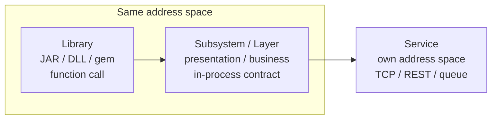
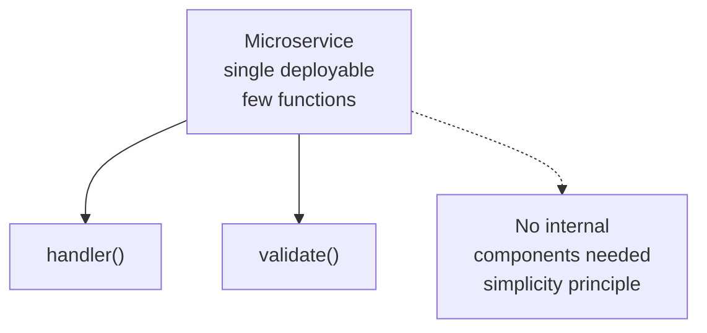
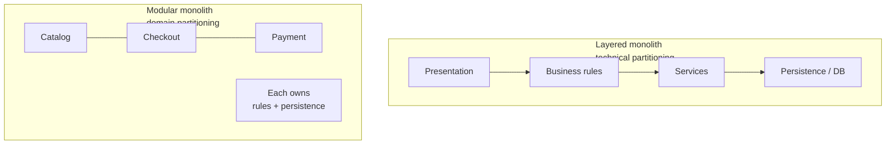
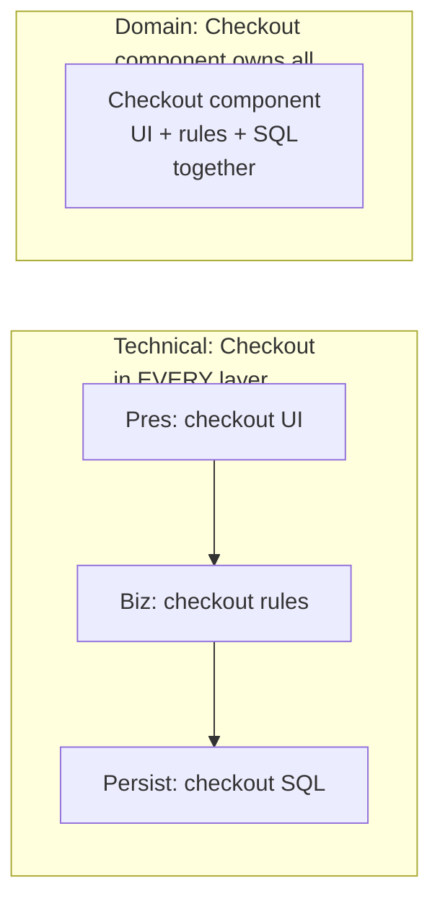
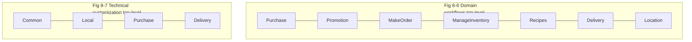
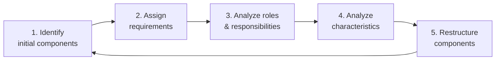
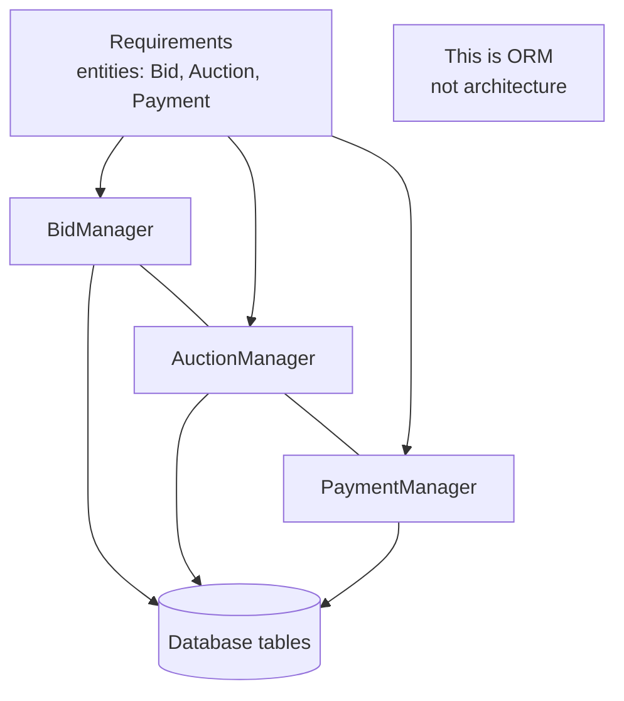
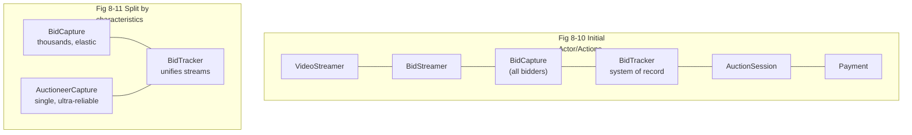

# Chapter 08: Component-Based Thinking — Definitive Technical Summary
*From: Fundamentals of Software Architecture: An Engineering Approach by Mark Richards & Neal Ford*
*Source PDF: pp. 120–137 (ground truth b03_ch08.txt) — figures below cite PDF pages.*

> [!NAV] **Chapter Navigation**
> ⬅️ **Previous:** [[chapter-07-scope-of-architecture-characteristics|Chapter 07: Scope of Architecture Characteristics]] | 🏠 **Index:** [[00-Master-Reading-Dashboard|Master Dashboard]] | ➡️ **Next:** [[chapter-09-foundations|Chapter 09: Foundations]]

---

## 1. Executive Summary & Core Engineering Problem

- **Core Thesis:** Architects think in **components** (physically packaged modules: JAR, DLL, gem, service), not raw classes. The first and most consequential decision is **top-level partitioning** — technical (layers: presentation/business/persistence) vs domain (workflows: Catalog, Checkout, Payment) — followed by relentless iteration over component granularity using requirements + architecture characteristics as forcing functions.
- **The Core Problem Statement:** Naive design maps every database entity to a `*Manager` component (the **entity trap** — an ORM diagram masquerading as architecture) or smears every workflow across every technical layer so a single `CatalogCheckout` change touches presentation + business + services + persistence + DB. Result: globally coupled, unmigratable monolith where granularity is either too fine (chatty) or too coarse (undeployable).
- **What This Chapter Covers (PDF pp.120–137):** Component scope varieties (p.120, Figs 8-1/8-2) → Architect vs Developer role (pp.121–122) → Partitioning: layered vs modular monolith (p.122, Fig 8-3), technical vs domain (p.123, Figs 8-4/8-5), Conway's Law + Inverse Maneuver (pp.123–124) → Silicon Sandwiches partitioning case (pp.125–127, Figs 8-6/8-7) → Developer role + Component identification flow (pp.128–129, Fig 8-8) → Granularity + discovery techniques + entity trap (pp.130–132, Fig 8-9) → GGG discovery via Actor/Actions (pp.132–135, Figs 8-10/8-11) → Quantum redux: monolith vs distributed decision (pp.135–136).
- **Historical Context:** Layered (Model-View-Controller-inspired) partitioning was the default for decades because it matched org charts (UI team, backend team, DBA team). DDD (Evans) + microservices + Simon Brown's modular monolith shifted the industry toward domain partitioning — organize by what changes together (workflows), not by technical kind.

---

## 2. In-Depth Technical Concepts & Internal Mechanics

### 2.1 Component Scope — Library vs Service

- **Module vs Component:** Module = logical grouping of related code. Component = *physical packaging* of a module the architect reasons about: JAR (Java), DLL/assembly (.NET), gem (Ruby), npm package, or a separately deployed service.
- **Stratification:** Components nest. A service contains libraries; a layer contains components; a deployable unit contains layers.

| Variety | Runs | Communicates via | Deploy | When to use |
|---|---|---|---|---|
| **Library** (in-process) | Same memory as caller | Function call | Compile-time (except DLL dynamism) | Shared utilities, persistence helpers, business-rules helpers |
| **Subsystem / Layer** | Same process, logical boundary | In-process call, layer contract | With monolith | Presentation, business, persistence tiers |
| **Service** (out-of-process) | Own address space | TCP/IP, REST, queue | Independently | Microservices, event processors, domain services |

- **Microservice minimalism (Fig 8-2 intuition):** Simplicity is a microservices principle — a service may be so small it needs no internal components at all, just a handful of functions. Do not force-fit layers inside every service.

### 2.2 Architect vs Developer Role

- **Architect owns:** defines, refines, manages, governs **components**; derives architecture characteristics (Ch.4–5); picks top-level partitioning; sets deployability/granularity constraints. Works with BAs, SMEs, QA, ops, enterprise architects. Architecture is independent of dev process (waterfall/JAD/Agile story cards — source of requirements does not matter), except Agile engineering practices around deployment/governance automation.
- **Developer/tech-lead owns:** classes and functions *inside* components, plus subcomponents. Architects advise on patterns but must not micromanage every class — otherwise the org never grows new architects.
- **Iteration contract:** Architect's initial component sketch is a **first draft**, never the last word. Implementation reveals edge cases; developers push back; architect restructures. Treat Fig 8-8 as a loop, not a waterfall gate.

### 2.3 Top-Level Partitioning — The First Law in Action

> First Law of Software Architecture: everything is a trade-off — including partitioning.

**Technical partitioning (layered monolith):** group by technical capability — presentation, business rules, services, persistence. Easy to find "all the SQL," matches MVC mental model, matches Conway-org charts. Cost: each workflow (e.g., `CatalogCheckout`) is *smeared* across all layers (Fig 8-5 left) — one business change ripples through N layers.

**Domain partitioning (modular monolith / microservices-ready):** group by workflow/domain — Catalog, Checkout, Payment, Inventory. Each top-level component may internally contain its own mini-layers/persistence helpers (Fig 8-5 right). Message flow matches problem domain; easier to extract to distributed services later. Cost: cross-cutting customization scattered in multiple places unless explicitly factored.

- **Conway's Law (Mel Conway, late 1960s):** Organizations produce designs that copy their communication structures. Backend team + DBA team + UI team → layered system. **Inverse Conway Maneuver (Jonny Leroy, ThoughtWorks):** evolve team + org structure *toward* the desired architecture — build cross-functional domain teams to get domain-partitioned systems.

### 2.4 Component Identification Flow (Iterative)

1. **Identify initial components** — from chosen partitioning, sketch coarse candidates; map domain functions to see where behavior lands. Expect this draft to be wrong.
2. **Assign requirements / user stories** — fit stories to components; create/merge/split components where fit is poor. Coarse-grained substrate only.
3. **Analyze roles & responsibilities** — check granularity against actors and behaviors the app must support.
4. **Analyze architecture characteristics** — subdivide where characteristics diverge (e.g., 1,000-user path vs 5-user path need different scalability even if functionally similar).
5. **Restructure** — iterate with developers as unknowns surface. Loop until responsibilities + characteristics + deployability converge.

### 2.5 Granularity & Discovery Techniques

- **Too fine:** excessive inter-component chatter, latency, distributed-transaction pain. **Too coarse:** internal coupling, untestable, undeployable lumps.
- **Entity trap (anti-pattern):** `CustomerManager`, `OrderManager`, `AuctionManager` — one component per DB entity. That is an ORM, not an architecture; provides zero packaging guidance, usually too coarse, and only suffices if the app is pure CRUD (in which case use Naked Objects/Isis, Rails scaffolding — don't build "architecture").

| Discovery technique | How | Best when |
|---|---|---|
| **Actor/Actions (RUP-origin)** | Identify actors (Bidder, Auctioneer, System) + actions each performs; group into components | General-purpose, distinct roles, any process (book uses it for GGG) |
| **Event storming (DDD)** | Assume messaging; find domain events; build components around event/message handlers | DDD + microservices/event-driven future |
| **Workflow approach** | Model key roles' workflows without mandating messaging; components around activities | Generic alternative when not committed to events |

None is universally superior — match to process and target style.

### 2.6 Quantum Redux — Monolith or Distributed?

- Single deployable + single DB = **monolith** (layered Ch.10, modular monolith, pipeline Ch.11, microkernel Ch.12). Multiple independently deployed services + remote protocols = **distributed** (Ch.13–17).
- Decision rule: count **quanta** (Ch.7). One set of characteristics → monolith advantages dominate (simplicity, cost, no fallacies tax). Divergent characteristics per component group (GGG: streaming vs auctioneer ordering vs elastic bidding) → distributed, to give each quantum its own ops envelope.

---

## 3. Important Figures, Diagrams & Visual Architecture

| Figure | PDF Page | Description |
|---|---|---|
| Fig 8-1 | p.120 | Component varieties (library / subsystem / service) |
| Fig 8-2 | p.121 | Tiny microservice needing no internal components |
| Fig 8-3 | p.122 | Layered vs modular top-level partitioning |
| Fig 8-4 | p.123 | Technical vs domain partitioning detail |
| Fig 8-5 | p.125 | Workflow smearing: CatalogCheckout across layers vs contained in domain |
| Fig 8-6 | p.126 | Silicon Sandwiches domain-partitioned design |
| Fig 8-7 | p.126 | Silicon Sandwiches technically partitioned design (Common/Local) |
| Fig 8-8 | p.128 | Component identification cycle |
| Fig 8-9 | p.130 | Entity trap (Managers per entity = ORM) |
| Fig 8-10 | p.133 | GGG initial components (Actor/Actions) |
| Fig 8-11 | p.135 | GGG split BidCapture by characteristics |

**Figure 8-1 — Different varieties of components (PDF p.120).**

- **Original Book Figure:** Figure 8-1 → PDF p.120 — open the source PDF at page 120 to compare.
- **Takeaway:** Increasing isolation (and cost) left→right; architects choose per quantum needs.

**Figure 8-2 — Microservice with so little code components are unnecessary (PDF p.121).**

- **Original Book Figure:** Figure 8-2 → PDF p.121. **Takeaway:** Don't invent layers inside a 100-line service.

**Figures 8-3 / 8-4 — Layered vs modular; technical vs domain partitioning (PDF pp.122–123).**

- **Original Book Figures:** Figures 8-3 → PDF p.122; 8-4 → PDF p.123. **Takeaway:** Same code, different top-level seams — technical kind vs business workflow.

**Figure 8-5 — CatalogCheckout smeared vs contained (PDF p.125).**

- **Original Book Figure:** Figure 8-5 → PDF p.125. **Takeaway:** Domain partitioning colocates what changes together.

**Figures 8-6 / 8-7 — Silicon Sandwiches domain vs technical partition (PDF p.126).**

- **Original Book Figures:** Figures 8-6/8-7 → PDF p.126.
- **Takeaway:** Domain (Fig 8-6): business-aligned, Inverse-Conway-friendly, migratable; customization repeated. Technical (Fig 8-7): customization isolated; global coupling, duplicated domain concepts, tangled data.

**Figure 8-8 — Component identification cycle (PDF p.128).**

- **Original Book Figure:** Figure 8-8 → PDF p.128. **Takeaway:** Explicit loop; characteristics analysis is a first-class step, not an afterthought.

**Figure 8-9 — Entity trap (PDF p.130).**

- **Original Book Figure:** Figure 8-9 → PDF p.130. **Takeaway:** If your "architecture" mirrors tables 1:1, download a CRUD framework instead.

**Figures 8-10 / 8-11 — GGG components then characteristics-driven split (PDF pp.133–135).**

- **Original Book Figures:** Figures 8-10 → PDF p.133; 8-11 → PDF p.135.
- **Takeaway:** Functionally one capture suffices; operationally auctioneer (availability/reliability) vs crowd (scalability/elasticity) must split — characteristics reshape components, foreshadowing distributed quanta.

---

## 4. Real-World Systems, Case Studies & Code Examples

### Silicon Sandwiches — Partitioning Trade-Off (PDF pp.125–127, Ch.5 kata)

Sandwich chain with common vs locally-customized recipes, ordering, delivery, inventory.

- **Domain partition (Fig 8-6):** Purchase, Promotion, MakeOrder, ManageInventory, Recipes, Delivery, Location — each with common+local subcomponents inside.
  - Advantages: business-aligned; cross-functional teams (Inverse Conway); message flow matches domain; easy data/component migration to distributed.
  - Disadvantage: customization code in multiple places.
- **Technical partition (Fig 8-7):** Common vs Local as top-level, Purchase/Delivery as workflows cutting across.
  - Advantage: customization isolated.
  - Disadvantages: global coupling (change Common/Local hits everything); duplicated domain concepts; single shared DB tangles data, blocking future distribution.

### Going, Going, Gone — Actor/Actions Discovery (PDF pp.132–135)

- **Actors:** Bidder (view video, view bid stream, place bid); Auctioneer (enter live bids, receive online bids, mark sold); System (start auction, process payment, track activity).
- **Initial components (Fig 8-10):** VideoStreamer, BidStreamer (read-only views), BidCapture, BidTracker (system of record), AuctionSession (lifecycle + payment resolution), Payment (third-party).
- **Characteristics split (Fig 8-11):** BidCapture → BidCapture (crowd scale/elasticity) + AuctioneerCapture (single-stream reliability/availability). BidTracker unifies both streams; links updated to BidStreamer. Design explicitly unfinished (registration, admin still missing) — iteration expected, no "one true design," pick least-worst trade-offs.

---

## 5. Architectural Trade-Off Matrix

| Partitioning | Change locality | Team shape | Migration to distributed | Best when | Avoid when |
|---|---|---|---|---|---|
| **Technical (layered)** | Workflow change touches all layers | Skill silos (UI/DBA/backend) | Hard (domains smeared, shared DB) | Small apps, tight budget, skill-specialized org | Fast-evolving domains, frequent workflow change |
| **Domain (modular)** | Workflow change contained in one component | Cross-functional per domain (Inverse Conway) | Easy (seams = service boundaries) | Evolving business, microservices future | Trivial app where layering simplicity wins |
| **Entity-trap "partition"** | Every feature touches N managers | Confused | Impossible (no seams) | Pure CRUD (but then skip architecture) | Any real workflow complexity |
| **Monolith (1 quantum)** | Single deploy, single DB | One pipeline | N/A | Uniform characteristics | Divergent scale/availability per component |
| **Distributed (N quanta)** | Independent deploys | Per-service teams | N/A | Divergent characteristics (GGG) | Paying fallacies tax without need |

---

## 6. Jargon Buster & Key Terminology

- **Component (Physical module):** Deployable/packaged unit (JAR/DLL/gem/service). Architect's lowest direct interaction level (below that: classes/functions → developers). Pitfall: confusing logical module with physical component.
- **Technical partitioning (Layer-by-kind):** Top-level split by capability (presentation/business/persistence). Synonym: layered. Decouples technical concerns; smears domains.
- **Domain partitioning (Split-by-workflow):** Top-level split by bounded context/workflow (Catalog/Checkout). Synonym: modular monolith philosophy; microservices-ready.
- **Conway's Law (Org-mirrors-artifact):** System designs copy org communication structures. Descriptive.
- **Inverse Conway Maneuver (Org-follows-desired-artifact):** Deliberately restructure teams to enable target architecture. Prescriptive.
- **Entity trap (Managers-per-table anti-pattern):** Components = entities + "Manager" suffix. Actually ORM; offers no packaging guidance.
- **Actor/Actions (Role-driven discovery):** RUP-origin; actors + their actions → components. General-purpose.
- **Event storming (Event-driven discovery):** DDD; events/messages → handlers → components. Fits messaging futures.
- **Workflow approach (Activity-driven discovery):** Roles' workflows → components, without mandating messaging. Generic middle ground.
- **Granularity (Component sizing):** Too fine = chatty; too coarse = coupled/undeployable. No formula — iterate via stories + characteristics.

---

## 7. System Design & Practical Engineering Takeaways

**Production checklist:**
1. Decide top-level partitioning explicitly on day one (technical vs domain) and record why — it determines style (layered vs modular) and team shape.
2. Run every component sketch through stories + characteristics (Fig 8-8 steps 2–4) before coding; split where characteristics diverge (GGG BidCapture lesson).
3. Ban entity-trap designs in review: if component diagram mirrors ER diagram 1:1, send back for workflow analysis.
4. Apply Inverse Conway deliberately: want domain services? Fund cross-functional domain teams, don't keep skill silos and hope.
5. Count quanta to choose monolith vs distributed — one quantum favors monolith; divergent quanta justify distribution cost.

**Interview blueprint:** Draw Fig 8-5 (Checkout smeared vs contained) to explain partitioning in 60 seconds. Cite Silicon Sandwiches trade-offs table verbatim. Pitfall: claiming domain partitioning is "always better" — violates First Law; acknowledge customization-scattering and data-tangling costs.

**Deep Mastery Q&A:**

**Q1. Why does technical partitioning slow down domain change?**
Because one workflow's code lives in every layer. Changing `CatalogCheckout` pricing touches presentation formatting, business rules, service DTOs, persistence SQL, and schema. Each layer needs its experts, tests, and coordination — N hops for one business idea. Domain partitioning colocates all five in one component/team.

**Q2. When is the entity trap acceptable?**
Only for pure CRUD with no real workflows — admin screens over lookup tables. Then full architecture is overkill; Naked Objects/Isis or Rails scaffolding generates UI from tables cheaper. The trap is *mistaking* that for a design that will support workflows, ordering, payments, and scale.

**Q3. How do architecture characteristics change component boundaries? (GGG example)**
Functionally, one BidCapture handles all bids. Operationally, auctioneer's single stream demands higher availability/reliability (disaster if dropped) while bidder streams demand elasticity/scalability (thousands bursting). One component cannot satisfy both SLAs — split into BidCapture + AuctioneerCapture, unified downstream by BidTracker. Characteristics literally draw the seam.

**Q4. Architect vs developer — where is the line?**
Architect: components, partitioning, characteristics, governance, deployability. Developer/tech-lead: classes/functions/subcomponents inside, with iteration rights — initial architect sketch is draft one. Architects who dictate every class starve the org of future architects.

**Q5. How does partitioning choice affect future migration to microservices?**
Domain partitioning pre-carves service boundaries (each top-level component + its data ≈ one service). Technical partitioning requires untangling smeared workflows and a shared database — the hardest migration tax. If distribution is even *plausible*, start domain-partitioned (modular monolith) even while deploying as one unit.
