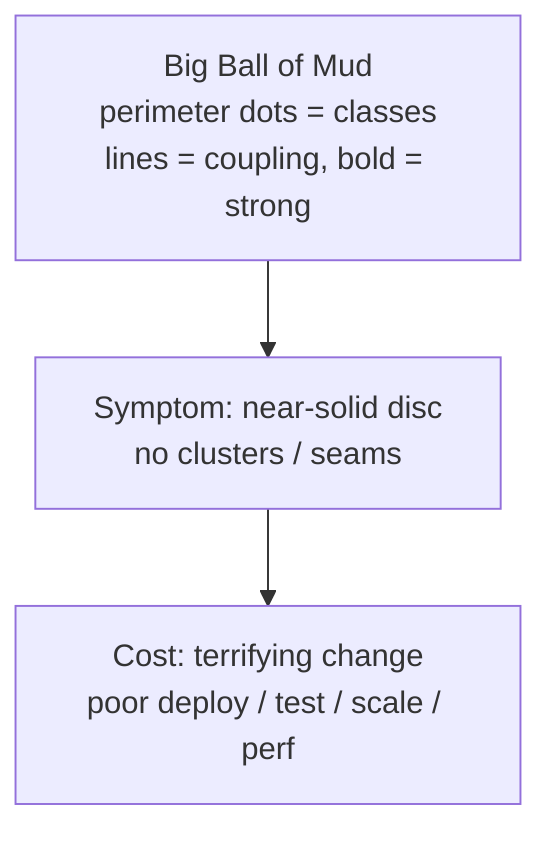
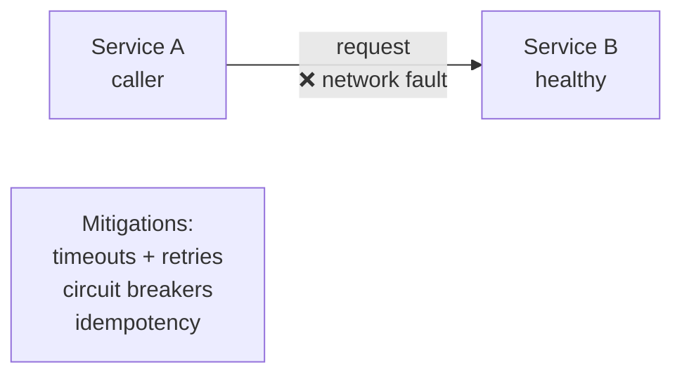
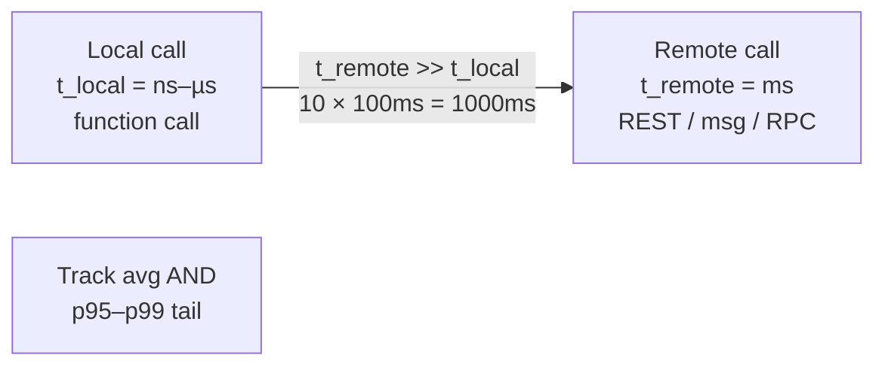
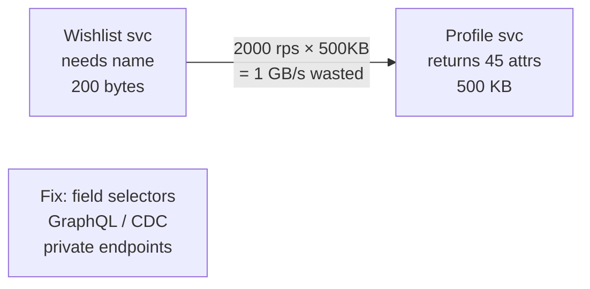
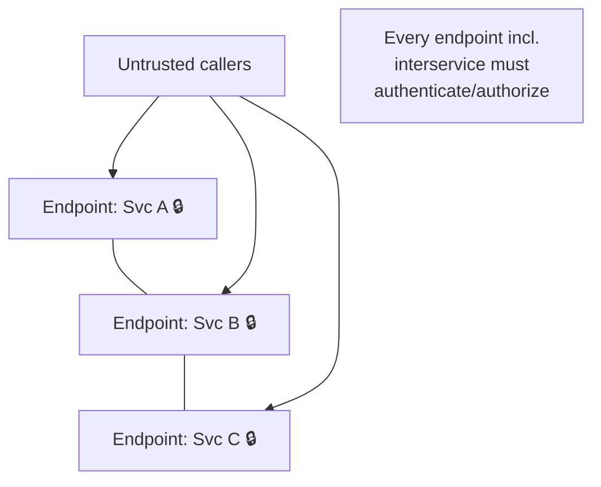
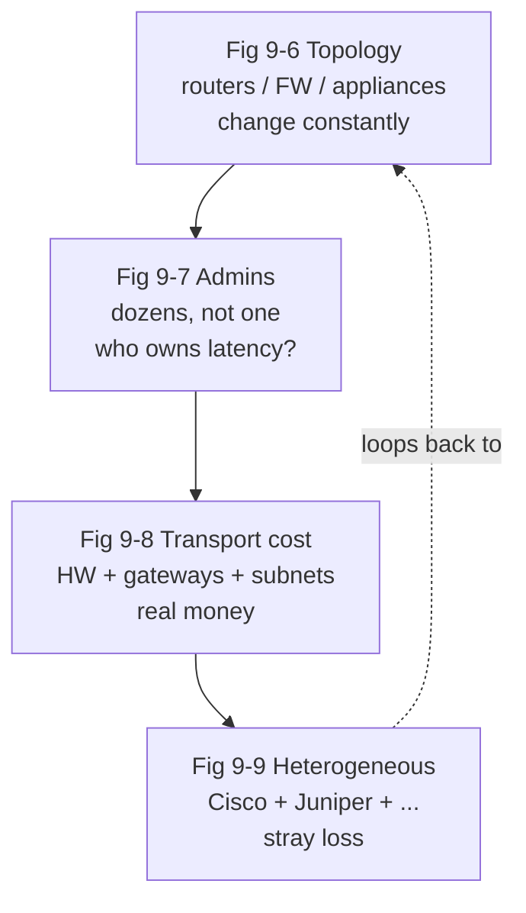

# Chapter 09: Foundations — Definitive Technical Summary
*From: Fundamentals of Software Architecture: An Engineering Approach by Mark Richards & Neal Ford*
*Source PDF: pp. 140–153 (ground truth b03_ch09.txt) — figures below cite PDF pages.*

> [!NAV] **Chapter Navigation**
> ⬅️ **Previous:** [[chapter-08-component-based-thinking|Chapter 08: Component-Based Thinking]] | 🏠 **Index:** [[00-Master-Reading-Dashboard|Master Dashboard]] | ➡️ **Next:** [[chapter-10-layered-architecture|Chapter 10: Layered Architecture]]

---

## 1. Executive Summary & Core Engineering Problem

- **Core Thesis:** Part II opener. Before rating any style, architects need shared foundations: what a **style** (overarching UI/backend/datastore organization + interaction) vs a **pattern** (lower-level solution *within* a style for scale/performance) means; what happens with **no architecture at all** (Big Ball of Mud); how we evolved from unitary → client/server → three-tier; and why the **monolith vs distributed** split — governed by the eight **fallacies of distributed computing** — dominates every style choice in Chapters 10–17.
- **The Core Problem Statement:** Teams adopt distributed styles for power (performance, scalability, availability) while implicitly assuming a reliable, zero-latency, infinite-bandwidth, secure, static, single-admin, free, homogeneous network. Production reality: networks partition, latency tails kill (10 chained 100 ms calls = 1 s), stamp coupling burns 1 Gbps on unneeded fields, every endpoint widens attack surface, 2 a.m. topology upgrades invalidate timeout assumptions. Monoliths avoid this tax; distributed styles pay it — knowingly or as an outage.
- **What This Chapter Covers (PDF pp.140–153):** Style vs Pattern definitions (p.137) → Big Ball of Mud anti-pattern + XRay visualization (p.140, Fig 9-1) → Unitary architecture (p.141) → Client/Server: desktop+DB, browser+web, three-tier + CORBA/DCOM (pp.141–142) → Java serialization cautionary tale (p.143) → Monolithic vs Distributed classification + style catalog (p.143) → Eight fallacies with diagrams (pp.144–151, Figs 9-2–9-9) → Other distributed concerns: logging, transactions/sagas/BASE, contracts (pp.151–152).
- **Historical Context:** Single-computer → mainframe+separate data → rich desktop + DB server → browser + web server (+DB) → three-tier with app servers (CORBA/DCOM plumbing developers now take for granted like TCP/IP, reborn as queues and event-driven patterns). Language designers even baked the transient three-tier assumption into Java (`Object.serialize`) — a permanent tax from a temporary style.

---

## 2. In-Depth Technical Concepts & Internal Mechanics

### 2.1 Style vs Pattern

| Term | Scope | Examples |
|---|---|---|
| **Architecture style** | Overarching organization: where UI/backend code lives (layers vs separately deployed services) + how it talks to datastores | Layered, Pipeline, Microkernel (monolithic); Service-based, Event-driven, Space-based, SOA, Microservices (distributed) |
| **Architecture pattern** | Lower-level design structure *within* a style to achieve a characteristic (scale, performance) | Circuit breaker, saga, CQRS, bulkhead, consumer-driven contracts |

New architects spend most effort here because styles are both important and abundant — each encapsulates a known trade-off bundle.

### 2.2 No Architecture: Big Ball of Mud → Unitary → Client/Server

- **Big Ball of Mud (Foote & Yoder, 1997):** Haphazard, sprawling, duct-tape spaghetti where information is shared promiscuously and nearly everything becomes global/duplicated. Structure never defined or eroded beyond recognition. Change = terrifying (unpredictable ripple). Suffers in deployment, testability, scalability, performance. Common cause: no governance of code quality/structure; trivial script (event handler → direct DB call) grown without seams.
- **Unitary:** Software + computer as one entity (early mainframes, single PCs, today only embedded/highly-constrained). Growth forces separation to preserve performance/scale.
- **Client/Server (two-tier):** Split technical function front/back.
  - *Desktop + DB server:* rich Windows UI local, industrial DB remote via network protocols; presentation local, heavy lifting remote.
  - *Browser + web server (+DB):* even thinner client; web+DB counted as one "tier" (same ops class) vs browser. Wider inside/outside-firewall distribution.
  - *Three-tier:* DB tier + app-server tier (Java/.NET) + generated HTML/JS frontend; CORBA/DCOM as the era's remote plumbing.

### 2.3 Monolithic vs Distributed — The Book's Classification

- **Monolithic (single deployment unit):** Layered (Ch.10), Pipeline (Ch.11), Microkernel (Ch.12).
- **Distributed (multiple deployment units + remote protocols):** Service-based (Ch.13), Event-driven (Ch.14), Space-based (Ch.15), Service-oriented (Ch.16), Microservices (Ch.17).
- No taxonomy is perfect, but this split isolates the shared challenge set (fallacies + logging + transactions + contracts) that *only* distributed styles pay.

### 2.4 The Eight Fallacies of Distributed Computing (Deutsch et al., Sun, 1994)

Each fallacy = believed-true-but-false assumption. All eight still apply.

**#1 The network is reliable.** Service A → Service B: B healthy but unreachable (partition, blip, firewall). Worse: A sent the request, B processed it, response lost → did it happen? Hence timeouts, retries (with idempotency!), circuit breakers. More network dependence (microservices) = less reliability, ceteris paribus.

**#2 Latency is zero.** Local call `t_local` = ns–µs (function call). Remote `t_remote` = ms (serialization + network + deserialization + security). Know your *average* (60 ms? 500 ms?) — 10 chained 100 ms calls = 1,000 ms added. More important: **p95–p99 tail** (avg 60 ms, p95 400 ms — the tail kills). Get numbers from network admins (→ Fallacy #6).

**#3 Bandwidth is infinite.** Monolith: negligible bandwidth per request once inside. Distributed: every hop consumes fabric; stamp coupling amplifies it. Book's worked example: Wishlist service → Customer Profile for one `name` (200 bytes needed) but receives 45 attributes / 500 KB; at 2,000 rps → 500 KB × 2,000 = **1 GB/s** for one call. Fix by sending only what's needed: private endpoints, field selectors, GraphQL, consumer-driven/value-driven contracts, internal messaging endpoints. Minimal payloads are the only cure.

**#4 The network is secure.** VPNs/firewalls breed complacency. Every distributed endpoint must be secured (including *interservice* calls) — attack surface grows by magnitudes vs monolith. Security per hop also slows sync architectures further.

**#5 Topology never changes.** Routers/switches/firewalls/appliances change constantly. War story: quiet weekend, no deploys, Monday morning timeouts/circuit-breakers tripping — root cause 2 a.m. "minor" network upgrade invalidating latency assumptions. Architects must stay in constant contact with ops/netadmins.

**#6 Only one administrator.** Dozens of network admins in a large company. Who owns your latency number? Who approved that topology change? Coordination cost is itself an architecture tax monoliths don't pay.

**#7 Transport cost is zero (money, not latency).** "Simple REST call" needs hardware, servers, gateways, firewalls, subnets, proxies. Distributed costs significantly more than monolithic. Analyze capacity/bandwidth/latency/security zones *before* committing — avoid surprise capex.

**#8 Network is homogeneous.** Cisco + Juniper + others never perfectly interoperate; stray packet loss persists despite standards. Loops back into #1 (reliability), #2 (latency), #3 (bandwidth) — an endless confusion loop.

### 2.5 Other Distributed-Only Concerns

- **Distributed logging:** Monolith = one log, easy trace. Distributed = dozens–hundreds of logs, different places/formats. Consolidators (Splunk) only scratch the surface.
- **Distributed transactions:** Monolith = ACID commits/rollbacks via persistence framework. Distributed = **eventual consistency** ( scalable/available/performat at cost of consistency/integrity). Tools: **transactional sagas** (event-sourced compensation or finite-state-machine orchestration); **BASE** (Basically Available, Soft state, Eventually consistent) — soft state = in-transit inconsistency between sources that converges via patterns/messaging.
- **Contract maintenance & versioning:** Behavior + data agreed by client and service. Hard because decoupled teams own each side; version deprecation needs explicit communication models.

---

## 3. Important Figures, Diagrams & Visual Architecture

| Figure | PDF Page | Description |
|---|---|---|
| Fig 9-1 | p.141 | Big Ball of Mud XRay visualization (real client codebase) |
| Fig 9-2 | p.144 | Fallacy #1 — network unreliability (A can't reach healthy B) |
| Fig 9-3 | p.145 | Fallacy #2 — t_local (ns/µs) vs t_remote (ms) |
| Fig 9-4 | p.146 | Fallacy #3 — bandwidth consumed between services |
| Fig 9-5 | p.147 | Fallacy #4 — every endpoint must be secured |
| Fig 9-6 | p.148 | Fallacy #5 — topology always changes |
| Fig 9-7 | p.149 | Fallacy #6 — many administrators, not one |
| Fig 9-8 | p.150 | Fallacy #7 — remote access costs money |
| Fig 9-9 | p.151 | Fallacy #8 — heterogeneous vendors |

**Figure 9-1 — Big Ball of Mud visualized (PDF p.141).**
XRay (Eclipse plug-in, now retired) circular plot: each perimeter dot = class; each line = coupling; bolder = stronger. Healthy architecture shows clustered arcs; this client shows a near-solid disc — any class change ripples unpredictably.

- **Original Book Figure:** Figure 9-1 → PDF p.141 — open the source PDF at page 141 to compare.
- **Takeaway:** Lack of governance visualizes as uniform coupling density — no safe change locality.

**Figure 9-2 — The network is not reliable (PDF p.144).**

- **Original Book Figure:** Figure 9-2 → PDF p.144. **Takeaway:** Health ≠ reachability; design for the gap.

**Figure 9-3 — Latency is not zero (PDF p.145).**

- **Original Book Figure:** Figure 9-3 → PDF p.145. **Takeaway:** Chain length × per-hop latency (+ tail) is the distributed performance budget.

**Figure 9-4 — Bandwidth is not infinite (PDF p.146).**

- **Original Book Figure:** Figure 9-4 → PDF p.146. **Takeaway:** Stamp coupling (shipping unneeded fields) converts a trivial need into backbone-scale bandwidth.

**Figure 9-5 — The network is not secure (PDF p.147).**

- **Original Book Figure:** Figure 9-5 → PDF p.147. **Takeaway:** Surface area scales with service × endpoint count; security per hop costs performance.

**Figures 9-6–9-9 — Topology / admins / cost / heterogeneity (PDF pp.148–151).**

- **Original Book Figures:** Figures 9-6 → PDF p.148; 9-7 → PDF p.149; 9-8 → PDF p.150; 9-9 → PDF p.151.
- **Takeaway:** Organizational + physical realities compound — change without notice, unclear ownership, real capex, imperfect interop feeding back into reliability/latency/bandwidth assumptions.

---

## 4. Real-World Systems, Case Studies & Code Examples

- **XRay Big Ball of Mud (PDF p.140):** Neal's anonymized Java web app — years of expedient patches, no structure. Visualization alone diagnoses: uniform dense coupling = no safe change. Contrast with layered/modular diagrams in Ch.10/Ch.8 where clusters are visible.
- **Java serialization parable (PDF p.143):** Three-tier was "forever" when Java was designed, so `Object` → `Serializable` by default for easy network object movement. Style died; the API fossil remains, blocking modern language evolution for backward compatibility. Moral (authors): favor simple designs as defense against unknowable futures — today's baked-in assumption is tomorrow's anchor.
- **Stamp-coupling arithmetic (PDF p.146):** 500 KB × 2,000 rps = 1 GB/s vs 200 B × 2,000 = 400 KB/s — a ~2,500× difference from contract discipline alone. Concrete lever architects control without new hardware.
- **Monday-morning topology outage (PDF p.148):** No deploys, yet timeouts everywhere → 2 a.m. network upgrade. Demonstrates why architects need ops on speed-dial and adaptive timeouts/bulkheads, not hardcoded assumptions.

---

## 5. Architectural Trade-Off Matrix

| Choice | Power gained | Tax paid | Best when | Avoid when |
|---|---|---|---|---|
| **Monolithic (Ch.10–12)** | Simplicity, low cost, no network tax, single log/txn | One quantum: uniform scale/availability; single failure domain | Uniform characteristics, small teams, tight budget | Divergent quanta needing independent scale/availability |
| **Distributed (Ch.13–17)** | Independent scale/availability/performance per quantum | All 8 fallacies + logging + sagas + versioning + capex | Divergent quanta justifying complexity (GGG) | CRUD app where monolith suffices |
| **Sync interservice** | Immediate consistency, simple reasoning | Fate-sharing, tail-latency stacking, security per hop | Read-your-write queries | Burst-mismatched or long chains |
| **Async interservice** | Decoupled tempo, buffered bursts | Eventual consistency, ordering/saga complexity | Throughput over immediacy | Strict ordering + immediate settlement |
| **Verbose contracts** | Convenience (one endpoint serves all) | Stamp-coupling bandwidth burn | Internal exploratory phase | High-rps production paths (use CDC/GraphQL) |

---

## 6. Jargon Buster & Key Terminology

- **Architecture style (Overarching shape):** UI/backend/datastore organization + interaction mode. Decides deploy units and datastore topology.
- **Architecture pattern (Within-style tactic):** Lower-level solution for a characteristic inside a style (e.g., saga for consistency). Pitfall: using "style" and "pattern" interchangeably.
- **Big Ball of Mud (Structureless sprawl):** Foote & Yoder anti-pattern; promiscuous global sharing; terrifying change. Opposite of partitioned architecture.
- **Unitary architecture (One-machine system):** Software + computer single entity. Today: embedded/constrained only.
- **Two-tier / Three-tier (Client/server splits):** 2-tier = frontend vs backend(+DB); 3-tier = DB + app-server + frontend (CORBA/DCOM era).
- **Fallacy of distributed computing (False network assumption):** One of eight believed-true statements (reliable, zero-latency, infinite-bandwidth, secure, static-topology, single-admin, free, homogeneous) — all false.
- **Stamp coupling (Oversized payload coupling):** Shipping far more fields than the consumer needs; bandwidth killer. Fix via selectors/GraphQL/CDC.
- **Long-tail latency (p95/p99 blowup):** Average looks fine (60 ms) but tail (400 ms) dominates user-visible chains. Always measure percentiles.
- **Eventual consistency (Converge-later guarantee):** Distributed state synchronizes at some unspecified future point — the price of scale/availability.
- **Saga (Distributed txn via compensation):** Sequence of local txns with compensating actions (event-sourced or FSM-orchestrated) instead of ACID 2PC.
- **BASE (Available-now, consistent-later):** Basically Available, Soft state (in-transit inconsistency), Eventually consistent. Technique, not software.
- **Contract (Agreed behavior + data):** Client/service shared assumptions; versioning/deprecation is a socio-technical challenge across teams.

---

## 7. System Design & Practical Engineering Takeaways

**Production checklist:**
1. Get measured avg + p95/p99 per-hop latency from netadmins before approving any chained-call design; budget chain length × p99, not avg.
2. Enforce minimal-payload contracts on hot paths (field selectors/GraphQL/CDC); compute bandwidth math (bytes × rps) in design review.
3. Secure every endpoint including interservice; count security-handshake cost in perf estimates for sync fan-outs.
4. Subscribe to network/topology change channels; avoid hardcoded timeouts — externalize and make them tunable with breakers/bulkheads.
5. Plan logging/tracing, saga/compensation, and contract-versioning strategy on day one of any distributed choice — not after first outage.

**Interview blueprint:** Open with style-vs-pattern one-liner, sketch monolith-vs-distributed catalog, then walk any two fallacies with numbers (latency chain 10×100 ms; stamp 1 GB/s vs 400 KB/s). Pitfall: reciting fallacies without mitigations — always pair each with timeout/breaker, tail metrics, payload discipline, change liaison.

**Deep Mastery Q&A:**

**Q1. Why does the book separate styles from patterns?**
Because style sets the deploy/data topology (and its fallacies tax), while patterns solve characteristics *within* that topology. Confusing them leads to "we added a circuit breaker, so we're microservices-ready" — a pattern cannot buy you out of a style's quantum or network realities.

**Q2. How can a Big Ball of Mud still "work" yet be the worst architecture?**
It runs until change is needed. Uniform coupling means no change locality, no safe deploy slice, no test seam, no scale lever — every fix risks global ripple. Visualization (Fig 9-1 density) predicts this before the first terrifying diff.

**Q3. Why is p99 more important than average latency in distributed chains?**
Averages hide stacking. 10 hops averaging 60 ms sounds like 600 ms, but if each hop's p95 is 400 ms, a meaningful fraction of user requests experiences multi-second tails (plus retries amplifying). Chains multiply tails, not averages.

**Q4. When is stamp coupling worth fixing vs ignoring?**
Compute bytes × rps. 500 KB × 2,000 rps = backbone-scale waste — fix immediately via selectors/CDC. Low-rps admin path returning extra fields — ignore; simplicity wins. Bandwidth discipline is an economic, not aesthetic, call.

**Q5. What does the Java serialization story teach about architecture decisions?**
Baking a transient style assumption into permanent substrate (language, schema, org) creates decades of drag. Prefer reversible, simple choices; isolate style-specific machinery behind abstractions so the next style shift doesn't require rewriting the world.
