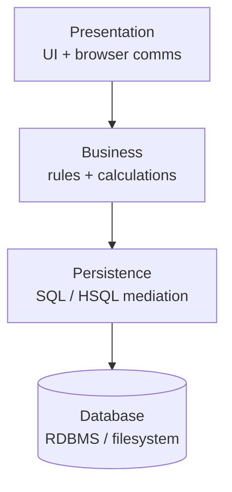
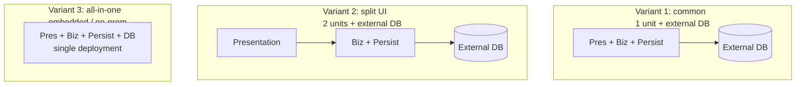
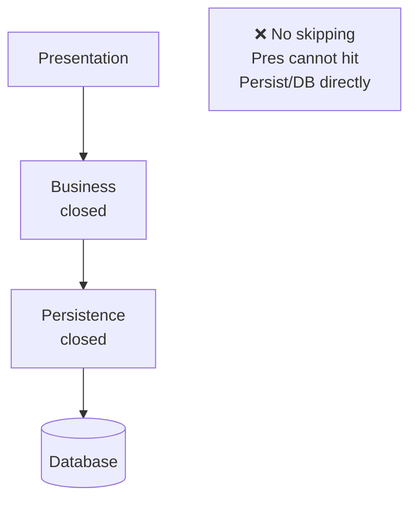
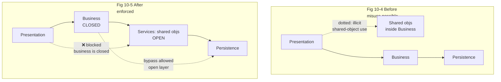
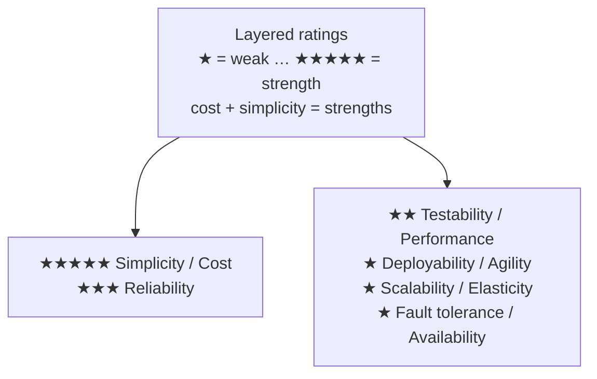

# Chapter 10: Layered Architecture — Definitive Technical Summary
*From: Fundamentals of Software Architecture: An Engineering Approach by Mark Richards & Neal Ford*
*Source PDF: pp. 154–162 (ground truth b03_ch10.txt) — figures below cite PDF pages.*

> [!NAV] **Chapter Navigation**
> ⬅️ **Previous:** [[chapter-09-foundations|Chapter 09: Foundations]] | 🏠 **Index:** [[00-Master-Reading-Dashboard|Master Dashboard]] | ➡️ **Next:** [[chapter-11-pipeline-architecture|Chapter 11: Pipeline Architecture]]

---

## 1. Executive Summary & Core Engineering Problem

- **Core Thesis:** The **layered (n-tiered) architecture** — logical horizontal layers (presentation, business, persistence, database) with strict closed/open access rules — is the de facto default because it is simple, familiar, cheap, and Conway-compatible (UI devs, backend devs, DBAs map to tiers). Its power is separation of technical concerns + **layers of isolation**; its price is low agility, deployability, testability, scalability, and the ever-present **architecture sinkhole anti-pattern** (pass-through layers doing no work).
- **The Core Problem Statement:** Naive layering lets every layer call any layer below (or adds layers ad hoc for shared objects) → tight inter-layer coupling, brittle change (persistence change ripples to presentation), whole-monolith redeploys for a 3-line fix, and 80%-sinkhole request flows where 4 layers instantiate objects just to forward a single `SELECT name, address`. Without closed/open discipline and sinkhole measurement, "layers" become expensive forwarding overhead.
- **What This Chapter Covers (PDF pp.154–162):** Why layered is the default + anti-patterns-by-implication/accident (p.153) → Topology: 4 standard layers + 3 deployment variants (p.154, Figs 10-1/10-2) → Layer responsibilities + technical partitioning + DDD mismatch (pp.154–155) → Layers of isolation: closed vs open (pp.155–156, Fig 10-3) → Adding layers: shared-objects → services layer (pp.156–158, Figs 10-4/10-5) → Sinkhole anti-pattern + 80-20 rule (pp.158–159) → When to use (p.159) → Ratings + per-characteristic rationale (pp.159–162, Fig 10-6).
- **Historical Context:** Predates MVC by decades but resonates with it — the reason developers "just start coding" into layers (Agile teams included). Fast-lane reader (early-2000s bypass for simple reads) is the ancestor of today's open-layer debate.

---

## 2. In-Depth Technical Concepts & Internal Mechanics

### 2.1 Topology — Four Logical Layers, Three Deployments

- **Standard logical layers (Fig 10-1):** Presentation (UI/browser communication) → Business (rules, calculations, aggregation) → Persistence (SQL/HSQL mediation) → Database (external RDBMS/filesystem). Small apps merge business+persistence (3 layers); large apps add rules/services layers (5+). No fixed count — 4 is the canonical teaching shape.
- **Under-the-hood request path (numbered):**
  1. Browser `GET /customer/42` → Presentation controller validates input, formats view model.
  2. Presentation → Business: `customerService.get(42)` — business knows *what* (apply discounts, aggregate orders) not *how displayed* nor *where stored*.
  3. Business → Persistence: `customerDao.find(42)` — persistence knows SQL dialect, connection handling, not business rules.
  4. Persistence → Database: `SELECT ... WHERE id=42` — returns row.
  5. Unwind: row → entity → enriched DTO → view — each layer adding its abstraction value.
- **Physical deployments (Fig 10-2):** (a) UI+Business+Persistence in one unit + external DB (common); (b) Presentation separate + Business+Persistence together + external DB (scaled frontend); (c) All four incl. embedded/in-memory DB in one unit (small apps, on-prem products). All variants remain **one quantum** (monolithic UI + processing + DB).

### 2.2 Technical Partitioning & Role Model

- Each layer owns one technical kind of logic — developers specialize (presentation experts, persistence experts) and find code fast ("all SQL lives *there*").
- **Trade-off:** Business domain `Customer` is smeared across *all* layers (presentation formatter, business validator, rules, persistence mapper, schema). DDD bounded-context thinking fits poorly — the seam is horizontal (kind), not vertical (workflow). See Ch.8 Fig 8-5.
- **Agility cost:** One domain change = coordinate N layers/teams. Separation of *technical* concerns bought with coupling of *business* change.

### 2.3 Layers of Isolation — Closed vs Open

- **Closed layer:** Request moving top-down **must** pass through the immediately-below layer; no skipping. Presentation → Business → Persistence → DB strictly.
- **Open layer:** Requests may bypass it (skip down) — e.g., presentation directly hitting persistence for a trivial read (old fast-lane reader).
- **Why closed matters:** Isolation = change in one layer doesn't ripple if inter-layer contracts hold. Open the layers and presentation→persistence direct wiring means a persistence change breaks *two* consumers (business + presentation) — tightly coupled, brittle, untestable. Layers become replaceable only when closed + contracts stable + business-delegate pattern (e.g., swap JSF → React without touching business).
- **When open is right:** Shared-objects case below; or consciously accepting coupling to cure sinkholes (see §2.4) — always document *which* layers are open/closed and *why*; undocumented openness rots into coupling.

### 2.4 Adding Layers — The Shared-Objects → Services-Layer Maneuver

- **Problem (Fig 10-4):** Business layer holds shared objects (date/string utils, auditing, logging). Rule: "presentation must not use them." But presentation *can* reach business layer, so dotted-line misuse is ungovernable.
- **Fix (Fig 10-5):** Insert a **services layer** (shared business objects) *below* business. Keep business **closed** → presentation cannot skip to services. Mark services **open** → business may use it (solid arrow) or bypass it to persistence (dotted arrow). Restriction now architecturally enforced, not merely documented.
- **General lesson:** Open/closed is the access-control language for request flows — use it to express intent, not just draw boxes.

### 2.5 Sinkhole Anti-Pattern & the 80-20 Rule

- **Mechanism:** Request descends presentation → business → rules → persistence → DB as pure pass-through (no aggregation/calculation/transformation), then ascends unchanged. Pays object-instantiation + mapping + I/O at every tier for zero value — memory + performance tax.
- **Measurement:** Some sinkhole % is inevitable. **80-20 rule:** ~20% sinkhole requests = acceptable overhead; ~80% = wrong style (consider microkernel pipeline-ish or open layers, or a different style entirely).
- **Alternative cure:** Open all layers (fast-lane reads) — trades change-manageability for speed. Conscious trade-off, not accident.

---

## 3. Important Figures, Diagrams & Visual Architecture

| Figure | PDF Page | Description |
|---|---|---|
| Fig 10-1 | p.154 | Standard logical layers (presentation/business/persistence/database) |
| Fig 10-2 | p.154 | Physical deployment variants (3 topologies) |
| Fig 10-3 | p.156 | Closed layers — no skipping |
| Fig 10-4 | p.157 | Shared objects in business layer (misuse possible) |
| Fig 10-5 | p.158 | New services layer enforces restriction (open vs closed) |
| Fig 10-6 | p.160 | Characteristics ratings scorecard |

**Figure 10-1 — Standard logical layers (PDF p.154).**

- **Original Book Figure:** Figure 10-1 → PDF p.154 — open the source PDF at page 154 to compare.
- **Takeaway:** Each layer is an abstraction over the work below; caller knows *what*, not *how*.

**Figure 10-2 — Physical deployment variants (PDF p.154).**

- **Original Book Figure:** Figure 10-2 → PDF p.154. **Takeaway:** Deployment varies; quantum stays one — monolithic UI + processing + data.

**Figure 10-3 — Closed layers (PDF p.156).**

- **Original Book Figure:** Figure 10-3 → PDF p.156. **Takeaway:** Strict descent = isolation; change contained behind contracts.

**Figures 10-4 / 10-5 — Shared objects → services layer (PDF pp.157–158).**

- **Original Book Figures:** Figure 10-4 → PDF p.157; Figure 10-5 → PDF p.158.
- **Takeaway:** Add a layer + set open/closed flags to make the rule structural, not aspirational.

**Figure 10-6 — Layered architecture characteristics ratings (PDF p.160).**

- **Original Book Figure:** Figure 10-6 → PDF p.160 — open the source PDF at page 160 to compare.
- **Takeaway:** Cheap to start, expensive to grow — every scale/ops characteristic rates 1–2 stars; only cost/simplicity (5) and reliability-without-network (3) redeem it. Ratings decay further as the monolith grows.

---

## 4. Real-World Systems, Case Studies & Code Examples

- **Starting-point strategy:** Unknown future style? Start layered (especially for microservices spikes while deciding) — but keep reuse minimal and inheritance shallow to preserve migratability to modular/distributed later.
- **JSF → React swap:** Closed layers + stable contracts + business delegate let teams replace the entire presentation tier without touching business/persistence — isolation paying off.
- **Sinkhole trace — Alice's address lookup:** `GET /customer/42/address` → presentation forwards → business forwards → rules forwards → persistence `SELECT name, address WHERE id=42` → bubbles back untouched. Four tiers of allocation/GC for a single-row fetch. At 20% of traffic = noise; at 80% = proof the domain is read-heavy CRUD better served by open layers or a different style.
- **Anti-patterns named:** *Architecture by implication* and *accidental architecture* — "unsure what style we use / just started coding" almost always means layered by default.

---

## 5. Architectural Trade-Off Matrix

| Characteristic (Fig 10-6) | Rating | Why (book rationale) |
|---|---|---|
| Simplicity / Cost | ★★★★★ | No distribution, familiar, low ceremony to build |
| Reliability | ★★★ | No network/bandwidth/latency; capped by monolithic risk + weak testing |
| Testability | ★★ | Mockable layers help, but full-regression per 3-line change is skipped |
| Performance | ★★ | No parallelism, closed descent, sinkholes; caching/threading is uphill |
| Deployability | ★ | Whole-unit redeploy + bundled changes + high risk + infrequent releases |
| Agility (change response) | ★ | Domain smeared across layers; N-layer coordination per feature |
| Scalability / Elasticity | ★ | One quantum; scale-by-multithreading/messaging is unnatural here |
| Fault tolerance / Availability | ★ | One OOM crashes all; MTTR minutes (2–15+ min restarts) |
| Modularity | ★★ (implied) | Technical seams only; domain seams absent |

**Heuristics:** Use layered if: small/simple app or website, tight budget/time, style still under analysis. Leave layered when: sinkholes →80%, deploy risk/frequency hurts, or scale/elasticity/availability dominate — move to modular, microkernel, or distributed.

---

## 6. Jargon Buster & Key Terminology

- **Layered / n-tiered architecture (Horizontal technical stack):** Components grouped by role (presentation/business/persistence/database); requests flow top-down. The default style.
- **Closed layer (No-skipping rule):** Must pass through immediate-below layer. Enables isolation/replaceability. Opposite: open layer.
- **Open layer (Bypass-allowed):** May skip down (fast-lane reads). Faster for trivial flows; couples consumers to deeper internals.
- **Layers of isolation (Change-containment guarantee):** Change behind a stable contract doesn't ripple — but only if traversed layers are closed.
- **Business delegate pattern (Stable inter-layer façade):** Contract shielding upper layers from lower-layer swaps (JSF→React case).
- **Services layer (Shared-object tier):** Extracted shared business utilities placed below business (open) to bar presentation access structurally.
- **Architecture sinkhole (Pass-through waste):** Layers forwarding without adding value — allocation + latency for nothing. Measure %; 80-20 rule decides style fit.
- **Fast-lane reader (Direct-read bypass):** Early-2000s term for open-layer shortcut from presentation to persistence/DB for simple retrievals.
- **Architecture by implication / Accidental architecture (Default-to-layered):** No explicit style decision (or "just coding," Agile included) → layered by inertia.
- **Single quantum (One deployable fate):** Monolithic UI + processing + DB scale/fail together — caps scalability/elasticity reasoning.

---

## 7. System Design & Practical Engineering Takeaways

**Production checklist:**
1. Document open vs closed per layer with reasons — review any new bypass as a coupling decision, not a shortcut.
2. Measure sinkhole % (tracing: layers adding zero transformation); >~50–80% triggers style re-evaluation.
3. Start layered when uncertain, but cap reuse and inheritance depth to keep the migration door open.
4. Never bundle unrelated changes into the monolith deploy — small, frequent, well-tested releases mitigate (not fix) deployability ★.
5. Plan the exit: when scale/elasticity/availability dominate, refactor toward modular/domain seams *before* the monolith's ratings decay further.

**Interview blueprint:** Draw Figs 10-1→10-3→10-5 as a 3-step story (layers → closed discipline → services-layer fix). Quote deployability anecdote (3-line change → whole-unit redeploy + bundled risk). Pitfall: praising layers' simplicity without naming sinkhole + one-quantum scaling ceiling.

**Deep Mastery Q&A:**

**Q1. Why must traversed layers be closed for isolation to hold?**
Because openness creates a second consumer of deep internals. If presentation reads persistence directly, a persistence contract change breaks both business *and* presentation — two blast radii instead of one. Closed layers guarantee one consumer per contract, so swaps (JSF→React, SQL dialect) stay local.

**Q2. When is adding a layer the right fix vs over-engineering?**
When it converts an ungovernable convention ("don't use those shared objects") into a structural impossibility (closed business bars presentation from open services tier). If the new layer carries no enforcement or abstraction value and merely forwards — it's a sinkhole contributor, not a fix.

**Q3. How do you detect sinkhole dominance in production?**
Trace requests and flag spans where a layer performs no aggregation/calculation/transformation (pure forward). Divide sinkhole requests by total. ~20% = tolerable; approaching 80% = the style's layering costs exceed its separation benefits — open layers or switch styles.

**Q4. Why does DDD sit poorly on layered architectures?**
DDD seams are vertical (bounded contexts/workflows); layered seams are horizontal (technical kinds). A `Customer` bounded context is sliced across all four layers, so context changes require cross-layer coordination — the opposite of DDD's autonomy goal. Modular/domain partitioning (Ch.8) aligns with DDD instead.

**Q5. A 3-line business fix requires full redeploy + full regression — why do teams then skip tests?**
Because the cost/benefit is punishing: hours of regression for a trivial diff, compounded by dozens of co-bundled changes raising risk without raising confidence. Hence testability ★★ (mocks help unit-wise) but system-level verification atrophies — a structural, not cultural, outcome of the style.
