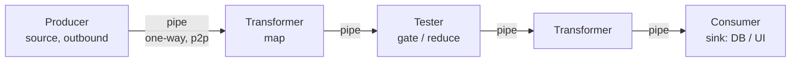
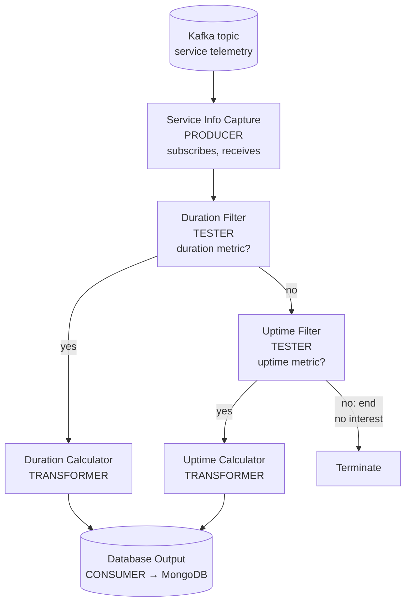
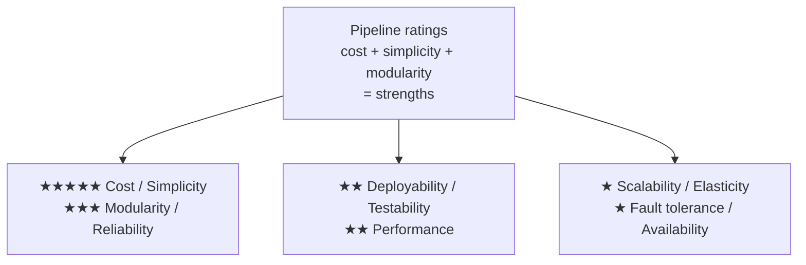

# Chapter 11: Pipeline Architecture — Definitive Technical Summary
*From: Fundamentals of Software Architecture: An Engineering Approach by Mark Richards & Neal Ford*
*Source PDF: pp. 163–168 (ground truth b03_ch11.txt) — figures below cite PDF pages.*

> [!NAV] **Chapter Navigation**
> ⬅️ **Previous:** [[chapter-10-layered-architecture|Chapter 10: Layered Architecture]] | 🏠 **Index:** [[00-Master-Reading-Dashboard|Master Dashboard]] | ➡️ **Next:** [[chapter-12-microkernel-architecture|Chapter 12: Microkernel Architecture]]

---

## 1. Executive Summary & Core Engineering Problem

- **Core Thesis:** The **pipeline (pipes-and-filters) architecture** — unidirectional point-to-point pipes connecting single-purpose stateless filters (producer → transformer/tester* → consumer) — is the oldest compositional style (Unix shells, MapReduce, ETL/EDI, Camel) and the cleanest fit for **one-way stream processing**. Its strengths mirror layered's (cost, simplicity) plus genuine **modularity** (swap one filter without touching others); its weaknesses mirror layered's too (one quantum, ★ deployability/scale/availability).
- **The Core Problem Statement:** Naive implementations build one giant filter doing ingest + qualify + calculate + persist ("composite task in a single box") or use broadcast/shared-state pipes → filters couple, reuse dies, performance collapses on large payloads. Without single-task stateless filters + small-payload point-to-point pipes, the pipeline degrades into a sequential monolith with extra serialization steps.
- **What This Chapter Covers (PDF pp.163–168):** Style recurrence: shells, functional map/reduce, MapReduce (p.163) → Topology: pipes + filters (p.164, Fig 11-1) → Filter taxonomy: producer/transformer/tester/consumer (p.164) → Knuth-vs-McIlroy composition parable + shell one-liner (pp.164–165) → EDI/ETL/Camel + telemetry-Kafka worked example (pp.165–166, Fig 11-2) → Ratings (pp.166–168, Fig 11-3).
- **Historical Context:** As soon as developers split work into discrete parts, pipelines followed. Unix `tr | sort | uniq` demonstrated compositional reuse decades before "microservices composition"; functional `map`/`filter`/`reduce` are the same idea in-language; MapReduce scaled it to clusters.

---

## 2. In-Depth Technical Concepts & Internal Mechanics

### 2.1 Pipes — The Dumb, Fast Connective Tissue

- **Rules:** Unidirectional, point-to-point (not broadcast) for performance; one source → one sink. Payload = any format, but **smaller is faster** — architects favor tiny messages (IDs, deltas, metric tuples) over fat documents.
- **Mechanics (numbered):** 1. Upstream filter emits datum onto outbound pipe. 2. Pipe transports (in-process queue, Kafka topic partition, Camel route) without transformation. 3. Downstream filter consumes exactly once (or at-least-once with idempotent handler). No routing intelligence in the pipe itself.
- **Failure mode:** Fat-payload pipes (multi-MB XML per event) saturate bandwidth (Ch.9 #3) and serialize/deserialize on every hop — pipeline becomes slower than the monolith it replaced. Fix: pass references/keys, fetch bulk data out-of-band.

### 2.2 Filters — Single-Task, Stateless, Composable

- **Constraints:** Self-contained, independent of other filters, generally **stateless**, exactly **one task**. Composite work = sequence of filters, not one smart filter.

| Filter | Direction | Functional twin | Example |
|---|---|---|---|
| **Producer (source)** | Outbound only | Input stream | Service Info Capture subscribing to Kafka topic |
| **Transformer** | In → transform some/all → out | `map` | Duration Calculator (raw ms → aggregated duration stat) |
| **Tester** | In → test criteria → optional out | `filter/reduce` gate | Duration Filter ("is this a duration metric? else route to Uptime Filter"); Uptime Filter (else terminate — data of no interest) |
| **Consumer (sink)** | Inbound only | Terminal write | Database Output persisting to MongoDB / rendering screen |

- **Compositional reuse:** Because each filter's contract is "bytes in → bytes out," Unix users invent pipelines the designers never imagined. Same property lets architects insert a new tester (e.g., `DBWaitFilter` after Uptime Filter) + transformer without touching existing filters — extensibility is structural.
- **Concrete parable — Knuth vs McIlroy (PDF p.164):** Task: top-n frequent words. Knuth: 10+ pages of Pascal + novel algorithm + documentation. McIlroy: `tr -cs A-Za-z '\n' | tr A-Z a-z | sort | uniq -c | sort -rn | sed ${1}q` — six composable filters, each trivial, whole fitting in a post. Lesson: reuse beats cleverness when abstractions compose.

### 2.3 Technical Partitioning, Single Quantum

- Partitioning is **technical** (by filter *kind*: producer/tester/transformer/consumer), not domain — same family as layered in that respect.
- Deployment is monolithic in the book's treatment → **one architecture quantum**. Hence scalability/elasticity/fault-tolerance ceilings identical to layered (see §5), despite better internal modularity. (Distributed pipe fabrics like Kafka + separately scaled consumers can stretch this in practice, but the book rates the canonical monolithic form.)

---

## 3. Important Figures, Diagrams & Visual Architecture

| Figure | PDF Page | Description |
|---|---|---|
| Fig 11-1 | p.163 | Basic pipes-and-filters topology |
| Fig 11-2 | p.165 | Telemetry pipeline over Kafka ( worked example) |
| Fig 11-3 | p.167 | Characteristics ratings scorecard |

**Figure 11-1 — Basic topology (PDF p.163).**



- **Original Book Figure:** Figure 11-1 → PDF p.163 — open the source PDF at page 163 to compare.
- **Takeaway:** Linear, directed, single-purpose stages — data flows one way; no callbacks.

**Figure 11-2 — Pipeline example: service telemetry via Kafka (PDF p.165).**



- **Original Book Figure:** Figure 11-2 → PDF p.165 — open the source PDF at page 165 to compare.
- **Takeaway:** Separation of concerns per filter (connect vs qualify vs compute vs persist) + trivial extensibility (splice a new tester/transformer after Uptime Filter for e.g. DB-wait metrics). Note the two Tester gates creating a decision tree inside a linear topology.

**Figure 11-3 — Pipeline characteristics ratings (PDF p.167).**



- **Original Book Figure:** Figure 11-3 → PDF p.167 — open the source PDF at page 167 to compare.
- **Takeaway:** Modularity (★★★ — swap one filter safely) is the lone structural upgrade over layered; all single-quantum deployment/scale penalties persist.

---

## 4. Real-World Systems, Case Studies & Code Examples

- **Unix shells (Bash/Zsh):** The canonical pipeline — `tr | sort | uniq -c | sort -rn` composes across decades without recompilation. Designers routinely surprised by user inventions — the extensibility proof.
- **Functional languages:** `map` (transformer), `filter/reduce` (tester) — same taxonomy in miniature; trains developers to keep stages pure/stateless.
- **MapReduce:** `map` + `reduce` distributed across clusters — pipeline topology at data-center scale.
- **EDI / ETL (extract-transform-load):** Document-to-document transforms, DB-to-DB flows — the enterprise business face of pipes-and-filters.
- **Apache Camel (mediators/orchestrators):** Business-process steps as routable pipes/filters.
- **Worked example — Kafka telemetry (PDF pp.165–166):** Service Info Capture (producer) → Duration Filter (tester) → Duration Calculator (transformer) *or* Uptime Filter (tester) → Uptime Calculator (transformer) → Database Output (consumer → MongoDB). Each filter owns one concern (Kafka connectivity vs qualification vs math vs persistence). Adding DB-connection-wait metrics = one new tester + one new transformer, zero changes to existing five.

```text
tr -cs A-Za-z '\n' | tr A-Z a-z | sort | uniq -c | sort -rn | sed ${1}q
# producer-ish → transformer → sorter → tester/counter → sorter → consumer (top-n)
```

---

## 5. Architectural Trade-Off Matrix

| Characteristic (Fig 11-3) | Rating | Why (book rationale) |
|---|---|---|
| Cost / Simplicity | ★★★★★ | Monolithic, familiar, no distribution tax |
| Modularity | ★★★ | Filter separation; modify/replace one filter safely (Kafka Duration Calculator case) |
| Reliability | ★★★ | No network tax; capped by monolithic deploy + testing limits (same as layered) |
| Deployability / Testability | ★★ | Slightly above layered (filter isolation) but still whole-monolith ceremony/risk/regression |
| Performance | ★★ | Sequential hops + serialization; parallelism/caching is unnatural |
| Scalability / Elasticity | ★ | One quantum; per-function scaling needs multithreading/messaging heroics |
| Fault tolerance / Availability | ★ | One OOM kills all; MTTR 2–15+ min restarts |
| Agility | ★★ (implied) | Better than layered for flow changes (splice filters), still technical partitioning |

**Heuristics:** Use pipeline if: strictly one-way staged processing (telemetry, ETL, EDI, text/stream transforms) with stable stage contracts. Avoid if: bidirectional conversation, complex routing/state, or independent per-stage scaling/availability dominates — then prefer event-driven (Ch.14) or space-based (Ch.15).

---

## 6. Jargon Buster & Key Terminology

- **Pipeline / Pipes-and-filters (Staged one-way flow):** Pipes = unidirectional point-to-point channels; filters = single-task stages. Data enters at producer, exits at consumer.
- **Pipe (Dumb channel):** One-way, point-to-point transport favoring small payloads. Pitfall: fat payloads turn pipes into bottlenecks.
- **Producer / Source (Entry filter):** Outbound-only origin (Kafka subscriber, file reader).
- **Transformer (Map stage):** Accepts input, transforms some/all, forwards. Stateless computation.
- **Tester (Gate stage):** Tests criteria, optionally emits (route-or-terminate). Functional `filter/reduce` analog; builds decision trees inside linear flow.
- **Consumer / Sink (Exit filter):** Termination — persists to DB or renders UI.
- **Compositional reuse (Invent-new-flows property):** Trivial stages recombine into unanticipated pipelines (McIlroy one-liner). Requires stateless, contract-stable filters.
- **Single quantum (One deployable fate):** Canonical pipeline deploys as one monolith → shared scale/availability ceiling.

---

## 7. System Design & Practical Engineering Takeaways

**Production checklist:**
1. Enforce one-task-per-filter in review; split composite filters on sight — sequence beats smarts.
2. Keep filters stateless; push state to the consumer-side store (MongoDB in the example) or keyed external state — stateful filters kill reuse and parallelization.
3. Cap pipe payload size (prefer keys/deltas); measure serialization cost per hop before productionizing fat events.
4. Design tester gates with explicit termination ("no interest → end") so uninteresting data exits cheaply instead of traversing dead stages.
5. Leave splice points (named pipes/topics) after each tester for future metrics — extensibility is the style's dividend; collect it deliberately.

**Interview blueprint:** Open with McIlroy one-liner vs Knuth 10-pages to sell composition, then draw Fig 11-2 decision-tree pipeline with filter kinds labeled. Quote modularity ★★★ vs deployability ★★ split to show you read the scorecard, not just the topology. Pitfall: proposing pipelines for request/response dialogues — pipelines are one-way; bidirectional needs layered/microkernel/event-driven.

**Deep Mastery Q&A:**

**Q1. Why must filters be stateless and single-task?**
Because reuse and replacement depend on it. A stateless single-task filter has a trivial contract (input → output) testable and swappable in isolation. A stateful composite filter couples qualification + computation + persistence, so every change risks all three and no other pipeline can reuse half of it.

**Q2. When does a pipeline outperform a layered design?**
For linear one-way flows (ingest → qualify → compute → persist) where each stage's contract is stable and stages evolve independently. Layered pays N-tier descent per request with domain smearing; pipeline pays one directed pass with stage isolation. For conversational CRUD with rich domain rules, layered/modular fits better.

**Q3. How do you extend the telemetry pipeline with a new metric safely?**
Add a tester after Uptime Filter (e.g., `DBWaitFilter`: "is this a DB-wait metric?") routing yes → new `DBWaitCalculator` → existing Database Output, no → terminate. Zero changes to the five existing filters; only new code + one splice. That is the modularity ★★★ in action.

**Q4. Why do deployability/testability still rate only ★★ despite modularity?**
Because deployment is still monolithic: one filter change redeploys all filters + re-runs full regression (or teams skip it, as in layered). Filter isolation helps unit scope but not release mechanics — the quantum, not the module count, governs deploy risk.

**Q5. What's the fastest way to kill pipeline performance?**
Large payloads on every pipe (serialization × hops) plus broadcast/stateful pipes forcing coordination. Keep payloads small, pipes point-to-point, filters stateless — or the pipeline becomes a slower sequential monolith with extra copies.
