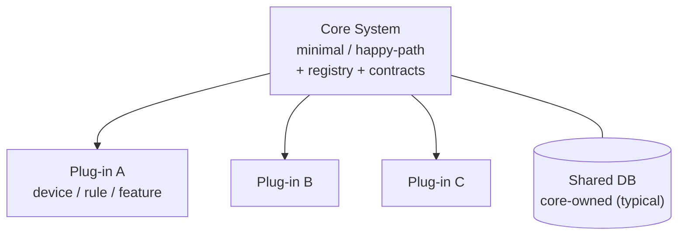
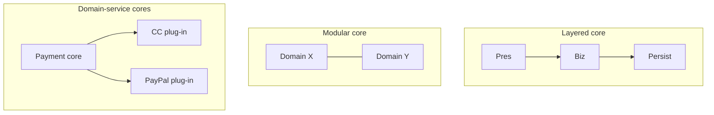
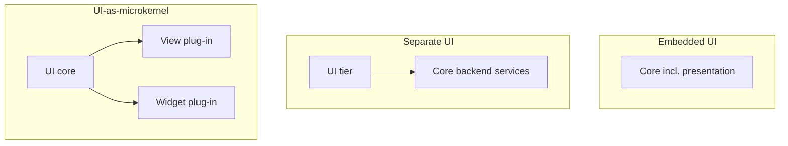
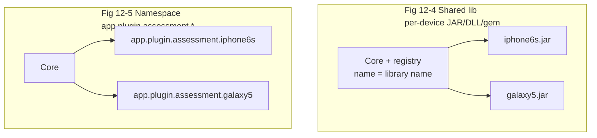
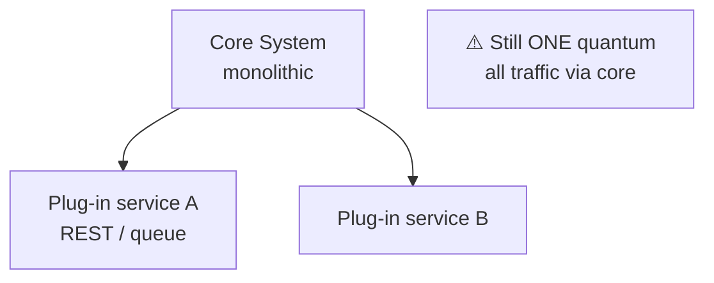
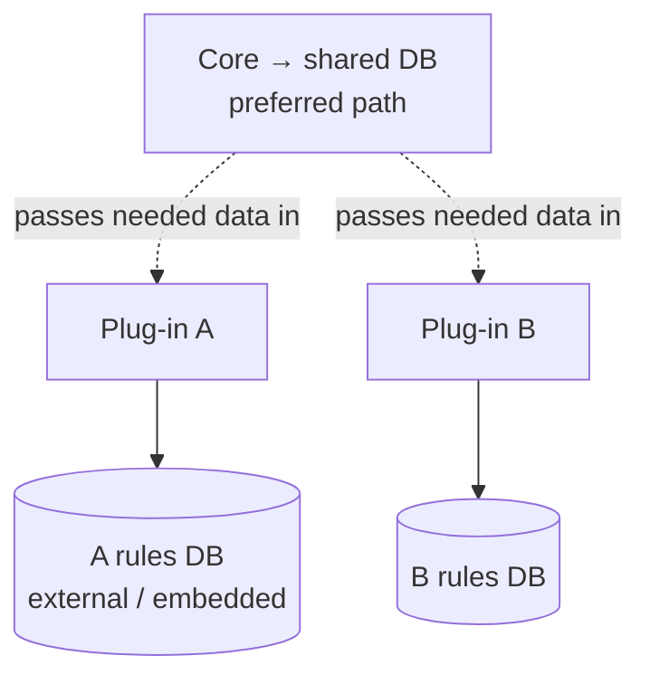
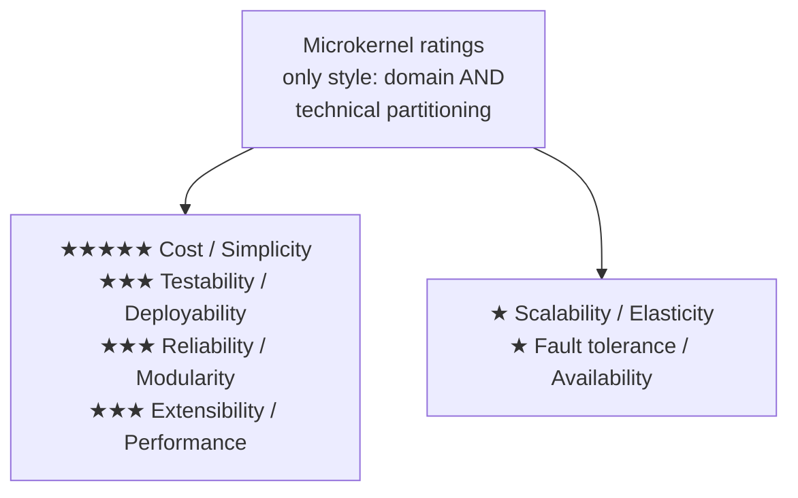

# Chapter 12: Microkernel Architecture — Definitive Technical Summary
*From: Fundamentals of Software Architecture: An Engineering Approach by Mark Richards & Neal Ford*
*Source PDF: pp. 170–182 (ground truth b03_ch12.txt) — figures below cite PDF pages.*

> [!NAV] **Chapter Navigation**
> ⬅️ **Previous:** [[chapter-11-pipeline-architecture|Chapter 11: Pipeline Architecture]] | 🏠 **Index:** [[00-Master-Reading-Dashboard|Master Dashboard]] | ➡️ **Next:** [[chapter-13-service-based-architecture|Chapter 13: Service-Based Architecture]] *(Part II continues)*

---

## 1. Executive Summary & Core Engineering Problem

- **Core Thesis:** The **microkernel (plug-in) architecture** — minimal **core system** (happy-path / minimal-to-run) + independent **plug-in components** (features, custom rules, volatile code) located via a **registry** under **standard contracts** — is the only style that is naturally both technically *and* domain partitioned, and the natural fit for product-based, extensible, customizable software (Eclipse, Jenkins, Jira, Chrome/Firefox, WildFly). It trades layered-style simplicity/cost for above-average testability, deployability, modularity, extensibility, and performance — while remaining (in canonical form) a single quantum with monolithic scale/availability ceilings.
- **The Core Problem Statement:** Naive cores accumulate `if (device=="iPhone6s") ... else if (device=="Galaxy5") ...` cyclomatic swamps where one rule change risks all rules (insurance-claims big-ball-of-rules, tax-form sprawl). Without extracting volatile/custom logic into isolated, registry-addressed plug-ins behind uniform contracts (with adapters for third-party variants), every customization re-tests and re-deploys the world.
- **What This Chapter Covers (PDF pp.170–182):** Style intent: product-based extensibility (p.169) → Topology: core + plug-ins (p.170, Fig 12-1) → Core definition: minimal vs happy-path + cyclomatic-complexity extraction + `assessDevice` before/after code (pp.170–171) → Core implementation variants: layered / modular / domain services + shared DB (p.171, Fig 12-2) → UI variants: embedded vs separate, UI-as-microkernel (p.172, Fig 12-3) → Plug-ins: point-to-point vs remote, compile vs runtime (OSGi/Prism/Jigsaw), shared-lib vs namespace implementations (pp.174–175, Figs 12-4/12-5), remote REST/message topology still one quantum (p.175, Fig 12-6), remote pros/cons, data ownership (pp.176–177, Fig 12-7) → Registry patterns + code (p.177) → Contracts + `AssessmentPlugin` interface (p.178) → Examples: Eclipse/Chrome/Jenkins + insurance claims + 1040 tax forms (pp.178–180) → Ratings (pp.180–182, Fig 12-8).
- **Historical Context:** Coined decades ago for extensible products (IDEs, browsers, build servers); now also the template for volatile business rules (per-jurisdiction claims, per-form tax law) where change cadence differs per plug-in but the happy path is stable.

---

## 2. In-Depth Technical Concepts & Internal Mechanics

### 2.1 Core System — Minimal-to-Run or Happy-Path

- **Two complementary definitions:** (a) *Minimal functionality to run* (Eclipse core = open/edit/save text; usable product only after plug-ins). (b) *Happy-path general flow* with cyclomatic complexity pushed out (claims intake → validate → settle stays; per-state windshield rules leave).
- **Before (swamp):** `assessDevice(id)` with N `else-if` branches — every new device edits the core, re-tests all branches, risks all clients.
- **After (registry dispatch):** `plugin = registry.get(deviceID); Class.forName(plugin).newInstance().assess();` — new device = new plug-in + one registry row; core untouched. Complex per-device rules live isolated, expandable, independently testable.
- **Core implementations (Fig 12-2):** Small cores → layered or modular monolith internally; larger → split core into domain services each with its own plug-ins (e.g., Payment Processing core with credit-card/PayPal/store-credit/gift-card/purchase-order plug-ins). Canonical deployments share **one database** across core + plug-ins.

### 2.2 Plug-Ins — Packaging, Binding Time, and Topology

| Dimension | Options | Trade-off |
|---|---|---|
| **Communication** | Point-to-point (method call to entry class) vs Remote (REST/messaging to service, even microservice-in-container) | P2P = simple, monolithic, fast; Remote = decoupled, scalable, async-capable but distributed cost/complexity, still **one quantum** (every request traverses core) |
| **Binding** | Compile-based (rebuild whole monolith per change) vs Runtime (OSGi / Penrose / Jigsaw / Prism (.NET) — add/remove without core redeploy) | Runtime = deployability win at framework cost |
| **Packaging** | Shared library (JAR/DLL/gem per device, Fig 12-4) vs Namespace/package in one codebase (`app.plugin.<domain>.<context>`, e.g., `app.plugin.assessment.iphone6s`, Fig 12-5) | Library = hard isolation; Namespace = simplest, discipline-dependent |
| **Data** | Core-owned shared DB (preferred — schema change hits core only) vs Plug-in-owned store (external or embedded/in-memory per plug-in, e.g., per-device rules engine, Fig 12-7) | Core-owned = decoupled plug-ins; plug-in stores = autonomy for volatile rules at consistency cost |

- **Isolation rule:** Plug-ins should be mutually independent (no plug-in → plug-in dependencies). Volatility isolation is the point — quarantine fast-changing code from the stable happy path.
- **Remote-access verdict:** Better decoupling/scale/throughput, runtime change without OSGi, async responsiveness (core fires assessment, plug-in callbacks on completion). But: distributed, not monolithic — wrong for on-prem third-party products; more cost/complexity; unresponsive plug-in (especially sync REST) fails the request where monolithic P2P would have succeeded. Choose by requirements, with explicit trade-off analysis.

### 2.3 Registry & Contracts — The Two Control Points

- **Registry (how core finds plug-ins):** Name + data contract + protocol details per plug-in. Spectrum: in-core `HashMap` (`"iPhone6s" → "Iphone6sPlugin" | "iphone6s.queue" | "https://atlas:443/assess/iphone6s"`) → embedded discovery → external (ZooKeeper/Consul).
- **Contracts (what core ↔ plug-in agree):** Standard per domain: behavior + input + output. Third-party custom contracts → **adapter** to the standard so core stays generic. Serialization: XML/JSON/objects.
- **Worked contract:** `AssessmentPlugin { assess(): AssessmentOutput; register(); deregister(); }` with `AssessmentOutput { assessmentReport (formatted string — core prints/displays without understanding), resell (bool), value, resellPrice }`. Roles crisp: plug-in owns domain detail (report formatting, valuation); core owns flow (locate → invoke → present).

### 2.4 Unique Partitioning Property

- Only style that is **both** domain- and technically-partitioned in practice: technically (core vs plug-ins as capability split) + domain-isomorphic (each plug-in ≈ one jurisdiction/client/form/location configuration). Problems with per-locale/per-client variance or user-customization emphasis (Jira, Eclipse) map 1:1 onto it.

---

## 3. Important Figures, Diagrams & Visual Architecture

| Figure | PDF Page | Description |
|---|---|---|
| Fig 12-1 | p.170 | Basic core + plug-ins topology |
| Fig 12-2 | p.172 | Core variations (layered / modular / domain services) |
| Fig 12-3 | p.173 | UI variants (embedded vs separate, UI-as-microkernel) |
| Fig 12-4 | p.174 | Shared-library plug-in packaging |
| Fig 12-5 | p.175 | Package/namespace plug-in packaging |
| Fig 12-6 | p.175 | Remote plug-in access via REST (still one quantum) |
| Fig 12-7 | p.177 | Plug-in-owned data stores |
| Fig 12-8 | p.180 | Characteristics ratings scorecard |

**Figure 12-1 — Basic microkernel topology (PDF p.170).**



- **Original Book Figure:** Figure 12-1 → PDF p.170 — open the source PDF at page 170 to compare.
- **Takeaway:** All requests enter the core; core delegates volatility outward.

**Figure 12-2 — Core variations (PDF p.172).**



- **Original Book Figure:** Figure 12-2 → PDF p.172. **Takeaway:** Core internals vary with size; plug-in philosophy persists at every scale.

**Figure 12-3 — UI variants (PDF p.173).**



- **Original Book Figure:** Figure 12-3 → PDF p.173. **Takeaway:** Presentation may live inside, outside, or itself be a microkernel (browsers/IDEs).

**Figures 12-4 / 12-5 — Shared-library vs namespace packaging (PDF pp.174–175).**



- **Original Book Figures:** Figure 12-4 → PDF p.174; Figure 12-5 → PDF p.175.
- **Takeaway:** Library = physical isolation; namespace (`app.plugin.<domain>.<context>`) = cheapest isolation, enforced by naming discipline + plug-in rules (self-contained, no cross-plug-in deps).

**Figure 12-6 — Remote plug-in access via REST (PDF p.175).**



- **Original Book Figure:** Figure 12-6 → PDF p.175. **Takeaway:** Remote plug-ins buy decoupling/scale/async but not independent quanta — core remains the single fate-sharing funnel.

**Figure 12-7 — Plug-in-owned data stores (PDF p.177).**



- **Original Book Figure:** Figure 12-7 → PDF p.177. **Takeaway:** Default to core-owned data (schema change hits one place); grant plug-in stores only for volatile, plug-in-private rules.

**Figure 12-8 — Microkernel characteristics ratings (PDF p.180).**



- **Original Book Figure:** Figure 12-8 → PDF p.180 — open the source PDF at page 180 to compare.
- **Takeaway:** Best monolithic all-rounder for change (isolated plug-ins lift test/deploy/modularity/extensibility to ★★★ and performance to ★★★ via small size + unplugging + no sinkholes); scale/availability remain ★ by single-quantum deployment.

---

## 4. Real-World Systems, Case Studies & Code Examples

- **Products:** Eclipse IDE (core = editor; usable product = plug-ins), PMD, Jira, Jenkins, Chrome/Firefox (core browser + viewer plug-ins), WildFly/JBoss (unplug clustering/caching/messaging → measurably faster — performance via subtraction).
- **Electronics recycling (PDF pp.170–178):** `assessDevice` if-ladder → registry dispatch (`Map<String,String>` with P2P / queue / REST entries); `AssessmentPlugin`/`AssessmentOutput` contract; per-device JAR or `app.plugin.assessment.iphone6s` namespace; optional per-device rules DB.
- **Insurance claims (PDF pp.179–180):** Per-jurisdiction rules (free windshield in state A, not B) as plug-ins (code or rules-engine instance per plug-in) over a stable file-and-process core. Fixes big-ball-of-rules where one edit needs analyst+dev+tester armies; new jurisdiction = new plug-in, zero cross-impact.
- **US 1040 tax software (PDF p.180):** 1040 summary form = core/driver; each worksheet/form = plug-in. Annual tax-law churn isolated to affected plug-ins — add/remove forms without core risk.

```java
// Registry: point-to-point, messaging, REST entries
Map<String, String> registry = new HashMap<>();
registry.put("iPhone6s", "Iphone6sPlugin");              // point-to-point
registry.put("iPhone6s", "iphone6s.queue");               // messaging
registry.put("iPhone6s", "https://atlas:443/assess/iphone6s"); // REST

// Dispatch (replaces if/else ladder)
String plugin = pluginRegistry.get(deviceID);
DevicePlugin p = (DevicePlugin) Class.forName(plugin).getConstructor().newInstance();
p.assess();

// Contract
public interface AssessmentPlugin {
  public AssessmentOutput assess();
  public String register();
  public String deregister();
}
public class AssessmentOutput {
  public String assessmentReport; // plug-in formats; core only displays
  public Boolean resell;
  public Double value;
  public Double resellPrice;
}
```

---

## 5. Architectural Trade-Off Matrix

| Characteristic (Fig 12-8) | Rating | Why (book rationale) |
|---|---|---|
| Cost / Simplicity | ★★★★★ | Monolithic, small apps, no distribution machinery |
| Testability / Deployability / Reliability | ★★★ | Isolated plug-ins narrow test/blast radius; runtime plug-ins cut deploy risk; reliability above layered but still monolithic |
| Modularity / Extensibility | ★★★ | Add/remove/change via self-contained plug-ins (tax-form case); fastest monolithic response to change |
| Performance | ★★★ | Small size, minimal sinkholes, unplug-unused-features (WildFly) |
| Scalability / Elasticity | ★ | Single quantum; remote plug-ins help throughput but core funnels all traffic |
| Fault tolerance / Availability | ★ | Monolithic fate sharing; MTTR like layered |
| Partitioning | Unique | Only style supporting domain + technical simultaneously (jurisdiction/client/form isomorphism) |

**Heuristics:** Use microkernel if: product/customizable software, per-client/locale/form variance, volatile rules over a stable happy path. Prefer P2P/compile for on-prem simplicity; runtime (OSGi) for hot-plug deployability; remote only when scale/async outweighs distributed cost — and never mistake remote plug-ins for multiple quanta.

---

## 6. Jargon Buster & Key Terminology

- **Microkernel / Plug-in architecture (Core + extensions):** Minimal core + registry-addressed independent plug-ins. Synonyms interchangeable in the book.
- **Core system (Happy-path / minimal-to-run):** Stable flow (Eclipse editor, claims intake, 1040 summary). Keeps registry + contracts + shared data access.
- **Plug-in component (Volatility container):** Standalone feature/custom-rule unit; mutually independent; no inter-plug-in deps. Houses cyclomatic complexity the core sheds.
- **Registry (Plug-in directory):** Name → implementation + contract + protocol map (HashMap → ZooKeeper/Consul). Core's only knowledge of plug-ins.
- **Contract (Core↔plug-in agreement):** Standard behavior + input/output per domain (`AssessmentPlugin`); third-party variants bridged by adapters.
- **Adapter (Contract bridge):** Translates custom third-party plug-in contract to the core's standard so core stays generic.
- **Compile-based vs Runtime plug-in (Deploy-time binding):** Compile = rebuild world per change (simple); Runtime = OSGi/Jigsaw/Prism hot-plug (deployable at framework cost).
- **Shared-library vs Namespace packaging (Isolation weight):** JAR/DLL/gem per plug-in (hard) vs `app.plugin.<domain>.<context>` packages in one codebase (cheap, discipline-based).
- **Remote plug-in (Service-backed extension):** REST/messaging/container invocation; async-capable; converts style to distributed while quantum stays one.
- **Domain-to-architecture isomorphism (Problem-shape match):** Jurisdiction/client/form variance mapping 1:1 onto plug-ins — the property making this style uniquely dual-partitioned.

---

## 7. System Design & Practical Engineering Takeaways

**Production checklist:**
1. Define the core as happy-path only; push every `if (variant)` branch into a plug-in on sight — measure core cyclomatic complexity trending down.
2. Standardize one contract per plug-in domain first; wrap third-party deviations in adapters — never branch the core per vendor.
3. Default data ownership to the core; grant plug-in-private stores only for volatile rules with explicit consistency expectations.
4. Choose binding deliberately: namespace → shared-lib → runtime (OSGi) → remote, each step buying deployability/scale at rising complexity — document why.
5. For remote plug-ins, add per-plug-in timeouts/breakers + async completion channels; a hung plug-in must not hang the core's entire request funnel.

**Interview blueprint:** Tell the `assessDevice` before/after story with registry code, then place Figs 12-1→12-6→12-7 as "topology → remote trap (still one quantum) → data rule." Cite WildFly-unplugging for performance and 1040-forms for extensibility. Pitfall: claiming remote plug-ins = microservices-scale — the core funnel keeps it one quantum with monolithic availability.

**Deep Mastery Q&A:**

**Q1. Why must plug-ins avoid depending on each other?**
Mutual independence is what makes change safe: add/remove/test one plug-in without reasoning about others. Inter-plug-in deps recreate the layered ripple the style exists to escape — and silently reintroduce the big-ball-of-rules through the back door.

**Q2. When is a plug-in-owned database justified over core-owned?**
When the data is private, volatile, and plug-in-shaped (per-device assessment rules, per-jurisdiction tables) and core only needs to pass inputs/receive outputs. Shared-enterprise truth (customer identity, claim ledger) stays core-owned so schema change has one blast radius.

**Q3. Runtime (OSGi) vs remote-service plug-ins — how to choose?**
Need hot-plug within a shippable product (IDE, on-prem suite)? Runtime framework — no redeploy, still monolithic ops. Need independent scaling/async across a fleet you operate? Remote services — but accept distributed ops, cost, and single-quantum funnel limits. Never pick remote just to "feel distributed."

**Q4. How does the adapter preserve the core's genericity?**
Core codes to one standard contract (`assess()/register()/deregister()` + `AssessmentOutput`). Each alien third-party plug-in gets a thin adapter implementing the standard by delegating to the custom API. Core never branches per vendor; new vendors = new adapters, not core edits.

**Q5. Why does performance rate ★★★ here but ★★ in layered/pipeline?**
Three compounding reasons: apps stay small (product scope, not enterprise sprawl); no sinkhole descent (core delegates directly to one plug-in); subtractive tuning (unplug clustering/caching/messaging like WildFly). None of these raise the single-quantum scale ceiling — but they lift steady-state speed within it.
