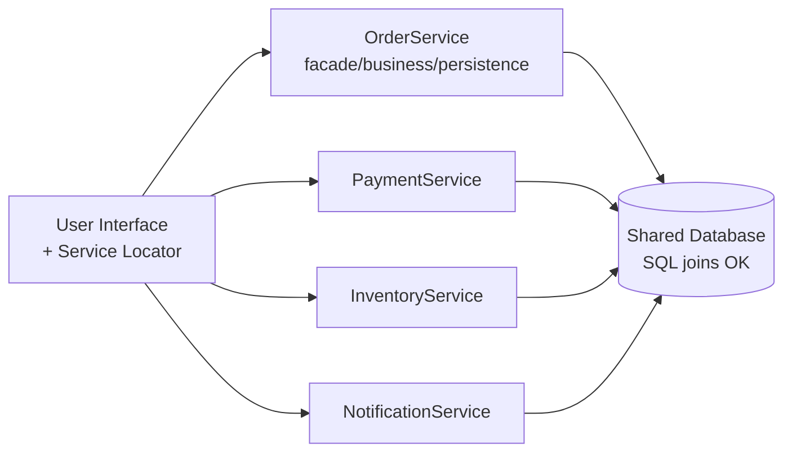
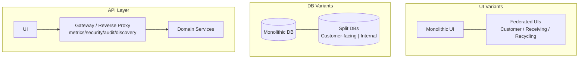
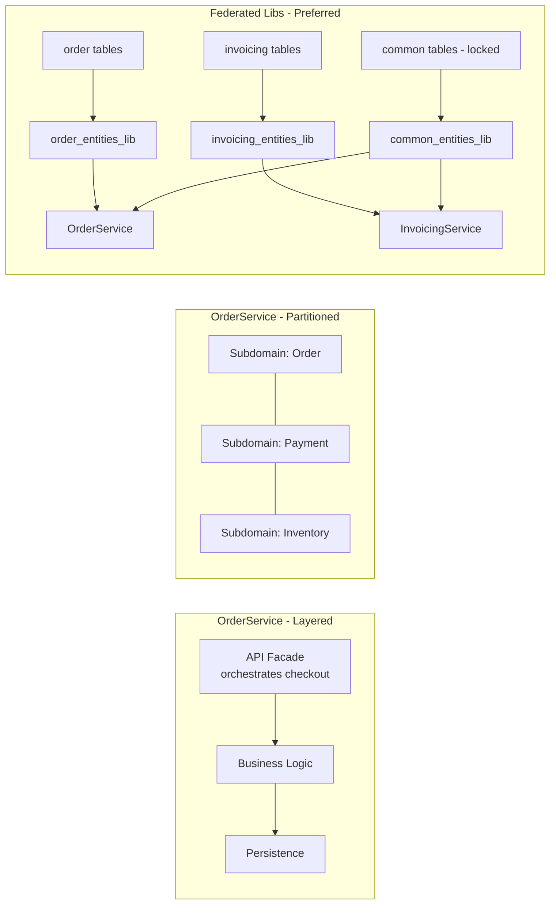
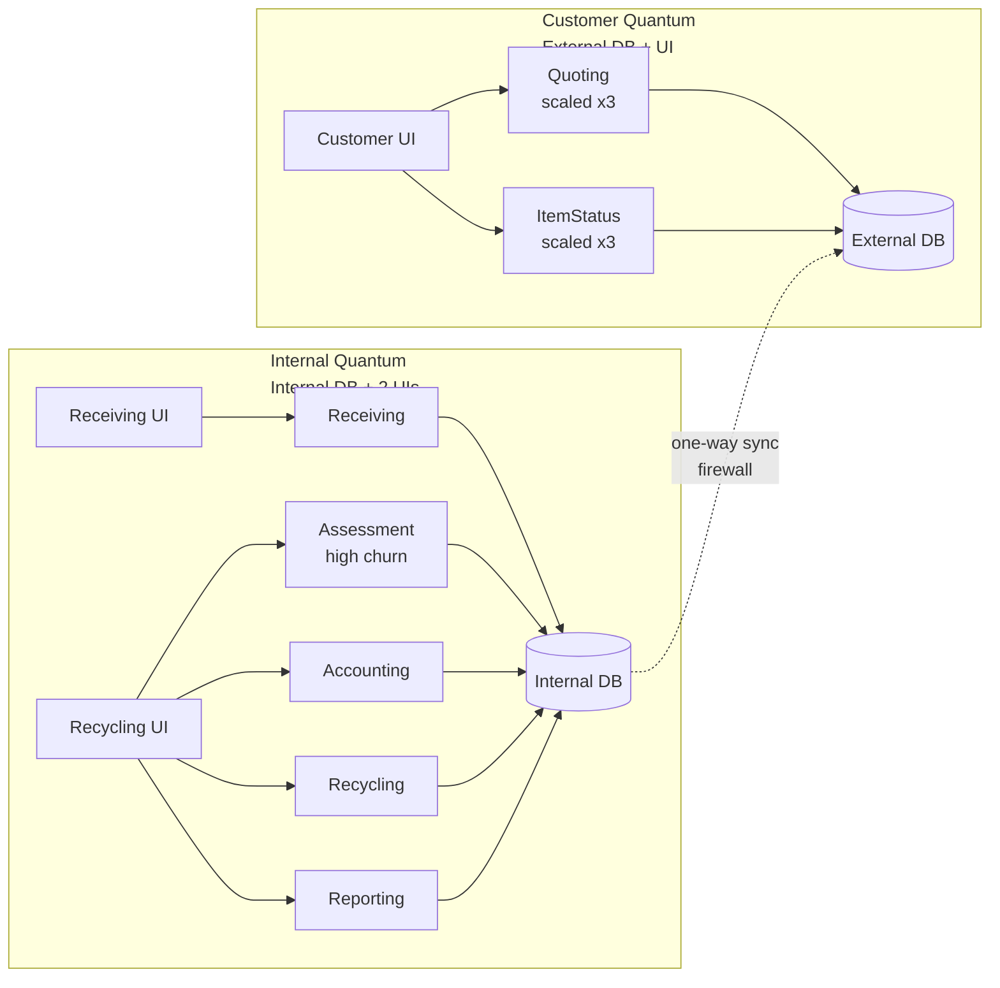

# Chapter 13: Service-Based Architecture — Definitive Technical Summary
*From: Fundamentals of Software Architecture: An Engineering Approach by Mark Richards, Neal Ford*
*Source PDF: pp. 184–199 (184-199 ground truth) — figures below cite PDF pages.*

> [!NAV] **Chapter Navigation**
> ⬅️ **Previous:** [[chapter-12-microkernel-architecture|Chapter 12: Microkernel Architecture]] | 🏠 **Index:** [[00-Master-Reading-Dashboard|Master Dashboard]] | ➡️ **Next:** [[chapter-14-event-driven-architecture|Chapter 14: Event-Driven Architecture]]

---

## 1. Executive Summary & Core Engineering Problem

- **Core Thesis:** Service-based architecture is the pragmatic distributed middle ground — 4 to 12 coarse-grained, domain-scoped, separately deployed services sharing a (usually) central database. It delivers domain partitioning with ACID transactions and low operational cost, without the orchestration/choreography tax of fine-grained microservices.
- **The Core Problem Statement:** Monolithic layered apps couple all domains into one deployable; a change to assessment rules forces retesting/redeploying quoting, payment, and reporting. Full microservices solve this but force BASE eventual consistency, sagas, and interservice chatter. Naive teams pick a Ferrari (microservices/EDA/space-based) to drive 50 km/h in rush-hour traffic — paying huge complexity for unneeded power. Service-based keeps the domain isolation win while preserving SQL joins and commit/rollback.
- **What This Chapter Covers (PDF pp. 184–199):** Basic topology Fig13-1 (p184) → UI variants Fig13-2 (p185) → DB variants Fig13-3 (p186) → API layer Fig13-4 (p187) → Service design Fig13-5 (p187-188) → ACID vs BASE checkout example (p188-189) → Database partitioning single vs federated libs Fig13-6/13-7 (p190-191) → Electronics recycling example Fig13-8 (p192-193) → Ratings Fig13-9 (p194) → Quanta Fig13-10 (p195) → When to use (p197-198).
- **Historical & Industry Context:** Born from domain-driven design pragmatism and backlash against both monolith rigidity and SOA/microservices over-engineering. Fits teams that want modularity + independent deployability but cannot afford distributed-transaction machinery, ELK/service-mesh overhead, or per-service database sprawl.

---

## 2. In-Depth Technical Concepts & Internal Mechanics

### 2.1 Basic topology — Fig13-1 (PDF p184)

- **Intuition:** One deployable per business domain (OrderService, PaymentService, QuotingService), not per entity. Typically 4–12 services total.
- **Mechanics, step-by-step:**
  1. Browser/mobile UI resolves service location via embedded service-locator or via API gateway/proxy.
  2. UI calls service remotely via REST (typical), but messaging/RPC/SOAP also allowed.
  3. Service executes entirely in-process orchestration (facade → business → persistence).
  4. Service reads/writes centrally shared relational DB with normal SQL joins.
  5. Response returns synchronously to UI.
- **Scaling rule:** Usually single instance per service. Add instances + load-balancing (UI → healthy instance) only where throughput/fault-tolerance demands it.
- **Concrete example:** QuotingService gets 40× traffic on sale days → run 3 instances behind load balancer; ReceivingService stays at 1 instance.
- **Failure mode:** If you let UI orchestrate 2+ services in one business transaction, you lose ACID and need sagas — avoid by keeping transaction inside one domain service.

### 2.2 Topology variants — UI, DB, API layer (PDF pp185-187)

| Variant | Option A | Option B | When to choose |
| :--- | :--- | :--- | :--- |
| **UI (Fig13-2, p185)** | Single monolithic UI calling all services | Federated UI domains, up to 1 UI per service | Federate for fault isolation, independent scaling, security (external customers have no network path to internal UIs) |
| **DB (Fig13-3, p186)** | Single monolithic shared DB | Separate DBs, up to domain-scoped DB per service | Split only if data is not needed by another service; otherwise you create forbidden interservice communication + duplication |
| **API layer (Fig13-4, p187)** | UI → services directly | UI → reverse proxy/gateway → services | Add gateway when exposing to external systems or consolidating metrics, security, auditing, discovery out of UI |

- **Rule:** Never do interservice synchronous calls in service-based. If two services need each other's data, your boundaries or DB partitioning are wrong.

### 2.3 Service design and granularity — Fig13-5 (PDF pp187-188)

Two valid internal designs for a coarse-grained domain service:

1. **Layered:** API facade → business layer → persistence layer.
2. **Domain-partitioned (modular-monolith inside):** Split service into subdomains, like a mini modular monolith.

- **API facade duty:** Orchestrates the business request internally. Example — `POST /orders` to OrderService facade: place order → generate order ID → apply payment → update inventory for each line item — all as local method calls in one ACID transaction.
- **Contrast with microservices:** Same checkout in microservices would be remote orchestration across OrderPlacement + Payment + Inventory services with BASE.
- **Alice/Bob checkout with expired card:**
  - *Service-based:* Single `BEGIN; INSERT order; CHARGE fails; ROLLBACK;` → DB clean, email customer "payment failed." No questions about reserved inventory.
  - *Microservices:* OrderPlacement already committed order + decremented inventory, then PaymentService fails. Now: is inventory reserved for a dead order? Can another customer buy the last unit? Requires compensating transactions.
- **Trade-off:** Coarse service change (e.g., order-placement logic) forces testing entire OrderService including payment code and deploys more code (higher blast radius) vs microservices where only tiny OrderPlacement changes.

### 2.4 Database partitioning — Figs13-6/13-7 (PDF pp189-191)

- **Problem:** 4–12 services share one DB + shared entity JAR/DLL. Single shared library with all entity objects + SQL is the *least effective* way: any table change forces rebuild/redeploy of every service, and you cannot tell impact without manual analysis. Versioning helps little.
- **Fix — federated shared libraries matching logical DB partitions:**
  - Logically partition DB into domains: e.g., common, customer, invoicing, order, tracking.
  - Create one shared lib per partition (`invoicing_entities_lib`, etc.). Invoicing table change → only services using that lib (InvoicingService) rebuild.
  - `common` tables (used by all) still couple everyone — mitigate by locking in version control, restricting write access to DBA team, emphasizing significance.
- **Heuristic (book, boxed):** Make logical partitioning as fine-grained as possible while still maintaining well-defined data domains.
- **Pseudocode — federated dependency:**
```java
// OrderService only depends on order + common, NOT invoicing
implementation "com.shop:common_entities:2.4.0"
implementation "com.shop:order_entities:1.9.0"
// InvoicingService depends on invoicing + common
implementation "com.shop:common_entities:2.4.0"
implementation "com.shop:invoicing_entities:3.1.0"
```

### 2.5 Quanta (PDF p195, Fig13-10)

- **Rule:** Count quanta by synchronous coupling + shared DB/UI, not by deployable count.
- Even with 7 deployables, if all share one DB + one UI → 1 quantum.
- Federate UI and DB → multiple quanta. Recycling example has 2 quanta: (a) customer-facing UI + customer DB + Quoting/ItemStatus, (b) internal UIs + internal DB + Receiving/Assessment/Accounting/Recycling/Reporting. Internal services share one DB so they are one quantum despite being 5 deployables + 2 UIs.
- Range for this style: 1 to many quanta.

---

## 3. Important Figures, Diagrams & Visual Architecture

| Figure | PDF Page | Description |
| :--- | :--- | :--- |
| Fig13-1 | p184 | Basic topology: UI → 4-12 domain services → shared DB |
| Fig13-2 | p185 | UI variants: monolithic vs federated domain UIs |
| Fig13-3 | p186 | DB variants: monolithic vs domain-scoped DBs |
| Fig13-4 | p187 | API gateway/proxy between UI and services |
| Fig13-5 | p187 | Service internals: layered vs subdomain-partitioned |
| Fig13-6 | p190 | Anti-pattern: single shared entity library |
| Fig13-7 | p191 | Preferred: federated libs matching DB partitions |
| Fig13-8 | p193 | Electronics recycling example (2 DBs, federated UIs) |
| Fig13-9 | p194 | Characteristics ratings (no 5-star, many 4-star) |
| Fig13-10 | p195 | Two quanta in recycling system |

**Fig13-1 Basic topology**
- *Flow:* UI uses service-locator/gateway → REST to domain service → SQL to shared DB.
- **Original Book Figure:** Figure 13-1 → PDF p184 — open the source PDF at page 184 to compare.

- *Takeaway:* Coarse domains + shared data = ACID + joins without distributed transactions.

**Fig13-2/13-3/13-4 Variants**
- **Original Book Figure:** Figures 13-2, 13-3, 13-4 → PDF pp185-187.

- *Takeaway:* Flexibility is the style's superpower — federate only where isolation/security/scale pays.

**Fig13-5 Service internals + Fig13-6/13-7 DB libs**
- **Original Book Figure:** Figures 13-5, 13-6, 13-7 → PDF pp187-191.

- *Takeaway:* Keep orchestration in-process; partition libs to contain DB-change blast radius.

**Fig13-8 Recycling example**
- *Flow:* Customer (website/kiosk) → Quoting → send device → Receiving → Assessment (constantly changing rules) → Accounting (payout) / Recycling (destroy/resell) + ItemStatus + Reporting. Federated UIs (Customer-Facing, Receiving, Recycling+Accounting). Two physical DBs separated by firewall, one-way internal→external access (or mirroring) for security.
- **Original Book Figure:** Figure 13-8 → PDF p193.

- *Takeaway:* Scale only hot customer-facing services; isolate churn (Assessment) to one deployable; protect internal data with network+data split.

---

## 4. Real-World Systems, Case Studies & Code Examples

- **Electronics recycling (book's core case, pp192-193):** Quoting, Receiving, Assessment, Accounting, ItemStatus, Recycling, Reporting as separate deployables. Assessment changes constantly for new iPhone/Galaxy models — isolated to one service gives agility + testability (limited scope) + deployability (low-risk frequent deploys). Only Quoting/ItemStatus scale for customer spikes; operational services stay singleton (simplifies in-memory cache + connection pooling).
- **Catalog checkout walkthrough (pp188-189):** See Section 2.3 for expired-card atomic rollback vs BASE inconsistency questions.
- **Security zoning:** External vs internal DBs in different network zones, vertical firewall line. Pattern applies to banking (internet banking vs core ledger), healthcare (patient portal vs EHR ops).
- **Production code shape — facade orchestration:**
```python
# OrderService facade - all local, one DB transaction
def place_order(cmd):
    with db.transaction():  # ACID commit/rollback
        order_id = orders.insert(cmd.items)
        payments.charge(order_id, cmd.card)  # raises on expired -> rollback
        for line in cmd.items:
            inventory.decrement(line.sku, line.qty)
    return order_id
```

---

## 5. Architectural Trade-Off Matrix

| Approach | Read/Write | Consistency | Deployability | Best Used When | Avoid When |
| :--- | :--- | :--- | :--- | :--- | :--- |
| **Service-based (4-12 coarse services, shared DB)** | SQL joins, ACID, pooled connections fine | Strong (commit/rollback inside service) | 4-star: frequent, low-risk per-domain deploys | DDD domains, need modularity without saga tax, moderate scale, tight budget | Need independent elasticity per tiny function, 100k+ concurrent, strict per-service data ownership |
| **Monolithic layered/modular monolith** | Same + in-process calls | Strong | Lower: one artifact, full regression | Single quantum, simple CRUD, small team | Hot domains need independent scale/fault isolation |
| **Microservices / EDA / Space-based** | Remote calls, BASE, sagas, caches | Eventual | Higher agility but far higher cost/complexity | Extreme scale/elasticity, polyglot, independent quanta | Team lacks DevOps/automation, transactions span domains |

- **Book ratings synthesis (Fig13-9, p194-196):** No 5-star. 4-star: agility (fast domain change), testability (limited scope), deployability (small blast radius vs monolith), fault tolerance (self-contained, no interservice calls — Receiving down ≠ Quoting down), reliability (less network/bandwidth). 3-star: scalability (coarse replicates more code). 2-star: elasticity (inefficient resource use). Simplicity + cost are differentiators — easiest/cheapest distributed style; more money/complexity would raise the 4s to 5s.
- **Heuristics:** Use service-based if one DB can serve load and transactions fit in one domain; split UI/DB into quanta when security/scale demands. Switch to microservices when single services need independent elasticity or teams need fully autonomous data ownership.

---

## 6. Jargon Buster & Key Terminology

- **Domain service (Coarse-grained service):** Separately deployed unit scoped to a business domain (e.g., Assessment), containing all code for that domain. Confusion: not an entity service (Customer entity) — much bigger.
- **API access facade (Orchestrating facade):** Entry layer inside each service that receives UI requests and coordinates internal business steps. Pitfall: do not confuse with API gateway (network proxy).
- **Service locator pattern:** UI-embedded lookup to find healthy service instance. Modern equivalent: client-side discovery.
- **ACID (Atomicity, Consistency, Isolation, Durability):** Traditional commit/rollback guarantee. Preserved inside service-based domain service.
- **BASE (Basic Availability, Soft state, Eventual consistency):** Distributed-transaction alternative used by fine-grained/microservices; weaker integrity.
- **Federated shared library:** One entity JAR/DLL per DB logical partition, so table change impacts only matching services. Opposite: single shared lib anti-pattern.
- **Orchestration (mediator/conductor) vs Choreography (dancers):** Coordinating multiple services centrally vs peer-to-peer. Service-based avoids both by keeping coordination in-process.
- **Architectural quantum:** Independently deployable + independently scalable + decoupled data. Sharing DB/UI merges quanta.
- **Ferrari analogy (book p177):** Using microservices/EDA power for simple needs wastes money — like driving a Ferrari 50 km/h in traffic.

---

## 7. System Design & Practical Engineering Takeaways

- **Production Engineering Checklist:**
  1. Scope services to DDD bounded contexts (4–12); never create entity services.
  2. Federate entity libs on day one matching logical DB partitions; lock `common` tables to DBAs.
  3. Keep transactions inside one service; forbid UI-orchestrated multi-service writes (or introduce sagas explicitly).
  4. Federate UIs/DBs into quanta for external/internal security zones; use one-way sync + firewall.
  5. Scale only hot services (Quoting/ItemStatus) with load-balanced instances; keep cold services singleton to simplify caching/pooling.
- **System Design Interview Blueprint:** When asked "design e-recycling/banking checkout": propose service-based with diagram (federated UIs, 5–7 domain services, 1–2 DBs, optional gateway). State numbers: <10k concurrent, <12 domains, ACID required → service-based beats microservices on cost/simplicity. Mention blast radius, rollback example, and migration path (partition tables per domain now for future split). Pitfall: don't propose per-entity microservices or cross-service joins.
- **Deep Mastery Questions:**
  1. *Q: Why does shared DB not collapse quanta to 1 in the recycling example? A: Because there are two physical DBs + separate UIs — customer quantum (Quoting/ItemStatus + external DB/UI) is decoupled from internal quantum (5 services + internal DB/UIs). Sharing within a quantum is fine; sharing across quanta is the problem.*
  2. *Q: Single shared entity JAR vs federated libs — quantify impact? A: Single lib: 1 table change → rebuild/redeploy N=7 services + full regression. Federated: same change → rebuild 1 service + consumer UIs only. Coordination cost drops from O(N) to O(1).*
  3. *Q: When does service-based force sagas anyway? A: When UI/gateway orchestrates 2+ domain services in one business transaction (e.g., UI calls OrderService then PaymentService separately). Fix by moving orchestration inside one facade or accept BASE+sagas.*
  4. *Q: Why 4 stars not 5 for fault tolerance? A: Services are self-contained (no interservice calls) so failure is isolated, but coarse size + shared DB/UI still create coupling points that finer, fully isolated microservices with per-service DBs avoid at higher cost.*
  5. *Q: How to preserve migration to microservices? A: Logically partition DB + libs per domain now, keep service contracts coarse but clean, avoid cross-service reads; later you can carve a domain DB + service without rewriting all consumers.*

