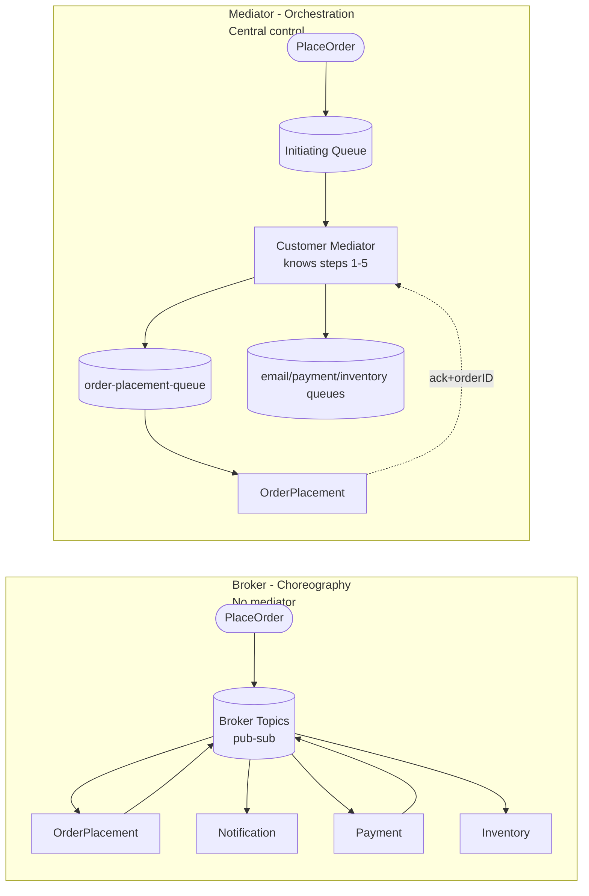
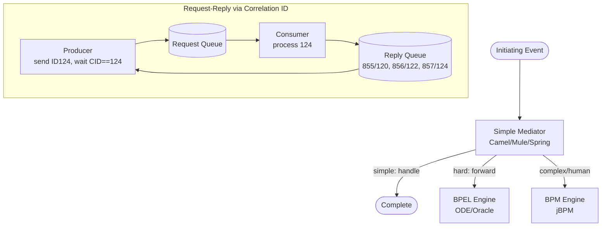
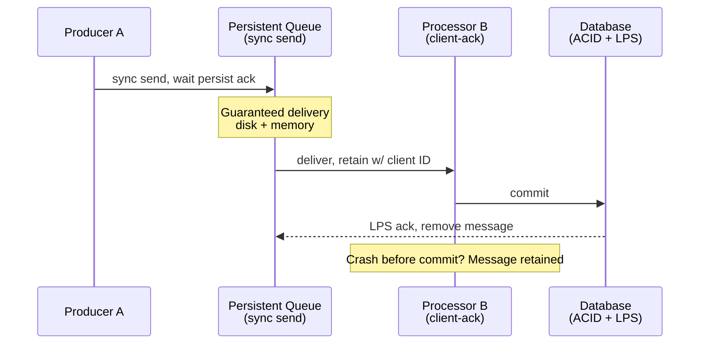

# Chapter 14: Event-Driven Architecture — Definitive Technical Summary
*From: Fundamentals of Software Architecture: An Engineering Approach by Mark Richards, Neal Ford*
*Source PDF: pp. 199–231 — figures below cite PDF pages.*

> [!NAV] **Chapter Navigation**
> ⬅️ **Previous:** [[chapter-13-service-based-architecture|Chapter 13: Service-Based Architecture]] | 🏠 **Index:** [[00-Master-Reading-Dashboard|Master Dashboard]] | ➡️ **Next:** [[chapter-15-space-based-architecture|Chapter 15: Space-Based Architecture]]

---

## 1. Executive Summary & Core Engineering Problem

- **Core Thesis:** Event-driven architecture (EDA) replaces deterministic request orchestration with decoupled, asynchronous event flows through two topologies — broker (high performance/scale, no central control) and mediator (workflow control, error handling, restartability at lower scale). Mastering async error handling, data-loss prevention, and request-reply is the price of its responsiveness.
- **The Core Problem Statement:** Request-based systems (UI → orchestrator → processors → DB) force users to wait 3,100 ms for a 3,000 ms comment check (bad-word + grammar + context). Under spikes, sync chains cascade timeouts. But naive fire-and-forget loses messages, scrambles order, and leaves no one knowing when "place order" is actually done or how to restart after Payment crashes while Inventory already decremented.
- **What This Chapter Covers:** Request model Fig14-1 (p199-200) → Broker topology Fig14-2 (p201) → Advertise-always Fig14-3 (p202) → Retail example Fig14-4 (p202-204) → Broker trade-offs Table14-1 (p205) → Mediator topology Fig14-5 (p205-206) → Mediator types + delegation Fig14-6 (p207-208) → Mediator steps Figs14-7–14-12 (p209-214) → Mediator trade-offs Table14-2 (p215) → Async responsiveness Fig14-13 (p216) → Workflow event pattern Figs14-14/14-15 (p217-220) → Preventing loss Figs14-16/14-17 (p221-222) → Broadcast Fig14-18 (p223) → Request-reply Figs14-19–14-21 (p224-226) → Choosing models Table14-3 + hybrids (p226-227) → Ratings Fig14-22 (p227-229).
- **Historical & Industry Context:** EDA grew with message brokers (RabbitMQ, ActiveMQ, HornetQ) and reactive thinking. It can stand alone or embed inside microservices/space-based as data pumps and scale buffers. The broker vs mediator split mirrors choreography vs orchestration everywhere else.

---

## 2. In-Depth Technical Concepts & Internal Mechanics

### 2.1 Request-based vs event-based (Fig14-1, p199-200)

- **Request model:** Request orchestrator (usually UI, sometimes API layer/ESB) deterministically, synchronously directs request to request processors which hit DB. Example: "get order history for 6 months" — data-driven, known context, needs certainty.
- **Event model:** React to something that happened. Example: "bid submitted after asking price announced" — system compares concurrent bids to find highest; path is dynamic, not predetermined.
- **Rule of thumb (p226):** Request-based for well-structured data-driven needs with certainty/control; event-based for flexible action-based events needing responsiveness/scale with complex dynamic routing.

### 2.2 Broker topology — Figs14-2/14-3/14-4 (pp201-204)

- **Components:** Initiating event → event broker (federated, domain-clustered, topics/exchanges, pub-sub) → event processor → processing event → broker → next processors, until no one cares.
- **No mediator.** Flow is chain-broadcast, fire-and-forget. Best for simple flows without central coordination.
- **Golden practice:** Every processor advertises what it did even if no one listens. Fig14-3: Notification sends email then emits `email-sent` to a topic no one subscribes to — message drops, but hook exists. Later an EmailAnalyzer can subscribe with zero changes to others. This is architectural extensibility.
- **Retail walkthrough (Fig14-4):**
  1. `PlaceOrder` → OrderPlacement inserts row, returns order ID, emits `order-created`.
  2. Three processors react in parallel: Notification (email → `email-sent` ignored), Inventory (decrement → `inventory-updated` → Warehouse reorders/rebalances), Payment (charge → `payment-applied` vs `payment-denied`).
  3. `payment-denied` → Notification emails "update card." `payment-applied` → OrderFulfillment picks/packs → `order-fulfilled` → Notification ("ready to ship") + Shipping (select method → ship → `order-shipped` → Notification "shipped").
- **Relay-race analogy (book):** Runner holds baton 1.5 km, hands off, done — available for next race. Processors scale independently; topics provide backpressure if a processor slows/dies.
- **Table14-1 Broker trade-offs (p205):**

| Advantages | Disadvantages |
| :--- | :--- |
| Highly decoupled processors | No workflow control (no one knows when order is "done") |
| High scalability, responsiveness, performance, fault tolerance | No error handling (Payment crash invisible, Inventory still decrements) |
|  | No recoverability/restart (no owner of original request state, cannot resubmit) + data inconsistency |

### 2.3 Mediator topology — Figs14-5–14-12 (pp205-214)

- **Components:** Initiating event → initiating queue → event mediator → dedicated channels (usually queues, point-to-point) → event processors → ack back to mediator. Processors do NOT advertise to the world.
- **Multiple mediators** per domain (customer mediator, order mediator) to avoid single point of failure + increase throughput.
- **Mediator implementation ladder:**
  - *Simple flows:* Apache Camel, Mule ESB, Spring Integration (code-written routes).
  - *Complex conditional/dynamic + error directives:* BPEL engines (Apache ODE, Oracle BPEL Process Manager, XML + graphical tooling).
  - *Long-running + human intervention:* BPM (jBPM). Example: `place-trade` over share limit needs senior-trader approval — mediator pauses, notifies, waits.
  - *Delegation model Fig14-6:* All events enter Simple Mediator which handles simple ones, forwards hard→BPEL, complex→BPM. Simple mediator may retain completion responsibility or fully delegate including client notification. Choosing Camel for human-long-running or BPM for simple wastes months.
- **Same retail order via mediator (Figs14-7–14-12):**
  - Step 1 Fig14-8: Customer mediator gets `PlaceOrder` from `customer-event-queue` → `create-order` to `order-placement-queue` → OrderPlacement validates/creates + returns order ID (+ maybe early reply to customer per business rules).
  - Step 2 Fig14-9: Mediator emits 3 parallel commands: `email-customer` + `apply-payment` + `adjust-inventory` to respective queues; waits for all 3 acks. Error here → mediator takes corrective action (unlike broker).
  - Step 3 Fig14-10: `fulfill-order` + `order-stock` in parallel → acks.
  - Step 4 Fig14-11: `email-customer` (ready to ship) + `ship-order`.
  - Step 5 Fig14-12: `email-customer` (shipped) → mark complete, drop state.
- **Commands vs events (key distinction p215):** Broker processing events are facts that happened (`order-created`, `payment-applied`) that can be ignored. Mediator messages are commands that must happen (`place-order`, `send-email`, `fulfill-order`).
- **Error/recoverability win:** Expired card → mediator gets error, knows step 3 cannot run, stops workflow, persists state, restarts at step 3 once payment applied.
- **Table14-2 Mediator trade-offs (p215):** Advantages: workflow control, error handling, recoverability, restart, better consistency. Disadvantages: more processor coupling, lower scalability/performance/fault tolerance (mediator bottleneck must scale too), hard to declaratively model dynamic flows → often hybrid mediator+broker for out-of-stock/nontypical paths.

### 2.4 Async responsiveness, error handling, loss prevention

- **Fig14-13 Sync vs async (p216):** Comment service needs 3,000 ms (bad-word + grammar + context checkers). Sync REST: 50 receive + 3,000 work + 50 reply = 3,100 ms user wait, guaranteed posted. Async messaging: 25 ms ack ("accepted, will process"), 3,025 ms background work. Responsiveness (ack fast) ≠ performance (work faster — would need parallel engines + caching). Caveat: async only promises eventual posting; bad-word rejection needs out-of-band repair (registered-user message); stock-trade async with no return path is harder.
- **Workflow event pattern Fig14-14/14-15 (pp217-220) — delegation/containment/repair:** Producer → channel → consumer; on error consumer immediately delegates to workflow processor and moves to next message (preserves responsiveness). Workflow processor auto-fixes (deterministic or ML anomaly) and resubmits to original queue; if unfixable → dashboard queue (Outlook-like app) for human fix + resubmit via `reply-to`.
  - *Trading example:* Contract `ACCOUNT,SIDE,SYMBOL,SHARES`. Basket has `2WE35HF6DHF,BUY,AAPL,8756 SHARES` → `NumberFormatException: For input string "8756 SHARES"`. Without pattern: only logged, trade lost. With pattern: Trade Placement delegates, Error service strips `SHARES`, resubmits → `trade placed: 2WE35HF6DHF,BUY,AAPL,8756`. Consequence: out-of-sequence resubmission breaks per-account order (SELL before BUY). Fix: queue same-account trades FIFO while error pending, drain after fix.
- **Preventing data loss Figs14-16/14-17 (pp221-222):** A→queue→B→DB has 3 loss points: (1) never reaches queue / broker dies, (2) B dequeues then crashes before processing, (3) B cannot persist (data error).
  - Fix 1: persistent queues (guaranteed delivery, disk + memory) + synchronous send (blocking wait for broker persist ack) — message is either with producer or persisted, never lost in transit.
  - Fix 2: client-acknowledge mode (message stays queued with client ID, invisible to others) vs auto-ack (removed on dequeue). Crash → message preserved.
  - Fix 3: ACID DB commit + last-participant support (LPS) to ack/remove from queue only after persist. End-to-end no loss from A to DB.

### 2.5 Broadcast, request-reply, choosing, hybrids

- **Broadcast Fig14-18 (p223):** Producer publishes once, N subscribers receive. Producer knows neither who nor what they do — highest decoupling. Uses: stock ticker broadcast, CEP, eventual-consistency fanout.
- **Request-reply Figs14-19–14-21 (pp224-226) — pseudosynchronous:** Need order ID / confirmation number synchronously over async fabric. Each channel = request queue + reply queue; producer sends async then blocking-waits on reply; consumer replies to reply queue.
  - *Correlation-ID (recommended):* Request ID=124, CID=null. Producer waits with selector `CID==124`. Reply queue has (ID855/CID120, ID856/CID122) — ignored. Consumer processes 124, replies ID857/CID124 → matched. No per-request queue churn.
  - *Temporary queue:* Producer creates temp queue, passes name in `reply-to` header, waits on it (no selector), consumer replies there, producer deletes. Simpler but broker creates/deletes queue per request — kills perf at volume.
- **Table14-3 Event-driven model (p227):** Advantages over request-based: better dynamic-content response, scalability/elasticity, agility/change, adaptability/extensibility, responsiveness/performance, real-time decisions, situational awareness. Trade-offs: eventual consistency only, less flow control/certainty, hard to test/debug (event-tree explosion to hundreds/thousands of scenarios).
- **Hybrids (p227):** EDA as primary or embedded (event-driven microservices, space-based data pumps, microkernel/pipeline hybrids). Benefits anywhere: removes bottlenecks, backpressure buffer when queues back up, responsiveness, programmatic scalability via competing consumers.
- **Quanta (pp228-229):** 1 to many. Shared DB merges processors into one quantum. Request-reply also merges (if A blocks for B's order ID and B is down, A cannot proceed — same quantum despite async wire).

---

## 3. Important Figures, Diagrams & Visual Architecture

| Figure | PDF Page | Description |
| :--- | :--- | :--- |
| Fig14-1 | p200 | Request-based model: orchestrator → processors → DB |
| Fig14-2 | p201 | Broker topology chain broadcast |
| Fig14-3 | p202 | Notification emits ignored event (extensibility hook) |
| Fig14-4 | p202-203 | Broker retail example (parallel fanout) |
| Table14-1 | p205 | Broker trade-offs |
| Fig14-5 | p206 | Mediator topology (queues + acks) |
| Fig14-6 | p208 | Mediator delegation (simple/hard/complex) |
| Fig14-7 | p209 | Mediator order steps overview |
| Figs14-8–14-12 | p210-214 | Mediator steps 1–5 walkthrough |
| Table14-2 | p215 | Mediator trade-offs |
| Fig14-13 | p216 | Sync 3100ms vs async 25ms comment post |
| Fig14-14/14-15 | p218-220 | Workflow event pattern + trading fix |
| Fig14-16/14-17 | p221-222 | Loss points + prevention (persist/sync-send/client-ack/LPS) |
| Fig14-18 | p223 | Broadcast fanout |
| Fig14-19/14-20/14-21 | p224-226 | Request-reply + correlation-ID vs temp queue |
| Fig14-22 | p228 | Ratings (5-star perf/scale/fault-tolerance/evolutionary) |

**Broker vs mediator core**
- **Original Book Figure:** Figures 14-2, 14-5 → PDF pp201, 206.

- *Takeaway:* Broker = relay race (hand off, done); mediator = conductor (knows score, waits for sections, restarts on wrong note).

**Mediator delegation + request-reply**
- **Original Book Figure:** Figures 14-6, 14-20, 14-21 → PDF pp208, 225-226.

- *Takeaway:* Route by complexity; prefer correlation-ID over temp queues at scale.

**Loss prevention + workflow repair**
- **Original Book Figure:** Figures 14-14, 14-17 → PDF pp218, 222.

- *Takeaway:* Persist + sync-send + client-ack + LPS closes all three loss gaps.

---

## 4. Real-World Systems, Case Studies & Code Examples

- **Online auction bid (event example):** Asking price announced → bids arrive concurrently → system reacts by ranking to find highest. Cannot be modeled as deterministic request; needs broker fanout.
- **Retail order (dual walkthrough):** Same PlaceOrder modeled both ways lets you feel the trade-off: broker parallel + fast but stuck on payment failure; mediator stepped + restartable but slower + coupled.
- **Website comment (responsiveness):** 3s of bad-word/grammar/context checks. Sync punishes user; async acks in 25 ms. Production fix for rejection: push notification/email "your comment needs edits" since original HTTP already closed.
- **Trading basket (workflow repair):** 6 AAPL orders, one malformed `8756 SHARES`. Code shape:
```java
// TradePlacement consumer - delegate, don't block
try { place(next); } 
catch (NumberFormatException e) {
  errorChannel.send(new FixRequest(next, e)); // move on immediately
}
// TradePlacementError (workflow delegate)
if (msg.hasSuffix(" SHARES")) {
  fixed = msg.strip(" SHARES");
  originQueue.send(fixed); // resubmit as new message
} else dashboardQueue.send(msg); // human fix via reply-to
```
- **Stock ticker broadcast:** Price publisher fanouts to risk, charting, alerting, ML features — publisher unaware of consumers; adding a new consumer requires zero publisher change.
- **Tools cited:** RabbitMQ, ActiveMQ, HornetQ (brokers); Camel/Mule/Spring Integration (simple mediators); ODE/Oracle BPEL (complex); jBPM (human-long-running); AMQP topic exchanges; FIFO queues for order preservation.

---

## 5. Architectural Trade-Off Matrix

| Approach | Latency / Throughput | Consistency / Recovery | Coordination Cost | Best Used When | Avoid When |
| :--- | :--- | :--- | :--- | :--- | :--- |
| **Broker (choreography)** | Highest responsiveness/perf/parallelism, competing-consumer scale | Eventual only, no restart, data inconsistency risk | Low (add listener, no mediator change) | Simple flows, spikes, extensibility, CEP/fanout | Need audit of "done", strict error/restart, ordered workflows |
| **Mediator (orchestration)** | Good but lower (mediator hop + bottleneck) | Better consistency, stateful restart from failed step | High (model workflow, scale mediator too) | Regulated multi-step transactions, human approvals, required acks | Ultra-high throughput, highly dynamic unknown paths |
| **Request-based sync** | Predictable, slower under load | Strong, easy to reason/test | Low | Point lookups, need immediate answer (order ID, auth) | Spiky load, long-running checks, need backpressure |
| **Request-reply over async** | Sync semantics + queue buffering | Ties quanta together (block = couple) | Medium (CID plumbing) | Need ID/confirmation but want buffering | Pure fire-and-forget suffices |

- **Book ratings synthesis (Fig14-22):** 5-star performance (async + parallel), scalability (programmatic competing consumers), fault tolerance (decoupled + promises/futures allow late processing), evolutionary (broker hooks make adds trivial). Low simplicity/testability (nondeterministic event trees). Technically partitioned (domain spread across processors/queues/topics).
- **Heuristics:** Default to request-based for certainty; add EDA for backpressure/responsiveness. Choose broker if you can tolerate "unknown done + manual recovery"; choose mediator if auditors ask "prove step 3 completed and restart from there." Often hybrid: mediator for main flow, broker for dynamic branches (out-of-stock).

---

## 6. Jargon Buster & Key Terminology

- **Initiating event:** First event starting flow (e.g., PlaceOrder, bid, job change). Vs processing event (what a processor did).
- **Processing event vs command:** Broker emits facts that happened (`order-created`, can be ignored); mediator sends commands that must happen (`create-order`, must be processed). Confusing them breaks error reasoning.
- **Broker topology (Choreography):** No central controller; processors chain-broadcast via lightweight broker topics. Think relay race.
- **Mediator topology (Orchestration):** Central mediator knows steps, uses point-to-point queues + acks. Think conductor.
- **Federated broker:** Multiple domain-clustered broker instances each holding that domain's channels.
- **Topic vs queue:** Topic = pub-sub broadcast (many listeners, broker); queue = point-to-point (one consumer, mediator). AMQP topic exchanges for broker.
- **Competing consumers:** Programmatically adding processor instances to drain load — source of EDA scalability.
- **Backpressure point:** Queue/topic buffering when downstream slows — prevents cascade failure.
- **Responsiveness vs performance:** Ack fast vs do work fast. Async improves former without touching latter.
- **Workflow event pattern (Reactive):** Delegate + containment + repair via workflow processor + dashboard for manual fix. Preserves responsiveness during errors.
- **Synchronous send / Guaranteed delivery / Client-ack / Last-participant support (LPS):** Four loss-prevention primitives (persist + blocking ack + retain-until-ack + DB-commit-gated removal).
- **Correlation ID vs temporary queue:** Two request-reply implementations; prefer CID (selector `CID==ID`) at volume; temp queue (per-request `reply-to` queue) chokes broker.
- **Pseudosynchronous:** Async wire with blocking wait — still couples quanta.
- **Event tree:** All possible downstream reactions to an event — can explode to thousands of test scenarios.

---

## 7. System Design & Practical Engineering Takeaways

- **Production Engineering Checklist:**
  1. Always advertise processing events even if unsubscribed — future consumers plug in free.
  2. Use persistent queues + sync send + client-ack + LPS on every async hop; never rely on auto-ack.
  3. Classify events simple/hard/complex upfront; front with simple mediator delegating to BPEL/BPM only when needed.
  4. Prefer correlation-ID request-reply; reserve temp queues for low-volume admin flows.
  5. Wrap async consumers with workflow-delegate + dashboard; isolate same-key ordering (per-account FIFO holding) so repairs don't reorder trades.
- **System Design Interview Blueprint:** For "design order pipeline for flash sale": draw broker fanout (OrderPlacement → Notification/Payment/Inventory parallel, topics as buffers, competing consumers for scale) + mediator fallback for payment-failure restart. Quote numbers: sync 3100 ms → async 25 ms ack; competing consumers scale linearly; backpressure absorbs 10× spikes. Name failure: Payment down → broker stuck, mediator knows. Pitfall: claiming async is "faster" — clarify responsiveness vs performance, eventual consistency, test explosion.
- **Deep Mastery Questions:**
  1. *Q: Why can't broker restart a failed PlaceOrder by resubmitting? A: No owner of global state; Inventory/Warehouse already acted on the first submission. Resubmission double-decrements. Mediator persists step state so it can resume at step 3.*
  2. *Q: When do two async processors share a quantum? A: Shared DB or blocking request-reply. If A needs B's order ID to proceed and B is down, A halts — same failure domain, same quantum despite async transport.*
  3. *Q: Temp queue vs correlation ID at 10k rps? A: Temp queue creates/deletes 10k queues/sec — broker metadata storm. Correlation ID reuses two queues + selector match — constant overhead.*
  4. *Q: How does advertise-always not waste resources? A: Unrouted topic messages drop cheaply, but preserve the data feed. Adding EmailAnalyzer later costs zero changes to producers — extensibility outweighs transient waste.*
  5. *Q: Fix out-of-order repair in trading? A: Processor records failed account ID, parks subsequent same-account messages in holding FIFO, processes others normally, drains holding queue after fix succeeds — preserves per-account order without blocking all accounts.*

