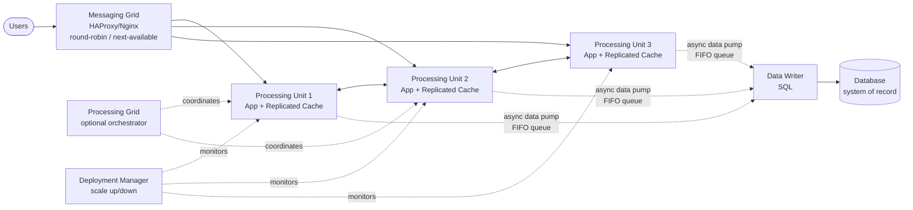
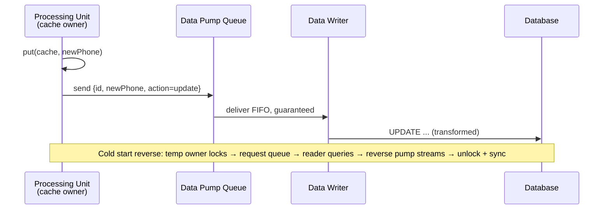

# Chapter 15: Space-Based Architecture — Definitive Technical Summary
*From: Fundamentals of Software Architecture: An Engineering Approach by Mark Richards, Neal Ford*
*Source PDF: pp. 232–255 — figures below cite PDF pages.*

> [!NAV] **Chapter Navigation**
> ⬅️ **Previous:** [[chapter-14-event-driven-architecture|Chapter 14: Event-Driven Architecture]] | 🏠 **Index:** [[00-Master-Reading-Dashboard|Master Dashboard]] | ➡️ **Next:** [[chapter-16-orchestration-driven-soa|Chapter 16: Orchestration-Driven SOA]]

---

## 1. Executive Summary & Core Engineering Problem

- **Core Thesis:** Space-based architecture removes the central database from the synchronous request path, keeping transactional data in replicated in-memory grids inside elastically scaled processing units and syncing to the database asynchronously via data pumps. Result: near-infinite scalability, 5-star elasticity/performance — at the cost of complexity, eventual consistency, and testing pain.
- **The Core Problem Statement:** Classic web → app → DB collapses into a triangle: web tier scales easily, app tier expensively, database hardest. At tens of thousands of concurrent ticket buyers or bidders, synchronous DB transactions bottleneck no matter how many web nodes you add. Caching retrofits and DB scale-out only move the bottleneck. Space-based inverts it: serve from memory, persist later.
- **What This Chapter Covers:** Limits Fig15-1 (p232) → Topology Fig15-2 (p233) → Processing unit Fig15-3 (p233-234) → Virtualized middleware: messaging grid Fig15-4 (p234-235), data grid Fig15-5 (p235-236) + Hazelcast member-list logs (p237-238), processing grid Fig15-6 (p238-239), deployment manager (p239) → Data pumps Fig15-7 (p239-240) → Data writers Figs15-8/15-9 (p241-242) → Data readers Fig15-10 (p242-243) → Data collisions formula + tables (p244-246) → Hybrid cloud Fig15-11 (p247) → Replicated vs distributed Figs15-12/13 + Table15-1 (p247-250) → Near-cache Fig15-14 (p250-251, not recommended) → Ticketing/auction examples (p251-252) → Ratings Fig15-15 (p253-254).
- **Historical & Industry Context:** Named for tuple space (parallel processors + shared memory). Enabled by Hazelcast, Apache Ignite, Oracle Coherence, plus cloud auto-provisioning. The only style that natively spans cloud processing + on-prem data via async pumps.

---

## 2. In-Depth Technical Concepts & Internal Mechanics

### 2.1 General topology (Fig15-2, p233)

Components: processing unit (app code + in-memory grid) + virtualized middleware (messaging/data/processing grids + deployment manager) + data pumps (async queues) + data writers (queue→DB) + data readers (DB→units on cold start) + database (system of record, off critical path).

Request path:
1. Request hits messaging grid → routed to any available processing unit (round-robin or next-available).
2. Unit serves entirely from local replicated cache — no synchronous DB call.
3. On write, unit updates its cache (becomes owner of update) and fires data pump message with action + new values.
4. Data writer eventually persists to DB. Reads from DB only on full-start/archive-miss via data reader + reverse pump.

### 2.2 Processing unit & virtualized middleware (pp233-239)

- **Processing unit (Fig15-3):** Web components + backend logic. Small app = 1 unit type; large app = functional units (Order, Payment) or even microservices inside units. Each embeds grid + replication engine.
```java
HazelcastInstance hz = Hazelcast.newHazelcastInstance();
Map<String, CustomerProfile> profileCache = hz.getReplicatedMap("CustomerProfile");
// every unit needing profiles runs this; put() replicates to same-named caches
```
- **Messaging grid (Fig15-4):** Front-door load balancer (HAProxy/Nginx). Simple round-robin → advanced next-available tracking which unit handles which request + session state.
- **Data grid (Fig15-5):** The heart. Every unit holds identical copy of each named cache. Shown as synchronous but actually async, typically <100 ms. Alternative: remote call to another unit (choreography) or via processing grid (orchestration).
- **Member-list mechanics (pp237-238 logs):** Each instance knows all peers by IP:port. 1 instance → `size:1`; 2nd joins → both `size:2`; 3rd → all `size:3`. `cache.put()` from instance 1 async-replicates to 2 and 3. On failure (instance 2 dies) → survivors auto-update to `size:2`. New instance joining with at least one live peer warms from peer, not DB.
- **Processing grid (Fig15-6, optional):** Orchestrates multi-unit business requests (order unit + payment unit). If absent, units choreograph peer-to-peer.
- **Deployment manager:** Watches latency/load, starts units as load rises, kills them as it falls. Critical for elasticity; best practice is pre-warming before known spikes (tickets on sale at 10am → spin up at 9:30).

### 2.3 Data pumps, writers, readers (pp239-243)

- **Data pumps (Fig15-7):** Always async (usually messaging for guaranteed delivery + FIFO order + decoupling so units proceed even if writer down). One pump per domain or per cache (CustomerProfile, Wishlist...). Contract includes action (add/update/delete) + data (for updates, only new values: `{customerId, newPhone}` + JSON/XML/object/map). Owner-unit must send.
- **Data writers:** Services/apps/data hubs (Ab Initio) holding SQL. Domain-based (Fig15-8): 4 customer pumps (Profile/Wishlist/Wallet/Preferences) → 1 customer writer with all customer SQL. Dedicated (Fig15-9): 1 writer per pump — more components but better scalability/agility via unit/pump/writer alignment.
- **Data readers + reverse pump (Fig15-10):** Only on (a) all instances of a named cache crashed, (b) full redeploy, (c) archive data not in cache. Flow: starting instances contend for cache lock → winner = temp owner, others wait → owner sends read-request to queue → data reader queries DB → streams rows via reverse pump → owner loads cache → releases lock → peers sync → processing begins. Writers/readers together form a data abstraction layer (units decoupled from table schemas via contracts + transformation logic that buffers column/type drops) vs data access layer (units coupled to schemas).

### 2.4 Data collisions (pp244-246)

Active/active replicated caches can collide: A updates blue-widgets 500→490 while B concurrently updates 500→495 during replication latency → A and B overwrite each other → both wrong (should be 485).

Formula: `CollisionRate = N × UR² / S × RL` where N=instances sharing named cache, UR=update rate, S=cache rows, RL=replication latency.

| Scenario | N | UR | S | RL | Updates/hr | Collisions/hr | % |
| :--- | :--- | :--- | :--- | :--- | :--- | :--- | :--- |
| Baseline (book) | 5 | 20/s | 50,000 | 100ms | 72,000 | 14.4 | 0.02% viable |
| Fast network | 5 | 20/s | 50,000 | 1ms | 72,000 | 0.1 | 0.0002% |
| Fewer instances | 2 | 20/s | 50,000 | 100ms | 72,000 | 5.8 | 0.008% |
| Small cache | 5 | 20/s | 10,000 | 100ms | 72,000 | 72.0 | 0.1% risky |

Takeaways: N and RL directly proportional (halve instances/latency → halve collisions); S inversely proportional (shrink cache 5× → 5× collisions); UR squared (spikes hurt quadratically). Measure RL in prod (rarely published; 100 ms is good planning default). Always compute min/normal/peak (update rates aren't flat).

### 2.5 Cloud, caching models

- **Hybrid cloud (Fig15-11, p247):** Units + middleware in managed cloud, physical DBs on-prem. Async pumps + eventual consistency make cloud↔on-prem sync effective: elastic cloud transacts, secure on-prem reports/analyzes. Unique to this style.
- **Replicated (Fig15-12) vs distributed (Fig15-13) + Table15-1 (p250):**

| Dimension | Replicated cache | Distributed cache |
| :--- | :--- | :--- |
| Optimization | Performance | Consistency (single copy, no replication) |
| Cache size | Small <100MB | Large >500MB (big caches bloat every unit's memory/VM) |
| Data type / update rate | Relatively static / low | Highly dynamic / high (grid can't keep up) |
| Fault tolerance | High (no central server; peer survives; some products need external controller) | Low (central server down = all units blind; mirroring helps but risks divergence) |
| Perf cost | Extremely fast (local memory) | Slower (remote proprietary protocol + latency) |

Rule: use both per data type — inventory counts (need consistency) → distributed; customer profiles/reference (product codes/descriptions) → replicated. >100MB or collision math failing → distribute.
- **Near-cache (Fig15-14, p250-251, NOT recommended):** Full backing distributed cache + per-unit front cache (subset with MRU/MFU/random eviction). Fronts sync with backing but NOT with each other → identical requests hit different data per unit → inconsistent latency/correctness. Avoid for space-based.

---

## 3. Important Figures, Diagrams & Visual Architecture

| Figure | PDF Page | Description |
| :--- | :--- | :--- |
| Fig15-1 | p232 | Triangle bottleneck: web (wide/easy) → app → DB (narrow/hard) |
| Fig15-2 | p233 | Full topology: units + middleware + pumps/writers/readers + DB |
| Fig15-3 | p233 | Processing unit internals (app + grid + replication) |
| Fig15-4 | p234 | Messaging grid routing |
| Fig15-5 | p235 | Data grid replication |
| Fig15-6 | p238 | Processing grid orchestration |
| Fig15-7 | p240 | Data pump queue → writer → DB |
| Fig15-8/15-9 | p241-242 | Domain vs dedicated writers |
| Fig15-10 | p243 | Reader + reverse pump cold start |
| Fig15-11 | p247 | Hybrid cloud/on-prem |
| Fig15-12/13/14 | p247-251 | Replicated vs distributed vs near-cache |
| Fig15-15 | p253 | Ratings (5-star elasticity/scale/perf) |

**Topology + grids**
- **Original Book Figure:** Figures 15-2, 15-4, 15-5, 15-6 → PDF pp233-239.

- *Takeaway:* DB off hot path; grids handle routing, sync, orchestration, and elasticity separately.

**Pump/writer/reader**
- **Original Book Figure:** Figures 15-7, 15-10 → PDF pp240, 243.

- *Takeaway:* Writes flow out async; reads from DB only when no live peer has the named cache.

---

## 4. Real-World Systems, Case Studies & Code Examples

- **Concert ticketing (pp251-252):** Hundreds idle → tens of thousands at on-sale, sellout in minutes. Seating inventory must update in <100 ms across all nodes — sync DB would collapse under concurrent transactions. Space-based: deployment manager pre-warms dozens of units; all serve seat maps from memory; purchases pump async to DB. Products: Hazelcast/Ignite/Coherence.
- **Online auction (p252):** Unpredictable joiners + bid rates per asking price. Per-auction units isolate bid data for consistency; pumps fan out to history/analytics/audit without bidding latency. Scale down as auctions close.
- **Hazelcast warmup in practice:** Never cold-read DB if one peer lives. Ops runbook: rolling redeploy (keep ≥1 instance per named cache alive) avoids reader path entirely.
- **Collision triage code:**
```python
def collision_risk(N, ur_per_sec, S, rl_sec):
    # CollisionRate = N * UR^2 / S * RL  (per second basis scaled to hour)
    per_sec = N * (ur_per_sec**2) / S * rl_sec
    return per_sec * 3600
print(collision_risk(5, 20, 50000, 0.10))  # ~14.4/hr
```

---

## 5. Architectural Trade-Off Matrix

| Approach | Read/Write | Scalability / Elasticity | Consistency / Recovery | Best Used When | Avoid When |
| :--- | :--- | :--- | :--- | :--- | :--- |
| **Space-based replicated** | Local-memory µs, async persist | 5-star scale/elasticity/perf (millions concurrent) | Eventual; collision risk; loss-prevention discipline required (Ch14 Ch) | >10k concurrent, spiky unpredictable load, ticketing/auctions/trading | Small CRUD, strong-consistency-per-write, tiny budget (license + memory cost) |
| **Space-based distributed cache** | Remote-cache ms + consistency | Lower scale, central bottleneck | Stronger (single copy) | Large (>500MB) or hot inventory counts | Need partition tolerance / ultra-low latency |
| **Traditional web+DB / EDA-direct-to-DB** | DB-bound ms + lock contention | Triangle-capped | Strong | Low concurrency, reporting-heavy | Flash spikes, high write contention |
| **Near-cache** | Mixed (hit-dependent) | Uneven per unit | Inconsistent fronts | — (book: avoid) | Space-based generally |

- **Book ratings synthesis (Fig15-15):** 5-star elasticity/scalability/performance via in-memory + DB removal. 1-star testability (can't afford 100k-user perf labs; often tested in prod — risky). Low simplicity (caching + eventual consistency complexity). Expensive (cache licenses + high cloud/on-prem footprint). Partitioning: both domain (units as domain services) + technical (units/pumps/readers/writers/DB as processing-vs-storage layers). Quanta: DB excluded (async); quanta follow UI↔unit sync links + inter-unit sync (processing-grid orchestration merges quanta).
- **Heuristics:** Choose space-based when peak >10k concurrent or spikes >10× mean and DB is proven bottleneck. Keep caches <100MB replicated; distribute the hot/small-consistency-critical ones. Pre-warm before known spikes; monitor RL to recompute collision risk.

---

## 6. Jargon Buster & Key Terminology

- **Tuple space:** Origin concept — parallel processors coordinating via shared memory. Space-based = modern distributed version.
- **Processing unit:** Deployable holding app logic + in-memory grid + replication engine. Scales horizontally via deployment manager.
- **Virtualized middleware:** Infrastructure layer (messaging/data/processing grids + deployment manager), custom or third-party.
- **Messaging grid:** Entry router + session manager (round-robin → next-available). e.g., HAProxy/Nginx.
- **Data grid:** Replication/sync fabric ensuring same-named caches match (<100 ms typical). e.g., Hazelcast/Ignite/Coherence.
- **Processing grid:** Optional orchestrator for multi-unit requests (order + payment). Without it, choreograph peer calls.
- **Deployment manager:** Autoscaler watching latency/load. The elasticity engine.
- **Data pump:** Async queue carrying cache deltas to writers (action + new values only). Provides guaranteed delivery + FIFO + decoupling.
- **Data writer / reader + reverse pump:** Writer persists pump messages; reader reloads DB→units on full cold start via separate queue. Together a data abstraction layer (schema-decoupled via contracts/transforms) not mere access layer.
- **Data collision:** Concurrent same-row updates on different replicas during RL window causing mutual overwrite. Governed by `N·UR²/S·RL`.
- **Replicated vs distributed vs near-cache:** Local copies synced vs central remote copy vs local front subset over central backing. Prefer first two per data type; avoid third.
- **Member list:** Peer registry (IP:port) per named cache enabling peer-warmup without DB.

---

## 7. System Design & Practical Engineering Takeaways

- **Production Engineering Checklist:**
  1. Size caches first (<100MB replicated, else distribute) and compute collision risk at peak UR + measured RL.
  2. Use rolling deploys keeping ≥1 peer per named cache alive; exercise reader path only in DR drills.
  3. Make pumps per-domain with explicit contracts (action + delta) + FIFO + persistence; writers idempotent for redelivery.
  4. Build data abstraction (transform in readers/writers) so DB column/type changes don't force unit redeploys.
  5. Pre-warm via deployment manager before flash events; autoscale on p99 latency, not just CPU.
- **System Design Interview Blueprint:** For "design Ticketmaster for 50k concurrent on-sale": draw messaging grid → 20–50 units with replicated seat cache → pumps → writers → DB; hybrid cloud units + on-prem DB if required. Cite <100 ms replication, FIFO pumps preserve order, deployment manager pre-warms. Mention distributed cache for seat-count consistency vs replicated for event metadata. Pitfall: proposing sync DB writes or near-cache; forgetting collision math and backpressure.
- **Deep Mastery Questions:**
  1. *Q: Why is DB not part of quanta here? A: No synchronous dependency — units transact from memory and pump async. DB outage stalls durability, not request serving (until pumps back up). Quanta boundaries follow sync UI↔unit and unit↔unit links.*
  2. *Q: Replicated 50k rows at 20/s with 100 ms RL shows 0.02% collisions — ship it? A: Only if business tolerates ~14/hr reconciliations via pumps/writers. For seat inventory (no oversell allowed) 0.02% is fatal → use distributed cache or per-auction unit partitioning.*
  3. *Q: Why does shrinking cache increase collisions? A: Same updates spread over fewer rows → higher same-row contention. Formula denominator S — halving rows doubles rate.*
  4. *Q: When does processing grid merge quanta? A: When two unit types must synchronously coordinate per request through the grid — failure of one blocks the other, so they share architecture characteristics.*
  5. *Q: Why avoid near-cache despite its popularity? A: Fronts diverge per unit (different MRU/MFU contents), so identical users get different hit rates/latencies and stale reads depending on which unit the messaging grid picks — violates predictable elasticity.*

