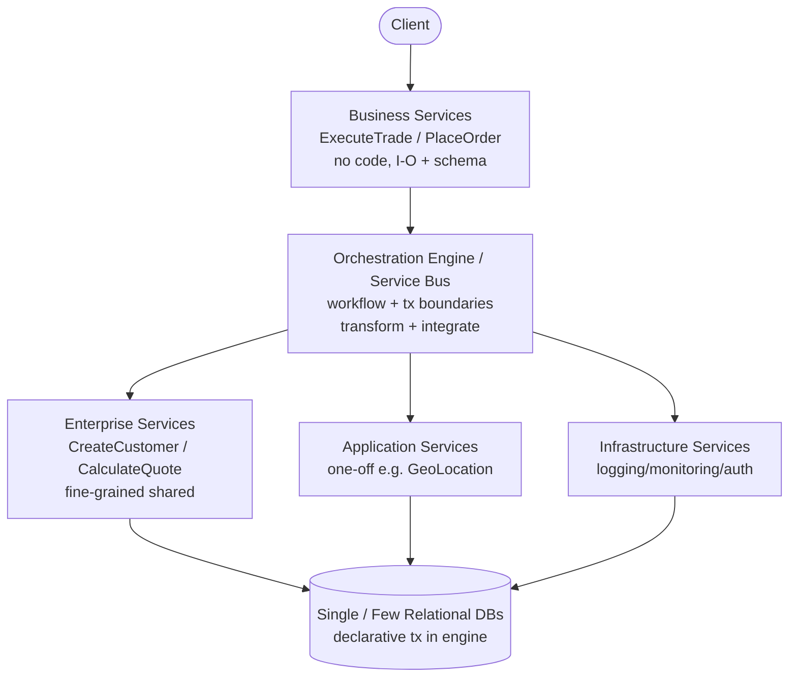
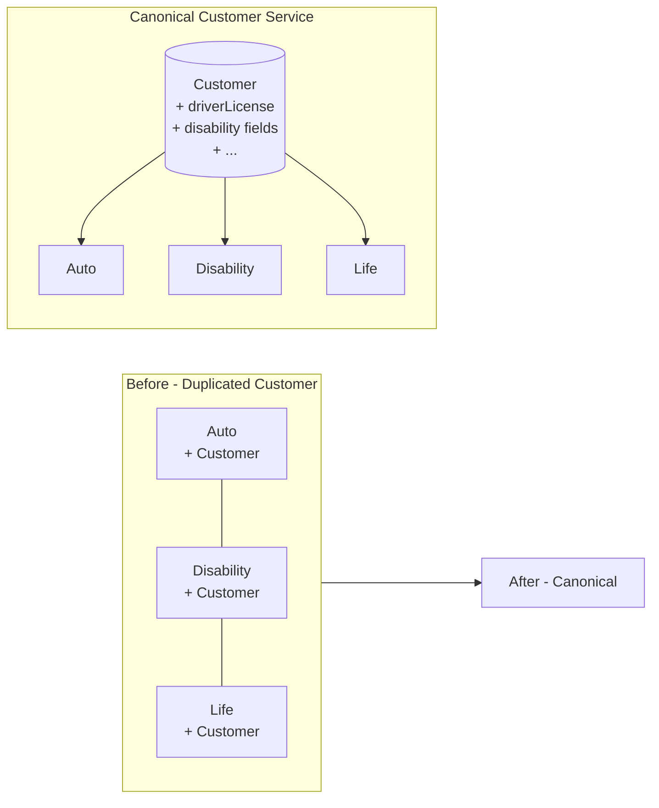

# Chapter 16: Orchestration-Driven SOA — Definitive Technical Summary
*From: Fundamentals of Software Architecture: An Engineering Approach by Mark Richards, Neal Ford*
*Source PDF: pp. 256–264 — figures below cite PDF pages.*

> [!NAV] **Chapter Navigation**
> ⬅️ **Previous:** [[chapter-15-space-based-architecture|Chapter 15: Space-Based Architecture]] | 🏠 **Index:** [[00-Master-Reading-Dashboard|Master Dashboard]] | ➡️ **Next:** [[chapter-17-microservices-architecture|Chapter 17: Microservices Architecture]]

---

## 1. Executive Summary & Core Engineering Problem

- **Core Thesis:** Orchestration-driven SOA — taxonomy-layered services (business/enterprise/application/infrastructure) stitched by a central orchestration engine over one/few databases — pushed technical partitioning and enterprise reuse to the extreme. Logically appealing, it proved a practical disaster: massive coupling, distributed-transaction agony, and a Conway's-law bottleneck that taught modern architects what *not* to do.
- **The Core Problem Statement:** Late-1990s enterprises merging at breakneck pace faced scarce, license-metered OS/DB/compute (per-machine OS fees, Byzantine DB licensing, app-server pooling wars). Architects answered with "reuse everything as fine-grained shared services." Result for a simple task like "add address line to CatalogCheckout": touch dozens of services across tiers + central schema, discover transaction boundaries are wrong, build a near-duplicate service — reuse theater that ground domains to dust.
- **What This Chapter Covers:** Era context (p255-256) → Topology Fig16-1 (p256) → Taxonomy: business/enterprise/application/infrastructure (p257) → Orchestration engine (p258) → Message flow Fig16-2 (p258-259) → Reuse & coupling Figs16-3/16-4 (p259-261) → Ratings Fig16-5 (p261-263).
- **Historical & Industry Context:** Like art movements, architectures reflect their era. Pre-open-source reliability, pre-Agile penetration in large orgs, pre-container elasticity — reuse philosophy + vendor orchestration suites (BPEL/ESB) + integration-architect fiefdoms made this inevitable, then obsolete. Its backlash directly birthed microservices' "prefer duplication, bound contexts, decentralize" creed.

---

## 2. In-Depth Technical Concepts & Internal Mechanics

### 2.1 Topology & taxonomy (Fig16-1, pp256-257)

All requests flow through the orchestration engine (service bus). Under it sits a strict service taxonomy, each layer with a reuse-driven responsibility:

| Layer | Granularity / Ownership | Example | Purpose & fate |
| :--- | :--- | :--- | :--- |
| **Business services** (top entry) | Coarse, no code — just input/output/schema, defined by business users. Litmus: "Are we in the business of…?" | ExecuteTrade, PlaceOrder | Domain facade; delegates entirely to engine + enterprise services |
| **Enterprise services** | Fine-grained, shared, team-built atomic blocks | CreateCustomer, CalculateQuote | Reusable assets to avoid rewriting workflows; markets/tech churn defeated stability — construction-materials analogy failed for software |
| **Application services** | One-off, single-app, app-team owned | Geo-location for one app | Escape hatch when org won't invest in full reuse |
| **Infrastructure services** | Concrete operational, shared infra+ops owned | Monitoring, logging, authN/Z | Cross-cutting ops reuse (the one layer modern sidecars kept) |

- **Demarcation note (p256):** Exact process boundaries varied by org; the layering idea was constant. Always distributed, typically over one/few relational DBs (unlike per-service DBs in microservices), so transactions were declared in the engine, not the DB.

### 2.2 Orchestration engine — the heart and bottleneck (p258)

Duties: stitch business→enterprise mappings, define transaction boundaries, transform messages, integrate custom + packaged + legacy systems.

Step-by-step failure:
1. Developer wraps 2–3 services in a distributed transaction — works.
2. Add 10 more services — where do boundaries lie? Each new path reopens the question.
3. Integration-architect team owning the engine becomes political force → bureaucratic bottleneck (Conway's law: org structure mirrors architecture — central engine breeds central gatekeepers).
4. Simple domain change now needs engine redeploy + coordinated service deploys + holistic testing.

Offloading transactions to tooling sounded good; finding correct granularity proved increasingly impossible.

### 2.3 Message flow (Fig16-2, pp258-259)

Even internal calls transit the bus. Example: `CreateQuote` (business) → service bus defines workflow → calls `CreateCustomer` + `CalculateQuote` (enterprise), each calling application services. Bus = integration hub + orchestrator. No bounded-context-local logic — all interesting routing lives centrally (the opposite of microservices' philosophy).

### 2.4 Reuse…and coupling (Figs16-3/16-4, pp259-261)

- **The reuse play:** Insurance divisions (auto, disability, life) each have Customer → extract to canonical Customer service (Fig16-3 → Fig16-4). Obvious win on paper.
- **Three hidden taxes:**
  1. **Ripple coupling:** Change canonical Customer → all divisions retest/redeploy. Incremental change dies; coordinated deployments + holistic testing become mandatory (First Law: reuse ↔ coupling).
  2. **Semantic bloat:** Auto needs driver's license (property of person, needed for vehicle risk); disability doesn't care but must carry the complexity. Single definition pleases no one.
  3. **Domain pulverization:** CatalogCheckout spread across dozens of tiers/services + single schema. "Add address line" = hunt across layers, fix schema, discover transactional granularity wrong → clone near-identical service. So much for reuse.
- **Alice example:** Alice adds `addressLine3` to checkout. Layered impact: business contract → 4 enterprise services → 6 app services → orchestration routes → central customer table migration → regression of auto + disability + life. Two-week estimate for a one-line domain need.

---

## 3. Important Figures, Diagrams & Visual Architecture

| Figure | PDF Page | Description |
| :--- | :--- | :--- |
| Fig16-1 | p256 | Taxonomy stack: business → orchestration engine → enterprise/app/infrastructure + DB(s) |
| Fig16-2 | p259 | Message flow: CreateQuote via bus to CreateCustomer/CalculateQuote |
| Fig16-3 | p260 | Before: three divisions each with own Customer |
| Fig16-4 | p260 | After: canonical Customer service (reuse + coupling) |
| Fig16-5 | p262 | Ratings: technically partitioned extreme, single quantum, disastrous deploy/test |

**Topology + flow**
- **Original Book Figure:** Figures 16-1, 16-2 → PDF pp256, 259.

- *Takeaway:* Every call, even internal, pays the central toll — the coupling point that collapses quanta to one.

**Reuse trap**
- **Original Book Figure:** Figures 16-3, 16-4 → PDF p260.

- *Takeaway:* Extraction achieves reuse by manufacturing system-wide coupling; any Customer change ripples to all divisions.

---

## 4. Real-World Systems, Case Studies & Code Examples

- **Insurance canonical Customer (pp259-261):** The book's central war story — see Section 2.4. Lesson: business components aren't construction materials lasting decades; markets, tech, and practices rot shared abstractions.
- **CatalogCheckout address line (p261):** Canonical example of pulverized domain. Modern microservices fix: co-locate checkout code + schema in one bounded context; change ships in one deploy.
- **Trade/quote flow (p259):** `CreateQuote` orchestration resembles BPEL XML wiring enterprise + app services — compare with Chapter 14 mediator delegation, but here the mediator is global and mandatory, not localized.
- **Vendor era:** Session replication across app servers + ESB suites (early Camel/Mule/BPEL ancestors) poured effort into making this scalable despite distributed perf drag — foreshadowing Chapter 14's mediator bottleneck discussion.
- **Pseudocode — then vs now:**
```xml
<!-- Then: central BPEL orchestrates everything -->
<invoke service="CreateCustomer"/><invoke service="CalculateQuote"/>
<!-- Now (microservices): bounded context owns workflow -->
<!-- POST /quotes -> QuoteService (local tx, own DB) -->
```

---

## 5. Architectural Trade-Off Matrix

| Approach | Reuse / Coupling | Change Cost | Perf / Scale | Best Used When | Avoid When |
| :--- | :--- | :--- | :--- | :--- | :--- |
| **Orchestration-driven SOA** | Max reuse, max coupling (canonical services) | Huge ripple, coordinated deploys, holistic testing | Poor perf (every request split across arch); scale possible via vendor heroics (session replication) | Historical study; legacy integration hub where engine already owns transactions | Any new build needing agility, deployability, domain clarity |
| **Service-based / microservices** | Bounded reuse, prefer duplication | Isolated per-context deploys | Better (fewer hops, local tx) | Modern DDD, evolutionary change | — |
| **Monolith (modular/microkernel)** | In-process reuse, cheap refactors | Single-quantum coordinated but local | Best raw perf | Single quantum suffices | Need independent quanta |

- **Book ratings synthesis (Fig16-5, pp261-263):** Most technically partitioned general-purpose architecture ever. Single quantum despite distribution — (1) one/few DBs couple all concerns, (2) engine couples all behavior (no part can have different characteristics than its mediator) → worst of monolith + distributed. Deployability/testability disastrous (also non-goals pre-Agile). Elasticity/scalability middling-passable via vendor effort. Performance extremely poor. Simplicity/cost inverted (complex + expensive). Enduring value: taught limits of distributed transactions + technical partitioning.
- **Heuristics:** If you inherit this, don't "fix reuse" — carve bounded contexts out (strangler), move transactions into contexts, shrink engine to integration-only, then retire it.

---

## 6. Jargon Buster & Key Terminology

- **Orchestration-driven SOA:** Distributed style with central engine stitching taxonomy-layered services. Vs choreography (peer-to-peer) and vs modern orchestration (localized mediators).
- **Taxonomy (business/enterprise/application/infrastructure):** Reuse-graded service layers. Modern hangs: only infrastructure reuse survived (as sidecars/mesh).
- **Orchestration engine / Service bus:** Central workflow + transaction + transformation + integration hub. Conway bottleneck: team owning it becomes gatekeeper.
- **Canonical service (e.g., canonical Customer):** Single org-wide definition absorbing all divisions' fields. Pitfall: semantic bloat + ripple coupling.
- **Technical partitioning:** Structuring by technical role (presentation/business/persistence or taxonomy layers) vs domain partitioning (by business capability). SOA is the extreme technical case; its backlash fueled domain-partitioned microservices.
- **Distributed transaction boundary:** Where atomic commit/rollback spans services. Hard in SOA because engine-declared boundaries rarely match evolving domain needs.
- **Ripple effect / Coordinated deployment:** One canonical change forcing multi-service release trains + holistic testing.
- **Domain pulverization ("ground to dust"):** Single business concept (CatalogCheckout) smeared so thinly across tiers that no team owns it.

---

## 7. System Design & Practical Engineering Takeaways

- **Production Engineering Checklist:**
  1. Never build a new canonical enterprise service — default to bounded-context duplication.
  2. If stuck with an engine, shrink it to legacy-integration only; move workflow/transactions into owning services.
  3. Break single-DB coupling first (partition tables per domain) to enable future quanta split.
  4. Measure Blast radius per change (services + engine routes + schema tables touched) and make it a fitness function — drive it down.
  5. Disband central integration gatekeepers into embedded domain teams (invert Conway).
- **System Design Interview Blueprint:** When asked "critique SOA vs microservices": draw Fig16-1 vs bounded contexts, explain single quantum (shared DB + engine), quantify "add address line" ripple (dozens services + schema + engine), cite perf (hops + security per endpoint) and deployability (coordinated trains). Propose strangler: extract one domain (e.g., Quotes) with own DB + local transactions first. Pitfall: praising reuse without naming coupling cost.
- **Deep Mastery Questions:**
  1. *Q: Why single quantum if services are distributed? A: Shared DB(s) couple data + engine couples behavior — every part shares failure/scale characteristics with the mediator, so no independent quanta exist.*
  2. *Q: Why did reuse fail if DRY is good? A: DRY optimizes code duplication; enterprise reuse coupled independent business lifecycles (auto vs disability). Different change rates + semantics made shared abstraction a coordination tax exceeding duplication cost.*
  3. *Q: Engine handled transactions declaratively — why still painful? A: Declarative doesn't solve granularity: correct atomic boundaries shift with domain evolution, forcing redesign or near-duplicate services each time.*
  4. *Q: What's the Conway lesson? A: Central engine → central team → political bottleneck. Architecture and org co-evolve; decentralize ownership to decentralize architecture.*
  5. *Q: When is this style's scalability claim misleading? A: Vendor session-replication scaled request handling but not change velocity or perf-per-request — throughput via heroics masked structural drag.*

