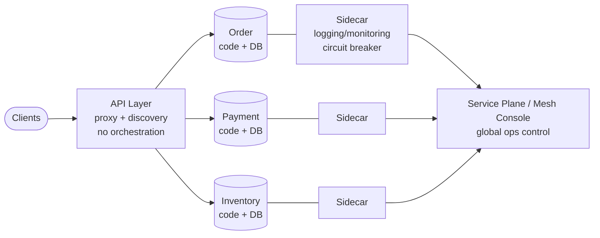
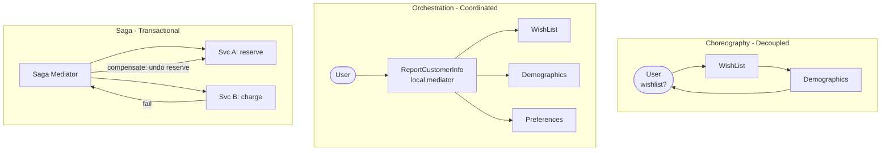

# Chapter 17: Microservices Architecture — Definitive Technical Summary
*From: Fundamentals of Software Architecture: An Engineering Approach by Mark Richards, Neal Ford*
*Source PDF: pp. 265–286 — figures below cite PDF pages.*

> [!NAV] **Chapter Navigation**
> ⬅️ **Previous:** [[chapter-16-orchestration-driven-soa|Chapter 16: Orchestration-Driven SOA]] | 🏠 **Index:** [[00-Master-Reading-Dashboard|Master Dashboard]] | ➡️ **Next:** [[chapter-18-choosing-architecture-style|Chapter 18: Choosing Architecture Style]]

---

## 1. Executive Summary & Core Engineering Problem

- **Core Thesis:** Microservices is the physical embodiment of domain-driven design's bounded context: tiny, single-purpose, independently deployed services with isolated data, favoring duplication over reuse to achieve extreme decoupling — at the price of distributed complexity that only DevOps automation, smart granularity, and disciplined async make survivable.
- **The Core Problem Statement:** Shared app servers + shared classes + shared databases create resource contention, poor isolation, and system-wide coupling: one growing app starves others; one `Address` change ripples everywhere. Naive "micro" takes the label literally, slicing entity-services that chatter constantly, recreating a distributed monolith with network latency + per-endpoint security + cross-service transactions on top.
- **What This Chapter Covers:** History/Fowler-Lewis 2014 + DDD (p265-266) → Topology Fig17-1 (p266) → Distributed (p267) → Bounded context (p267-268) → Granularity purpose/transactions/choreography (p268) → Data isolation + entity trap (p269) → API layer (p269) → Operational reuse: sidecar Fig17-2 + mesh Figs17-3/17-4 + discovery (p270-272) → Frontends Figs17-5/17-6 (p273-274) → Communication: protocol-aware heterogeneous interop + enforced heterogeneity (p274-275) → Choreography Figs17-7/17-9 vs orchestration Figs17-8/17-10 (p276-279) → Sagas Figs17-11/17-12 (p280-283) → Ratings Fig17-13 (p283-284) → References (p285).
- **Historical & Industry Context:** Unlike styles named after the fact, microservices was named early (Martin Fowler & James Lewis, March 2014 "Microservices") and popularized just as free OS + containers + cloud provisioning + DevOps automation made per-service infrastructure practical. Heavily inspired by DDD bounded contexts; defined in opposition to "gigantic services" SOA.

---

## 2. In-Depth Technical Concepts & Internal Mechanics

### 2.1 Topology, distributed, bounded context (pp266-268)

- **Topology (Fig17-1):** Dozens of small services, each with own code + DB + dependencies, fronted by optional API layer. Far smaller than SOA enterprise services.
- **Distributed (p267):** Each service = own process (physical → VM → container). Solves multitenant app-server ills: shared bandwidth/memory/disk contention + leaky isolation. Cost: network >> method call + security per endpoint. Hence granularity + transaction discipline are the architecture.
- **Bounded context (p267-268):** DDD decoupling: inside a context, code/schemas couple to produce work; nothing couples outside. Monolith shares `Address` across domains; microservices duplicates it per service. First Law reminder: reuse ↔ coupling. Goal here is decoupling → choose duplication.
- **Domain-partitioned extreme:** Every boundary should be a domain/subdomain/workflow. The most domain-centered modern style — and the most distinct quanta (exemplifies the quantum measure).

### 2.2 Granularity — the label trap (p268)

> *The term "microservice" is a label, not a description. — Martin Fowler*

Teams hear "micro" as commandment and build nano-services needing constant links. Purpose is capturing domain/workflow, which is sometimes large. Guidelines:

| Lens | Test | Action if violated |
| :--- | :--- | :--- |
| **Purpose** | Does service contribute one cohesive behavior? | Split grab-bags, merge fragments |
| **Transactions** | Can business transaction complete inside one service? | If you need cross-service ACID, boundaries are wrong — fix granularity, don't add distributed tx |
| **Choreography** | Do "isolated" services chatter excessively? | Bundle back into larger service to kill overhead |
| **Iteration** | Did first pass nail it? (Never.) | Iterate on boundaries, data deps, comm styles |

### 2.3 Data isolation & API layer (p269)

- **No shared schemas/DBs as integration.** Beware entity trap (p110): don't make `CustomerService` = `customer` table CRUD. Model workflows/domains, not entities.
- **Lost single source of truth:** Relational unifier gone. Options: (a) designate owner domain as truth and coordinate via calls, (b) replicate/cache outward. Either way, architect must choose per fact.
- **Upside:** Polyglot persistence — each service picks cheapest/right-sized store (relational vs doc vs graph) and can switch without cross-team coupling (no shared implementation details).
- **API layer (optional but common):** Proxy/indirection + ops hosting (naming/discovery). Must NOT be mediator/orchestrator — all interesting logic stays in bounded contexts. Mediators belong to technically partitioned styles; microservices is firmly domain-partitioned.

### 2.4 Operational reuse — sidecar & mesh (pp270-272)

DDD duplication is for domain code; operational concerns (monitoring, logging, circuit breakers) *benefit* from coupling. Solution:

1. **Sidecar (Fig17-2):** Common component inside each service pod (owned by team or shared infra) handling ops. Upgrade monitoring once in sidecar → all services inherit. Solves "who upgrades 50 bespoke loggers?"
2. **Service mesh (Figs17-3/17-4):** Sidecars wire into a service plane → consistent operational interface + holistic console for global logging/monitoring control. Each service = node in mesh.
3. **Service discovery (often in mesh/API layer):** Request → discovery → healthy instance; monitors rates, spins instances for scale/elasticity.

### 2.5 Frontends (pp273-274)

- **Monolithic UI (Fig17-5):** Single JS/desktop/mobile app calls via API layer. Pragmatic; sacrifices UI-level isolation.
- **Microfrontends (Fig17-6):** Each service emits its UI fragment; frontend coordinates fragments (React or microfrontend frameworks). Unifies domain from UI to DB in one team — original DDD vision (UI inside bounded context) made practical.

### 2.6 Communication (pp274-279)

- **Sync vs async:** Sync = caller blocks. Async = events/messages (internal EDA). Microservices uses *protocol-aware heterogeneous interoperability*: no central hub so each service knows/discover which protocol (REST vs queues) to use (protocol-aware) + each may use different stacks/languages/stores (heterogeneous/polyglot) + they call each other over network (interoperability).
- **Enforced heterogeneity anecdote:** PIM-startup chief architect mandated different stacks per team (Java vs .NET) to make accidental class-sharing impossible. Enterprises standardize to reduce complexity; microservices standardizes only where coupling pays (ops), otherwise right-sizes tech per narrow scope (not every service needs industrial RDBMS).
- **Choreography (broker-like, Figs17-7/17-9):** No central coordinator. Fig17-7: User → CustomerWishList → (missing demographics) → CustomerDemographics → reply. Preserves decoupling + speed. Complex case Fig17-9: first service fans out to many others, becoming de-facto mediator (front-controller pattern) + complexity concentrates in that service.
- **Orchestration (localized mediator, Figs17-8/17-10):** Build a coordinator service. Fig17-8: User → ReportCustomerInformation mediator → fans to demographics/wishlist/etc. Fig17-10: dedicated mediator for complex workflow focuses coupling in one place, leaving others clean. Domain/architecture isomorphism: decoupled goal ↔ broker/choreography shape are symbiotic; orchestration adds coupling but tames coordination.
- **Trade-off (First Law):** Choreography = max decoupling, harder error/coordination. Orchestration = focused coupling, simpler reasoning, more bottlenecks. Prefer choreography; orchestrate complex flows locally.

### 2.7 Transactions & sagas (pp280-283)

> *Don't do transactions in microservices — fix granularity instead!*

Cross-service atomicity = connascence of value (worst dynamic coupling). Transactional need usually signals over-slicing. Exception: two services need vastly different characteristics yet must coordinate → saga sparingly (dominant sagas = design mistake).

- **Saga (Fig17-11):** Mediator calls each participant, records success/failure, commits synchronously if all succeed.
- **Compensating on failure (Fig17-12):** If step 1 succeeded but step 2 failed → mediator sends undo to step 1. Implementations: (a) pending-state per request until global success (complex with async + contingent arrivals + network chatter), (b) do/undo per operation (less coordination, but undo >> do in complexity — more than doubles work). Use sparingly.

---

## 3. Important Figures, Diagrams & Visual Architecture

| Figure | PDF Page | Description |
| :--- | :--- | :--- |
| Fig17-1 | p266 | Microservices topology (small services + own DBs + API layer) |
| Fig17-2 | p270 | Sidecar pattern (ops component per service) |
| Fig17-3 | p271 | Service plane connecting sidecars |
| Fig17-4 | p272 | Mesh console (holistic ops view) |
| Fig17-5 | p273 | Monolithic frontend via API layer |
| Fig17-6 | p274 | Microfrontends (per-service UI fragments) |
| Fig17-7/17-9 | p276/278 | Choreography simple vs complex (front controller) |
| Fig17-8/17-10 | p277/279 | Orchestration simple vs complex (dedicated mediator) |
| Fig17-11/17-12 | p281-282 | Saga success vs compensating failure |
| Fig17-13 | p284 | Ratings (5-star scale/elasticity/evolutionary) |

**Topology + sidecar/mesh**
- **Original Book Figure:** Figures 17-1, 17-2, 17-3, 17-4 → PDF pp266, 270-272.

- *Takeaway:* Domain decoupling (services + DBs) + operational coupling (sidecars + mesh) — split the two concerns.

**Choreography vs orchestration vs saga**
- **Original Book Figure:** Figures 17-7–17-12 → PDF pp276-282.

- *Takeaway:* Choreograph by default; orchestrate complex coordination locally; saga-compensate only as last resort.

---

## 4. Real-World Systems, Case Studies & Code Examples

- **Fowler/Lewis 2014 lineage + DDD CatalogCheckout:** Checkout domain (items + customers + payment) modeled as collaborating bounded contexts, each owning code + schema, duplicating shared concepts like `Address` rather than coupling to a canonical type.
- **PIM startup enforced heterogeneity:** Java vs .NET per team to prevent accidental coupling. Modern take: Node for BFF, Java for ledger, Python for ML features — each right-sized, switched independently.
- **WishList → Demographics (Fig17-7) vs Report mediator (Fig17-8):** Same user need ("show wishlist with demographics") solved choreographed (2 hops, decoupled) vs orchestrated (mediator fans out, focused coupling). Complex Fig17-9/17-10 shows when choreography collapses into front-controller and deserves explicit mediator.
- **Saga e-commerce checkout:**
```python
# Saga mediator - compensating path
try:
    order.reserve(items)      # pending
    payment.charge(card)      # pending
    inventory.commit(items)   # pending
    mediator.commit_all()     # success
except PaymentFailed:
    mediator.compensate([order.release, inventory.release])
    # undo >> do: release must handle partial, expired holds, race with reorders
```
- **Mesh/discovery in prod:** Istio/Linkerd sidecars + service discovery autoscaling; API gateway hosting discovery for UI/mobile. References (p285): Sam Newman *Building Microservices*, Richards *Microservices vs SOA* + *Antipatterns*.

---

## 5. Architectural Trade-Off Matrix

| Approach | Coupling / Granularity |Perf / Reliability | Change / Scale | Best Used When | Avoid When |
| :--- | :--- | :--- | :--- | :--- | :--- |
| **Microservices (bounded, choreographed)** | Extreme decoupling, duplication > reuse | Lower raw perf (network + per-endpoint auth); fault-tolerant if low chatter (redundancy fixes rest) | 5-star scale/elasticity/evolutionary (tiny units, automation) | Fast-moving domains, independent team velocity, varied characteristics per domain | No DevOps automation, need cross-service ACID everywhere, tiny team/budget (distributed-monolith risk) |
| **Distributed monolith (nano-services + sync mesh)** | Coupled via network (worst) | Poor perf + fragile (cascading timeouts) | Slow (lockstep deploys) | — anti-pattern | Mistaking "micro" for "tiny entity services" |
| **Service-based / modular monolith** | Coarse domains, shared DB | Higher perf, simpler tx | Moderate scale, cheaper | Single-few quanta, ACID-first | Need per-function elasticity/polyglot |
| **Orchestrated (mediator/saga-heavy)** | Focused coupling | Bottlenecked but reasoned | Coordinated but slower | Complex regulated workflows | High-throughput fanout better choreographed |

- **Book ratings synthesis (Fig17-13):** Highs: scalability/elasticity/evolutionary (most scalable systems built this way; automation + tiny decoupled units enable fast architectural evolution) + deployability/testability (DevOps prerequisite — couldn't exist without it). Cautions: performance (network + security overhead; fix via caching/replication + choreography over orchestration), fault tolerance/reliability dip with excessive interservice comm (fix via redundancy/scale). Domain-centered with most distinct quanta — the quantum ideal.
- **Heuristics:** Choreograph unless error/coordination complexity forces a local mediator. If sagas dominate, re-slice boundaries along transaction lines. Cache/replicate to claw back perf; never add global ESB-style orchestrator.

---

## 6. Jargon Buster & Key Terminology

- **Bounded context (DDD):** Domain + its code/schemas coupled internally, decoupled externally. Microservices = physical bounded contexts.
- **Microservice (label not description):** Small single-purpose deployable. Pitfall: "micro" doesn't mean entity-small; means domain-cohesive.
- **Entity trap:** Modeling services as table CRUD (CustomerService = customer rows). Leads to chatter + distributed monolith.
- **Protocol-aware heterogeneous interoperability:** No hub → services know protocols (aware) + may use different stacks (heterogeneous) + call over network (interop). Enables polyglot without central tax.
- **Enforced heterogeneity:** Deliberately different stacks per team to prevent accidental sharing. Opposite of enterprise standardization.
- **Sidecar:** Co-deployed ops container (logging/monitoring/circuit-breaking) enabling shared upgrades. Forms mesh via service plane.
- **Service mesh / plane / discovery:** Mesh = sidecar network; plane = consistent ops interface; discovery = elastic routing/spin-up. Often hosted with API layer.
- **Microfrontends:** Per-service UI fragments coordinated in browser. Extends bounded context to frontend.
- **Choreography (broker-like) vs orchestration (mediator-like):** Peer calls vs local coordinator. Isomorphism: choreography shape matches decoupling goal.
- **Front-controller pattern:** Choreographed service secretly acting as mediator for complex flow — signal to extract explicit orchestrator.
- **Saga + compensating transaction:** Mediated distributed commit with undo on failure (pending-state or do/undo). Sparing use only.
- **Connascence of value:** Dynamic coupling where services must agree on runtime values (e.g., transactional state) — worst kind, created by cross-service tx.
- **Distributed monolith:** Nano-services + sync mesh requiring lockstep deploys — microservices' cost with monolith's coupling.

---

## 7. System Design & Practical Engineering Takeaways

- **Production Engineering Checklist:**
  1. Slice by transaction + purpose + chatter — merge chatty neighbors, split grab-bags, iterate.
  2. Isolate data per service (own schemas/stores); designate owner-truth or replicate explicitly — never share DBs.
  3. Keep API layer dumb (proxy/discovery); put workflow in contexts or explicit local mediators.
  4. Deploy sidecars + mesh + discovery for unified ops; automate deploy/test (non-negotiable prerequisite).
  5. Choreograph by default; introduce saga/compensation only for exceptional differing-characteristic coordination, with idempotent do/undo.
- **System Design Interview Blueprint:** For "design checkout for 100k sellers": draw API → Order/Payment/Inventory/Notify bounded services with own DBs, choreographed events, sidecar mesh, discovery autoscaling. State granularity tests, entity-trap avoidance, polyglot stores, cache for perf, saga only if asked about failure ("compensate reserve on charge-fail, but prefer re-slicing"). Numbers: network 1–5 ms vs method ns, per-endpoint auth overhead, competing-consumer scale. Pitfall: proposing entity services or global orchestrator.
- **Deep Mastery Questions:**
  1. *Q: Why does cross-service transaction violate microservices? A: Creates connascence of value + couples lifecycles/failure domains, destroying independent deployability/scalability — the style's reason for being. Fix boundaries so transactions fit inside contexts.*
  2. *Q: When does choreography become front-controller anti-pattern? A: When one "choreographed" service fans out to many others for complex workflows (Fig17-9), accumulating mediator duties + domain logic. Extract dedicated orchestrator (Fig17-10) to isolate coordination coupling.*
  3. *Q: Sidecar vs shared library for ops? A: Library couples via version upgrades per team (slow, inconsistent); sidecar couples via infra-owned deploy (one upgrade propagates, consistent mesh control) while keeping domain code decoupled.*
  4. *Q: How do quanta differ from SOA here? A: Each bounded service + DB can scale/fail independently → many distinct quanta. SOA's shared DB + global engine forced one quantum despite distribution.*
  5. *Q: Microfrontends when? A: When team autonomy must extend to UI (one team per domain end-to-end) and API-monolith UI becomes integration bottleneck. Cost: fragment coordination + perf; use component frameworks or dedicated microfrontend infra.*

