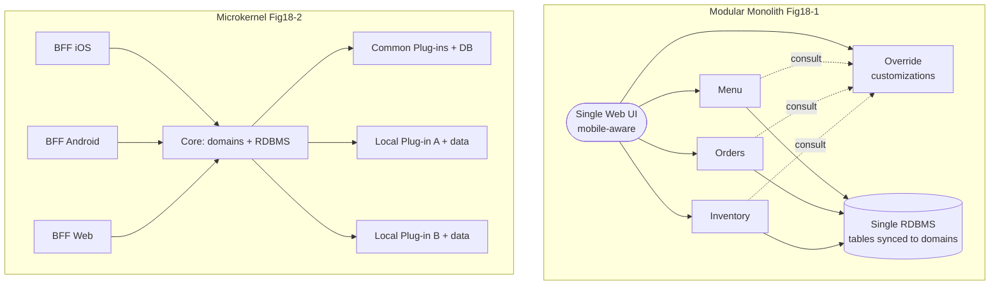
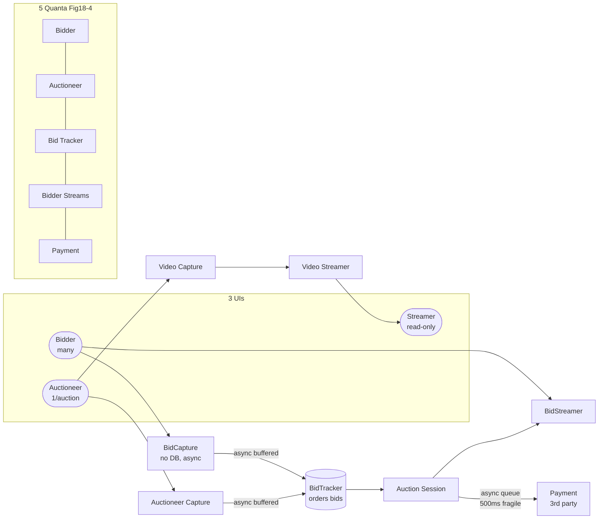
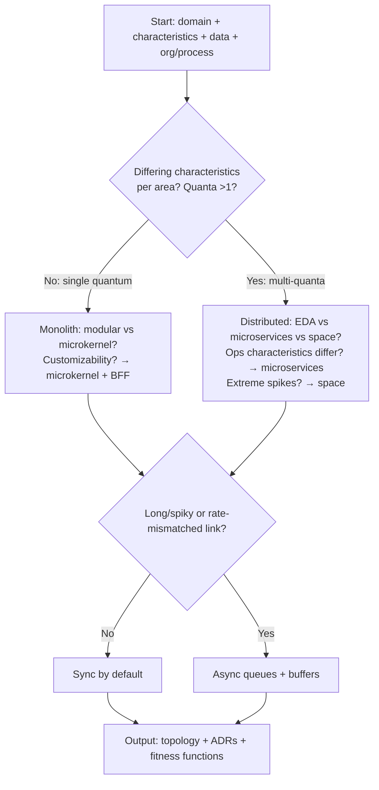

# Chapter 18: Choosing the Appropriate Architecture Style — Definitive Technical Summary
*From: Fundamentals of Software Architecture: An Engineering Approach by Mark Richards, Neal Ford*
*Source PDF: pp. 287–299 — figures below cite PDF pages.*

> [!NAV] **Chapter Navigation**
> ⬅️ **Previous:** [[chapter-17-microservices-architecture|Chapter 17: Microservices Architecture]] | 🏠 **Index:** [[00-Master-Reading-Dashboard|Master Dashboard]] | ➡️ **Next:** [[chapter-19-architecture-decisions|Chapter 19: Architecture Decisions]]

---

## 1. Executive Summary & Core Engineering Problem

- **Core Thesis:** *It depends!* No universal best style exists — choice is the culmination of domain understanding, architecture characteristics, data placement, sync/async needs, org/process constraints, and domain/architecture isomorphism. The architect's output is topology + decision records + fitness functions, defaulting to synchronous monolith simplicity and distributing only where differing quanta demand it.
- **The Core Problem Statement:** Fashion churn (Kubernetes then unknown, now conferences, soon replaced; Docker's tectonic surprise; accelerating tool→practice→design loops), domain drift (evolution, mergers), tech/licensing shocks, and org immaturity punish cargo-cult picks. A highly coupled multipage insurance flow forced into decoupled microservices, or a 50k-concurrent auction forced into a coupled monolith, both fail — not from bad code but from style/domain mismatch.
- **What This Chapter Covers:** It-depends framing (p287) → Shifting fashion: past/ecosystem/capabilities/acceleration/domain/tech/external (p288) → Decision criteria: domain/characteristics/data/org/process/isomorphism (p289-290) → Determinations: monolith-vs-distributed (quanta), data placement, sync-vs-async (p290-291) → Silicon Sandwiches monoliths: modular Fig18-1 (p291-292) + microkernel Fig18-2 (p292-293) + BFF + sync choice (p293-294) → GGG distributed: microservices choice + Fig18-3 (p294-295) + services + async rationale (p296) + 5 quanta Fig18-4 + least-worst design (p297).
- **Historical & Industry Context:** Closes Part II (Architecture Styles) before Part III (Techniques & Soft Skills). Synthesizes quanta analysis (Ch8/GGG p112), characteristics elicitation, and isomorphism (microkernel↔customizability, space↔discrete processors) into a repeatable selection method that survives fashion cycles.

---

## 2. In-Depth Technical Concepts & Internal Mechanics

### 2.1 Why fashion shifts (p288)

| Driver | Mechanism | Example |
| :--- | :--- | :--- |
| Past observations | Pain with reuse/monoliths reshapes next designs | Reuse rethink after SOA canonical-model failures |
| Ecosystem chaos | Unpredictable tool explosions | Kubernetes 0→global conferences→future replacement |
| New capabilities | New paradigm, not just tool swap | Docker containers → new practices, pipelines,us unstable |
| Acceleration | Tools→practices→design feedback quickens | Constant flux is the only stable state |
| Domain / tech / external | Business evolution, mergers, stack shifts, license costs | Prohibitive cloud/DB licensing forcing migration |

Lesson: track trends to know when to follow vs make principled exceptions — not to chase novelty.

### 2.2 Decision criteria + determinations (pp289-291)

Architect designs two things: the requested domain + all structural glue for success. Must be comfortable with:

1. **Domain (operational characteristics):** General understanding of major flows, not SME depth, especially perf/scale/consistency drivers.
2. **Characteristics impacting structure:** Elicited and prioritized (availability, elasticity, customizability...).
3. **Data architecture:** DBA collaboration on DB/schema/legacy interaction — data placement shapes style.
4. **Org factors:** Cloud costs, M&A plans (→ open/integration-friendly), budgets.
5. **Process/teams/ops:** Agile/QA/ops maturity. Immature automation → avoid microservices/space-based that depend on it.
6. **Domain/architecture isomorphism:** Shape match. Microkernel ↔ customizability (plug-ins); space-based ↔ discrete parallel ops (genome analysis, bidding). Mismatch warning: highly scalable needs ↔ large coupled monolith; semantically coupled multipage insurance forms ↔ decoupled microservices (use service-based instead).

Determinations:

- **Monolith vs distributed (quanta test):** Single set of characteristics → monolith may suffice (other factors can still push distributed). Differing characteristics per area → distributed. Uses quanta analysis from component design.
- **Where data lives:** Monolith → 1/few RDBMS assumed. Distributed → which services persist, how data flows for workflows. Iterate structure + behavior together.
- **Sync vs async:** Sync convenient, fewer debug hazards (no deadlocks/races/sync bugs). Async buys perf/scale/backpressure at debugging cost.

> *Use synchronous by default, asynchronous when necessary.*

Output: topology (+ hybrids) + ADRs for hardest decisions + fitness functions guarding principles/operational characteristics.

### 2.3 Monolith case: Silicon Sandwiches (pp291-294)

Single quantum suffices + simple low-budget app → monolith, but two component designs explored:

- **Modular monolith (Fig18-1, p291-292):** Domain components + single RDBMS + single web UI (mobile-aware to save cost). Sync tables/schemas to domains now to ease future distribution. Customization (lacking natively) via `Override` endpoint where devs upload customizations; every customizable component references Override — perfect fitness-function target (assert every customization path consults Override).
- **Microkernel (Fig18-2, p292-293) for customizability isomorphism:** Core = domain components + single RDBMS (again migration-ready). Customizations = plug-ins (common plug-in set + DB, plus local plug-ins each with own data, mutually decoupled). API layer as thin microkernel adaptor via Backends-for-Frontends (BFF): backend emits generic info, per-device BFFs (iOS, Android, web) translate format/pagination/latency for richest UX + future devices.
- **Communication:** Synchronous throughout — no extreme perf/elasticity, no lengthy ops.

### 2.4 Distributed case: Going, Going, Gone (GGG) auction (pp294-297)

Needs differing characteristics per role (auctioneer vs bidder availability/scale) + explicit ambitious scale/elasticity/perf + fine-grained customization → candidates low-level EDA vs microservices → **microservices** (separates by operational characteristics; pure EDA separates by communication style: orchestrated vs choreographed). Perf weakness addressed by design (avoid over-orchestration/aggressive data splits).

- **Fig18-3 services (p295-296):** Components became services 1:1. Three UIs: Bidder (many), Auctioneer (one per auction), Streamer (read-only video+bid stream, optimizable). Services: BidCapture (conduit, no persistence, async → BidTracker), BidStreamer (read-only fanout), BidTracker (unifies auctioneer + online bids, near-real-time ordering, async inbound queues buffer rate differences), AuctioneerCapture (separate from BidCapture per quanta analysis p112 — different characteristics), AuctionSession (per-auction workflow), Payment (third-party, post-auction), VideoCapture/Streamer.
- **Sync/async mix (p296):** Async chosen to bridge differing characteristics. Example: Payment handles 1 per 500 ms; many auctions ending together would timeout synchronously → queues add reliability to fragile point.
- **Fig18-4 five quanta (p297):** Payment, Auctioneer, Bidder, BidderStreams, BidTracker (roughly per-service; stacks = multiples). Quanta analysis at component stage made service/data/comm boundaries obvious. Not "correct"/only/best — least-worst trade-offs. Microservices + judicious events/messages = generic pattern leverage + expansion foundation.

---

## 3. Important Figures, Diagrams & Visual Architecture

| Figure | PDF Page | Description |
| :--- | :--- | :--- |
| Fig18-1 | p292 | Silicon Sandwiches modular monolith (domains + single DB/UI + Override) |
| Fig18-2 | p293 | Silicon Sandwiches microkernel (core + plug-ins + BFFs) |
| Fig18-3 | p295 | GGG microservices (3 UIs + 8 services, sync+async) |
| Fig18-4 | p297 | GGG 5 quanta boundaries |

**Silicon Sandwiches — two monoliths**
- **Original Book Figure:** Figures 18-1, 18-2 → PDF pp292-293.

- *Takeaway:* Same quantum, different isomorphism bets — modular for simplicity/migration vs microkernel when customizability dominates (plug-ins + BFFs).

**GGG microservices + quanta**
- **Original Book Figure:** Figures 18-3, 18-4 → PDF pp295, 297.

- *Takeaway:* Let quanta (differing characteristics) draw service/data/queue lines; use async to decouple fragile rate-mismatched links.

**Selection flowchart (synthesis of pp289-291)**

- *Takeaway:* Executable version of "sync by default, async when necessary" + quanta test.

---

## 4. Real-World Systems, Case Studies & Code Examples

- **Silicon Sandwiches (sandwich-shop kata):** Low-budget CRUD + custom sandwiches. Modular: `POST /customize → Override` + fitness function:
```java
// Fitness: every customizable component must consult Override
assertThat(callsTo("Override.check", perRequest)).isGreaterThan(0);
```
Microkernel BFF:
```python
# Thin adaptor per device
def bff_ios(generic_menu):
    return paginate(format_for_ios(generic_menu), page_size=10, latency_budget_ms=200)
```
- **GGG auction (pp294-297):** BidCapture vs AuctioneerCapture split came directly from quanta analysis (p112) — same "capture bid" function, different availability/scale needs → separate services/queues. BidTracker orderingSpace: two async inbound rates reconciled near-real-time. Payment queue absorbs end-of-auction thundering herd that would timeout sync calls.
- **Isomorphism pairs to reuse:** Genome pipeline (discrete steps) → space-based processors; customizable SaaS → microkernel plug-ins; coupled forms flow → service-based coarse services (not microservices).
- **Fashion caution:** Teams adopting Kubernetes because "everyone does" without quanta justification repeat SOA reuse error — new Ferrari, same traffic jam.

---

## 5. Architectural Trade-Off Matrix

| Choice | When it wins | Cost if wrong | GGG/Sandwiches verdict |
| :--- | :--- | :--- | :--- |
| **Modular monolith** | Single quantum, low budget, simple CRUD, future split possible via table/domain sync | Coupled scale/fault (all share fate) | Sandwiches default — cheapest sufficient |
| **Microkernel + BFF** | Customizability dominant, per-device UX matters | Plug-in/versioning overhead | Sandwiches alternative when customization is top characteristic |
| **Microservices + events** | Differing operational characteristics, fine customization, elastic scale | Distributed complexity, perf overhead, saga risk | GGG winner — operational separation + async buffers |
| **Pure EDA** | Flow defined by comm style (orchestrated vs choreographed) | Doesn't separate by ops characteristics | GGG runner-up — rejected for this reason |
| **Space-based** | 10k+ concurrent spikes, DB bottleneck proven | Cost/complexity/collisions | GGG/microservices sufficed; space overkill without proven triangle bottleneck |
| **Sync by default** | Predictable, debuggable, fast enough | Cascade timeouts under spikes/mismatched rates | Sandwiches all-sync; GGG sync except fragile links |
| **Async where needed** | Backpressure, rate smoothing, responsiveness | Eventual consistency, races, test explosion | GGG BidTracker inbounds + Payment outbounds |

- **Heuristics:** Single quantum → monolith (modular unless customizability → microkernel). Multi-quanta → distributed (ops-differ → microservices, spike-capped → space, flow-centric → EDA). Sync unless queue solves a named fragility (500 ms Payment, 10× bid burst). Always emit ADRs + fitness functions (Override consultation, quanta independence, BFF latency budgets).

---

## 6. Jargon Buster & Key Terminology

- **It depends:** Not evasion — recognition that style follows context (domain, characteristics, data, org, process, isomorphism).
- **Domain/architecture isomorphism:** Shape match between problem and style (customizability↔microkernel, discrete processors↔space-based). Mismatch predicts pain.
- **Quanta test (monolith vs distributed):** One characteristic set → monolith viable; differing sets → distribute. From component-level quanta analysis.
- **Synchronous by default, asynchronous when necessary:** Default to debuggable sync; pay async's consistency/debug tax only for named perf/scale/fragility wins.
- **Modular monolith:** Domain components + single DB/quantum, single deployable. Migration-ready if tables mirror domains.
- **Microkernel (plug-in) + BFF:** Core + decoupled plug-ins (own data) + per-device Backend-for-Frontend adaptors (format/pagination/latency). For customizability + rich multi-device UX.
- **Silicon Sandwiches / Going, Going, Gone (GGG):** Book katas — sandwich shop (single-quantum monolith lab) and live+online auction (multi-quanta distributed lab with 3 UIs, 8 services, 5 quanta).
- **BidCapture vs AuctioneerCapture:** Same function split by differing characteristics — quanta-driven slicing exemplar.
- **Architecture Decision Record (ADR) + fitness function:** Written rationale for hard choices + automated guard (e.g., "all custom paths consult Override", "Payment stays async", "BFF p99 <200 ms").
- **Least-worst design:** No perfect architecture — choose minimal-regret trade-offs with expansion room.
- **Shifting fashion drivers:** Past pain, ecosystem chaos, new capabilities, acceleration, domain/tech/external shocks. Follow intelligently, except principledly.

---

## 7. System Design & Practical Engineering Takeaways

- **Production Engineering Checklist:**
  1. Run quanta analysis before style choice; let differing characteristics draw boundaries.
  2. Sync tables/schemas to domain components even in monoliths for future split.
  3. Encode top characteristics as fitness functions (Override coverage, quanta independence, BFF budgets, queue-depth SLOs).
  4. Isolate rate-fragile links (Payment 500 ms, bid bursts) with async queues; keep the rest sync.
  5. Document least-worst rationale in ADRs; revisit when fashion/domain/licensing shifts.
- **System Design Interview Blueprint:** For "choose style for X": start "it depends", elicit characteristics + scale + consistency + team maturity, apply quanta test, check isomorphism, propose topology (Sandwiches modular/microkernel or GGG microservices with 5 quanta), justify sync/async per link with numbers (500 ms Payment → queue prevents timeouts; 50k bidders → competing consumers + read-only streams). Name alternatives rejected and why (pure EDA for GGG, space-based overkill). Pitfall: leading with favorite style or Kubernetes without quanta evidence.
- **Deep Mastery Questions:**
  1. *Q: Why did GGG pick microservices over pure EDA? A: GGG needed separation by operational characteristics (auctioneer vs bidder scale/availability), which microservices models as services/quanta. Pure EDA separates by communication style (orchestrated vs choreographed), orthogonal to the dominant driver.*
  2. *Q: When do two monolith designs both satisfy one quantum? A: When simplicity + single characteristics allow either; choice hinges on secondary isomorphism — modular for low cost/migration vs microkernel when customizability + multi-device UX dominate (plug-ins + BFFs).*
  3. *Q: How does BFF preserve microkernel purity? A: Keeps core generic and device quirks (format/pagination/latency) in thin per-device adaptors — core stays stable while UX evolves per platform without core changes.*
  4. *Q: Why "least-worst" not "best" for GGG? A: Every style improves some characteristics at others' expense (perf vs scale vs consistency). Least-worst = minimal regret across prioritized characteristics with room to evolve — validated by ADRs + fitness functions, not fashion.*
  5. *Q: Give a sync→async trigger with numbers? A: Payment 500 ms max throughput 2 rps; 20 auctions ending together = 20 concurrent needs → sync would queue-thread-timeout. Async queue buffers + drains at 2 rps reliably — justifies paying eventual-consistency + ops cost on that link only.*

