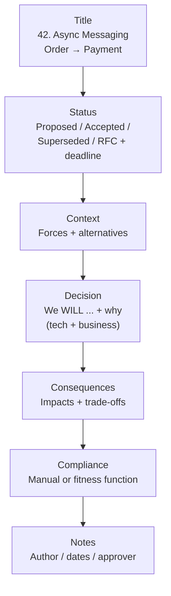
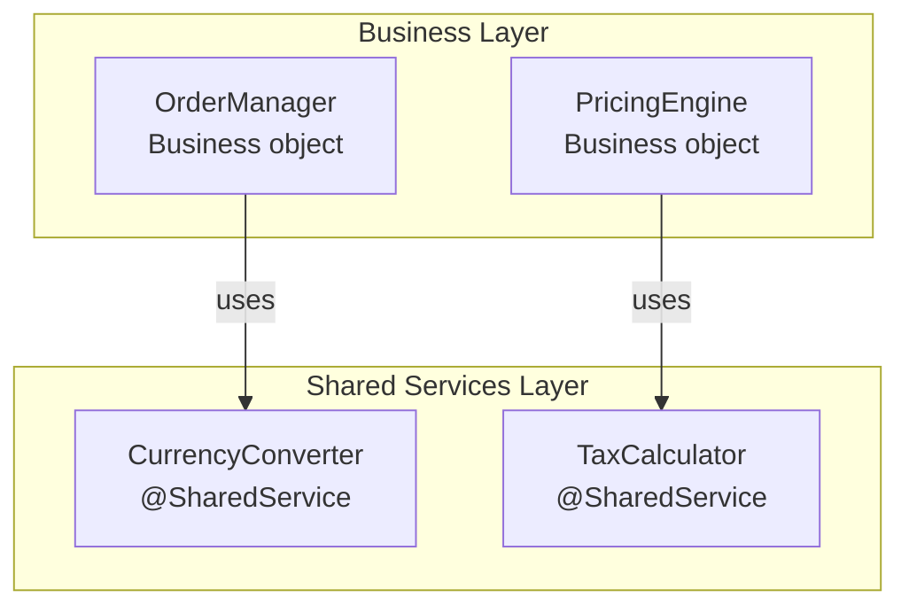
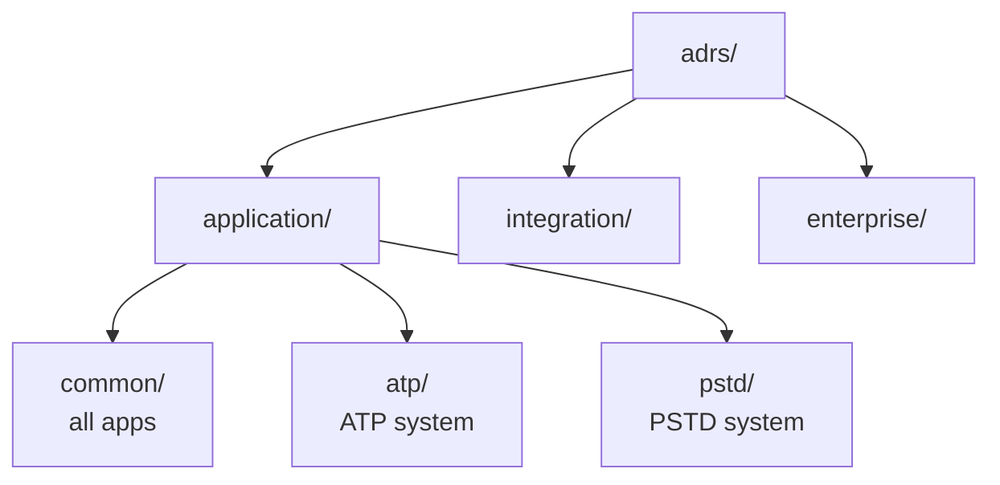
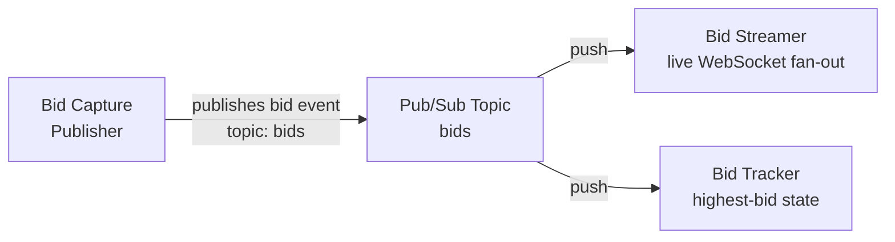
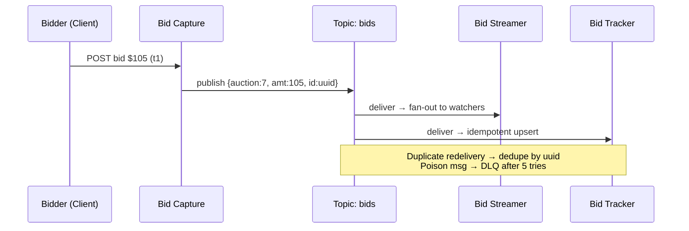

# Chapter 19: Architecture Decisions — Definitive Technical Summary
*From: Fundamentals of Software Architecture: An Engineering Approach by Mark Richards, Neal Ford*
*Source PDF: pp. 302–317 (402-page PDF) — figures below cite PDF pages.*

> [!NAV] **Chapter Navigation**
> ⬅️ **Previous:** [[chapter-18-choosing-architecture-style|Chapter 18: Choosing Architecture Style]] | 🏠 **Index:** [[00-Master-Reading-Dashboard|Master Dashboard]] | ➡️ **Next:** [[chapter-20-analyzing-architecture-risk|Chapter 20: Analyzing Architecture Risk]]

---

## 1. Executive Summary & Core Engineering Problem

- **Core Thesis:** Every architecture lives or dies on decisions — not diagrams. This chapter argues that architects must make decisions explicitly, justify them technically *and* commercially, communicate them through a single system of record, and preserve the *why* so future architects don't relive Groundhog Day. The vehicle is the Architecture Decision Record (ADR): a 1–2 page text file with Title, Status, Context, Decision, Consequences, plus Compliance and Notes.
- **The Core Problem Statement:** Naive teams make decisions in hallway chats and email threads. Six months later nobody remembers *why* gRPC beat messaging, or whether REST between Order and Payment was ever approved. Result: decisions re-litigated endlessly (Groundhog Day), avoided out of fear (Covering Your Assets), or lost in inboxes (Email-Driven Architecture). Concrete breakage: an architect picks replicated in-memory cache for product reference data to cut coupling; services with tight memory limits OOM in production because the decision was never validated with implementers.
- **What This Chapter Covers (PDF pp. 302–317):** Covering Your Assets anti-pattern (p.302) → Groundhog Day anti-pattern (p.302) → Email-Driven Architecture anti-pattern (p.303) → Architecturally Significant defined (p.304, Nygard) → Architecture Decision Records + tooling (p.305) → Basic Structure: Title/Status/Context/Decision/Consequences/Compliance/Notes (pp.306–311, Fig 19-1) → RFC status + approval thresholds (pp.307–308) → Storing ADRs: directory/wiki layout (pp.311–312, Fig 19-3) → ADRs as Documentation / for Standards (p.313) → Worked Example: Going, Going, Gone pub/sub ADR 76 (pp.314–315, Figs 19-4/19-5).
- **Historical & Industry Context:** Michael Nygard first evangelized ADRs in a blog post; ThoughtWorks Technology Radar marked them "adopt." Nat Pryce's `adr-tools` CLI added numbering/supersede management; Micha Kops documented practical workflows. The chapter positions ADRs against heavyweight templates (arc42, C4 documentation) and email/wiki sprawl: keep the template consistent *and* concise, version it, link supersessions.

---

## 2. In-Depth Technical Concepts & Internal Mechanics

### 2.1 Three Architecture-Decision Anti-Patterns

| Anti-Pattern | Symptom | Root Cause | Cure (Book Prescription) |
| :--- | :--- | :--- | :--- |
| **Covering Your Assets** (Asset-Covering / Decision Avoidance) | Architect defers every hard call; teams stall | Fear of being wrong | Decide at the **last responsible moment** (enough info to justify, not so late you block dev or hit Analysis Paralysis) + continuous collaboration with implementers so bad calls surface fast |
| **Groundhog Day** (Endless Re-litigation) | Same debate every sprint — "why not messaging?" | No recorded justification, or technical-only justification with no business value | Record *both* technical and business justification in the ADR Decision section; if no business value exists, reconsider the decision |
| **Email-Driven Architecture** (Lost Decisions) | Nobody knows a decision was made; multiple conflicting copies | Decision buried in email body; broadcast to everyone | Never put the decision in the email body — put context + link to single system of record; notify only directly-impacted stakeholders ("this directly impacts you") |

- **Concrete walkthrough — replicated cache:** Architect Alice decides: all product reference data (description, weight, dimensions) lives in a read-only replicated cache owned by Catalog Service, replicated to every consumer. *Why:* kills interservice calls, cuts coupling. Dev team Bob discovers some services can't fit the replica in heap under peak scale. Because Alice pairs weekly with teams (anti-Covering-Your-Assets), she catches it in days and amends the ADR — e.g., switch heavy consumers to request-based fetch — instead of discovering OOMs in prod.
- **Business justifications that count (p.303):** cost, time to market, user satisfaction, strategic positioning. Always frame to what *that* stakeholder cares about: cost-savings pitch fails on a stakeholder obsessed with time-to-market. Example: splitting a monolith → technical win (independent deploy, smaller VMs) is insufficient; add "ship features 30% faster, cut release cost $X/quarter."

### 2.2 Architecturally Significant — What Deserves an ADR?

Michael Nygard's test: a decision is **architecturally significant** if it affects **structure, nonfunctional characteristics, dependencies, interfaces, or construction techniques**. Technology choice *can* be architectural if it moves an "-ility."

| Dimension | Meaning | Example ADR |
| :--- | :--- | :--- |
| **Structure** | Patterns/styles, bounded-context boundaries | Share data between microservices vs. keep isolated |
| **Nonfunctional characteristics ("-ilities")** | Performance, scalability, availability, etc. | Choose gRPC over messaging to hit p99 < 50 ms |
| **Dependencies** | Coupling points between components/services | Forbid shared databases; each service owns its schema |
| **Interfaces** | Gateways, buses, contracts, versioning/deprecation policy | All external access via API gateway with semantic versioning |
| **Construction techniques** | Platforms, frameworks, tools, process choices with architectural impact | Standardize on Spring Boot 3 + Java 21 for all services |

> Intuition: if a future developer could innocently undo it during refactoring and break an "-ility," write it down.

### 2.3 ADR Basic Structure (Fig 19-1)

Seven sections (five canonical + two recommended). Keep the template identical everywhere; add Alternatives only if needed.

**1. Title.** Sequential number + short unambiguous phrase. Good: `42. Use of Asynchronous Messaging Between Order and Payment Services`. Bad: `Messaging decision`.
**2. Status: Proposed | Accepted | Superseded (+ RFC).**
- `Proposed` = needs higher approval (lead architect, review board).
- `Accepted` = approved, ready to implement.
- `Superseded by N` / `Accepted, supersedes M` = preserves history. Example: ADR 42 (async Order→Payment) `Superseded by 68`; ADR 68 (REST Order→Payment after Payment Service relocated) `Accepted, supersedes 42`. Nobody re-asks "what about messaging?" — the trail answers it.
- `Request for Comments, Deadline 09 JAN` = draft circulated for validation without falling into Analysis Paralysis. After deadline, architect dispositions comments → Proposed or Accepted.
- Forces the conversation: *when can I self-approve?* Starter thresholds: cost (license + hardware + effort-hours × FTE rate; e.g., > €5,000 needs board), cross-team impact, security implications. Document the thresholds.
**3. Context (Forces at play).** "What situation forces this decision?" Describe scenario + alternatives crisply; doubles as architecture documentation. Example: "Order Service must pass payment info to Payment Service; options are REST or async messaging."
**4. Decision (affirmative voice, why > how).** Nygard style: "We *will* use async messaging between services" — not "I think messaging might be best." Emphasize *why*: future readers can see *how* from diagrams; only the ADR tells them *why* gRPC was picked for latency despite coupling cost, preventing a well-meaning refactor to messaging that adds 3 s latency and upstream timeouts.
**5. Consequences (impact + trade-offs).** Every decision has good and bad impacts — write both. Classic: async fire-and-forget review posting cuts response from 3,100 ms → 25 ms, but error handling ("bad words in review?") gets complex; stakeholders explicitly accepted responsiveness over simplicity. Capture that bargain.
**6. Compliance (recommended addition).** How is adherence measured — manual review or automated **fitness function**? Name the test, its location, and cadence. Example (layered architecture, Fig 19-2): "All `@SharedService` classes reside in `..services..`" enforced by ArchUnit `classes().that().areAnnotatedWith(SharedService.class).should().resideInAPackage("..services..")`. Note prerequisites (new annotation + stories to apply it).
**7. Notes (recommended metadata).** Original author, approval date, approved-by, superseded date, last-modified date/by/what — even under Git, this beats `git log` for quick audits.

### 2.4 Storing ADRs — Single System of Record (Fig 19-3)

- One file (Markdown/AsciiDoc) or one wiki page per decision. Prefer wiki or shared browsable directory over per-repo Git for org-wide decisions: not everyone has repo access, and integration/enterprise decisions outlive any single codebase.
- Recommended tree: `application/common/` (all apps, e.g., framework-annotation rule), `application/<ATP|PSTD>/` (per-system), `integration/` (inter-service/system comms), `enterprise/` (global, e.g., "no cross-system database sharing"). Wiki mirrors this as landing pages.
- Email rule: body carries *nature + context + link only* ("important decision regarding service communication that directly impacts you — see <link>"), never the decision text. Prevents N systems of record and stale forwards when ADR 42 → 68.

### 2.5 ADRs as Documentation and as Standards

- **As documentation:** Context describes the subsystem; Decision records rationale (the best docs); Consequences records trade-offs (perf vs. scalability). No separate 80-page SAD needed to answer "why."
- **As standards:** Context states the forcing situation; Decision states the standard *and why it must exist* (if you can't justify it, kill it — developers follow justified standards); Consequences vets implications before enforcement.
- **Worked example — Going, Going, Gone (Figs 19-4/19-5):** Dozens of decisions (event-driven microservices, split bidder/auctioneer UIs, RTP video, single API layer, pub/sub). The book's ADR 76 covers async pub/sub between Bid Capture → Bid Streamer → Bid Tracker: Context (fan-out of bids under auction spikes), Decision (we will use pub/sub topic `bids`, at-least-once, idempotent consumers), Consequences (elastic scale-out, but ordering/duplicates and dead-letter handling required), Compliance (fitness function asserts no direct REST calls between the three services; chaos test kills a consumer and verifies drain).

---

## 3. Important Figures, Diagrams & Visual Architecture

| Figure | PDF Page | Description |
| :--- | :--- | :--- |
| Fig 19-1 | p.306 | Basic ADR structure (7 sections) |
| Fig 19-2 | p.310 | Layered-architecture decision example (shared services layer) |
| Fig 19-3 | p.312 | Recommended ADR directory / wiki navigation tree |
| Fig 19-4 | p.314 | Pub/sub between Bid Capture, Bid Streamer, Bid Tracker |
| Fig 19-5 | p.315 | Full ADR 76 example (async pub/sub for bidding) |

**Figure 19-1 → PDF p.306 — ADR skeleton.** Seven boxes in order; Status gates the lifecycle; Context→Decision→Consequences is the narrative spine; Compliance + Notes make it governable.



- **Original Book Figure:** Figure 19-1 → PDF p.306 — open the source PDF at page 306 to compare.
- **Takeaway:** Identical headings everywhere; history is first-class via Superseded links.

**Figure 19-2 → PDF p.310 — Governable layering decision.** Business objects in business layer may only use shared objects living in shared-services layer; ArchUnit/NetArchTest enforces it.



- **Original Book Figure:** Figure 19-2 → PDF p.310 — open the source PDF at page 310 to compare.
- **Takeaway:** If it can't be checked (by test or review), it isn't a decision — it's a wish.

**Figure 19-3 → PDF p.312 — Where ADRs live.** One tree, browsable by scope.



- **Original Book Figure:** Figure 19-3 → PDF p.312 — open the source PDF at page 312 to compare.
- **Takeaway:** Scope-based lookup beats repo-scattered files; wiki landing pages mirror the folders.

**Figure 19-4 → PDF p.314 — Auction pub/sub decision.** Bid Capture publishes; Bid Streamer (live fan-out) and Bid Tracker (state) subscribe independently.



- **Original Book Figure:** Figure 19-4 → PDF p.314 — open the source PDF at page 314 to compare.
- **Takeaway:** Decouples burst ingestion from heterogeneous consumers; ordering/idempotency move into the contract.

**Figure 19-5 → PDF p.315 — ADR 76 full text (reconstruction).** Title / Status: Accepted / Context: 10k bids/min spikes, REST fan-out collapses / Decision: we will use async pub/sub (at-least-once, idempotent, DLQ) + business justification (no lost bids = revenue + trust) / Consequences: +elasticity, −ordering/duplicates/ops cost / Compliance: fitness function + load test / Notes: author/date/approver.



- **Original Book Figure:** Figure 19-5 → PDF p.315 — open the source PDF at page 315 to compare.
- **Takeaway:** A complete ADR answers *what, why, so-what, and how-we'll-know* on one page.

---

## 4. Real-World Systems, Case Studies & Code Examples

- **Production systems named:** ThoughtWorks Technology Radar (ADR "adopt" ring), Nat Pryce `adr-tools` (numbering, `adr new/supersede`), ArchUnit (Java) / NetArchTest (C#) fitness functions, wiki/filesystem renderers, Going, Going, Gone auction (RTP video, single API layer, event-driven microservices).
- **Architectural divergence:** Per-repo Git ADRs (versioned with code, great for app-scoped calls) vs. wiki/shared-tree ADRs (accessible org-wide, right for integration/enterprise calls). Book recommends the latter as default for larger orgs.
- **Code — compliance fitness function (Java/ArchUnit, PDF p.311):**

```java
@Test
public void shared_services_should_reside_in_services_layer() {
    classes().that().areAnnotatedWith(SharedService.class)
        .should().resideInAPackage("..services..")
        .because("All shared services classes used by business "
               + "objects in the business layer should reside in the services "
               + "layer to isolate and contain shared logic")
        .check(myClasses);
}
// Companion stories: (1) create @SharedService annotation,
// (2) annotate existing shared classes, (3) run in CI on every build.
```

```csharp
// C# equivalent (NetArchTest) — same rule, same intent
var result = Types.InCurrentDomain()
    .That().HaveCustomAttribute(typeof(SharedServiceAttribute))
    .Should().ResideInNamespace("MyApp.Services")
    .GetResult();
Assert.True(result.IsSuccessful);
```

- **War stories:** (1) Replicated-cache OOM caught via dev collaboration, not prod outage. (2) gRPC→messaging refactor that spiked latency because the original latency rationale was never written. (3) Review-posting async trade explicitly accepted: 25 ms response worth complex moderation-error path. (4) ADR 42→68 supersession chain that ended "what about messaging?" debates permanently.

---

## 5. Architectural Trade-Off Matrix

| Approach | Decision Speed | Memory (Why Preserved) | Discoverability | Governance | Best Used When | Avoid When |
| :--- | :--- | :--- | :--- | :--- | :--- | :--- |
| **ADRs (recommended)** | Medium (write + approve) | High (Context+Decision+Supersede chain) | High (one tree, numbered, linked) | Strong (Compliance + fitness functions) | Any significant decision; regulated/long-lived systems | Trivial local choices (variable names) |
| **Email threads** | Fast | Near zero (lost, forked) | Low (inbox search) | None | FYI pings linking to the ADR | As system of record — never |
| **Hallway / meeting-only** | Fastest | Zero | Zero | None | Brainstorming before writing the ADR | As the decision itself |
| **Heavyweight SAD (50+ pp)** | Slow | Medium (stale fast) | Medium | Manual | Contractual deliverables | Agile teams needing living docs |
| **No decision (defer forever)** | Blocked | N/A | N/A | N/A | Genuinely awaiting last-responsible-moment data | Covering Your Assets — fear-driven delay |

**Heuristics:** Use RFC status with a hard deadline when you need broad validation; default to self-approve only under agreed cost/impact/security caps. If you can't state business value, don't make the decision. If you can't state how you'll check it, don't expect compliance.

---

## 6. Jargon Buster & Key Terminology

- **Architecture Decision Record (ADR) (One-page decision contract):** Numbered 1–2 page file capturing Title/Status/Context/Decision/Consequences (+Compliance/Notes). Pitfall: writing a novel — keep it concise or nobody reads it.
- **Covering Your Assets (Fear-driven deferral):** Avoiding decisions to dodge blame. Antidote: last responsible moment + dev collaboration.
- **Groundhog Day (Re-litigation loop):** Re-debating settled decisions for lack of recorded why. Antidote: full technical + business justification.
- **Email-Driven Architecture (Lost-decision syndrome):** Decisions scattered across inboxes. Antidote: link-only emails to a single record.
- **Last Responsible Moment (Latest safe decision point):** Wait for enough signal without blocking teams or sliding into Analysis Paralysis.
- **Analysis Paralysis (Over-deliberation stall):** Endless discussion, no decision. Antidote: RFC deadlines, then decide.
- **Architecturally Significant (Nygard's filter):** Affects structure, "-ilities," dependencies, interfaces, or construction techniques. If yes → ADR.
- **Status: Proposed / Accepted / Superseded / RFC (Decision lifecycle):** Who approved what, what replaced what, what's still open for comment. Never supersede a merely Proposed ADR — just revise it.
- **Compliance + Fitness Function (Automated decision watchdog):** Executable check (ArchUnit/NetArchTest, chaos test, metric alert) proving the decision holds. Pitfall: specifying a check with no owner/schedule.
- **Single System of Record (One truth for decisions):** Exactly one canonical location per ADR; everything else links to it.
- **Business Justification (Why the business pays):** Cost, time-to-market, satisfaction, strategic positioning framed in stakeholder terms. No business value → no decision.

---

## 7. System Design & Practical Engineering Takeaways

### 7.1 Production Engineering Checklist

1. **Template once, reuse everywhere:** Lock the 7 headings (Title/Status/Context/Decision/Consequences/Compliance/Notes) in Markdown + wiki template + `adr-tools` init; reject free-form decision docs in review.
2. **Agree approval caps this week:** Publish cost (e.g., > €5,000), cross-team, and security gates for self-approval; link the policy from every ADR Status section.
3. **Write why twice:** Every Decision states technical *and* business why; every Consequences states accepted downsides. Reviewer checklist: "could a new hire avoid reverting this from this page alone?"
4. **Attach a check to every ADR:** Either a fitness-function test ID + CI job or a named manual reviewer + date. No Compliance section → return to author.
5. **Link, don't paste:** Decision emails contain context sentence + "directly impacts you" filter + URL. Audit quarterly for pasted decisions and migrate them.

### 7.2 System Design Interview Blueprint

- **Open with anti-patterns:** "I'll avoid the three failure modes — fear-driven deferral, undocumented re-litigation, and email-scatter — by issuing numbered ADRs with supersede links."
- **Show lifecycle fluency:** Walk RFC → Proposed → Accepted → Superseded with the 42→68 messaging-to-REST story; explain when you'd self-approve vs. escalate (cost/blast-radius/security).
- **Demo governance:** Sketch the ArchUnit rule and CI placement; explain what breaks the build vs. what triggers a review.
- **Pitfalls:** Passive voice ("might be good if…"), tech-only justification, Git-only storage for enterprise rules, unbounded RFC periods.

### 7.3 Mastery Self-Assessment Questions

#### Question 1 (Conceptual Depth)
*Why does the book insist on both technical and business justification — isn't a solid technical case enough?*
- **Answer:** Technical merit doesn't pay bills or prioritize. Splitting a monolith for cleaner deploys is nice; "cut feature lead time 30% and release cost $X" is fundable and lets stakeholders weigh cost/risk. The business case is also a litmus test: no business value → likely no decision. It further filters messaging: pitch cost to cost-driven sponsors, speed to speed-driven ones.

#### Question 2 (Failure Scenario & Edge Cases)
*ADR 42 mandated async Order→Payment; Payment Service moved regions and now requires REST (ADR 68). How do you record this without triggering Groundhog Day?*
- **Answer:** Mark ADR 42 `Superseded by 68` and ADR 68 `Accepted, supersedes 42`, carrying forward the original context (why async once won) plus new forces (network/security constraints forcing REST) and fresh trade-offs (simplicity vs. coupling/latency). The bidirectional link + rationale preempts "why not messaging?" because the answer is on the page. Never edit 42 in place — history must survive.

#### Question 3 (Trade-Off & Governance)
*When should an ADR live in the service repo vs. the shared ADR tree, and how do you enforce each?*
- **Answer:** App-scoped rules (e.g., PSTD retry policy) can live with code for versioning proximity — enforce via repo CI fitness functions. Integration/enterprise rules (no shared DBs, gateway versioning) belong in the shared tree/wiki so all teams and non-Git readers see them — enforce via centralized pipeline checks + periodic audits. Decide by blast radius, not author convenience; cross-repo impact always goes shared.

---

> [!NAV] **Chapter Navigation**
> ⬅️ **Previous:** [[chapter-18-choosing-architecture-style|Chapter 18: Choosing Architecture Style]] | 🏠 **Index:** [[00-Master-Reading-Dashboard|Master Dashboard]] | ➡️ **Next:** [[chapter-20-analyzing-architecture-risk|Chapter 20: Analyzing Architecture Risk]]
