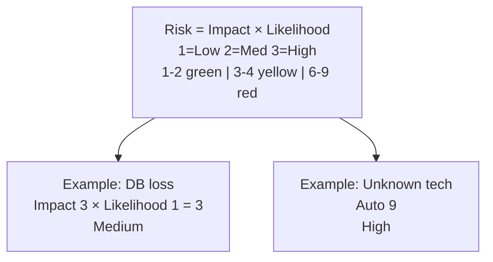
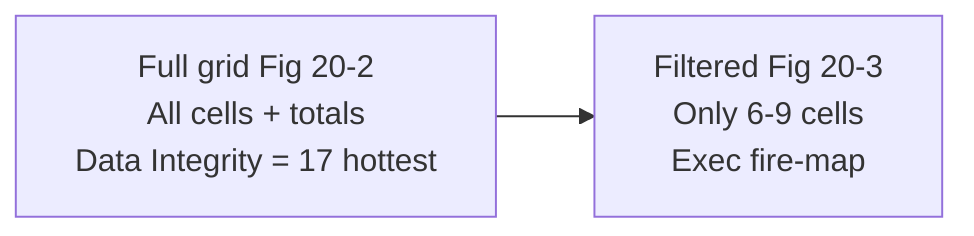
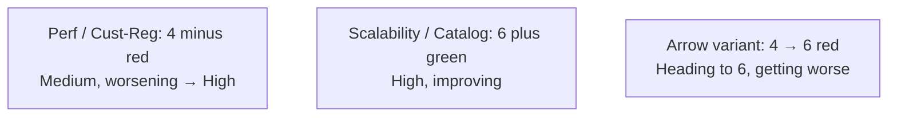
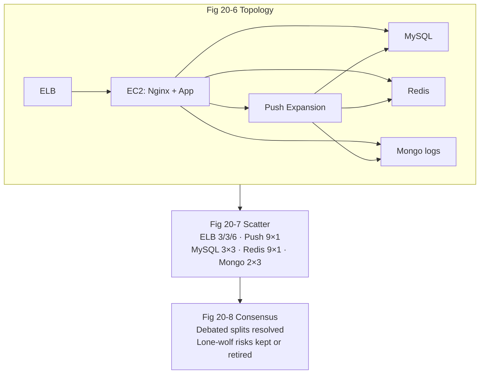
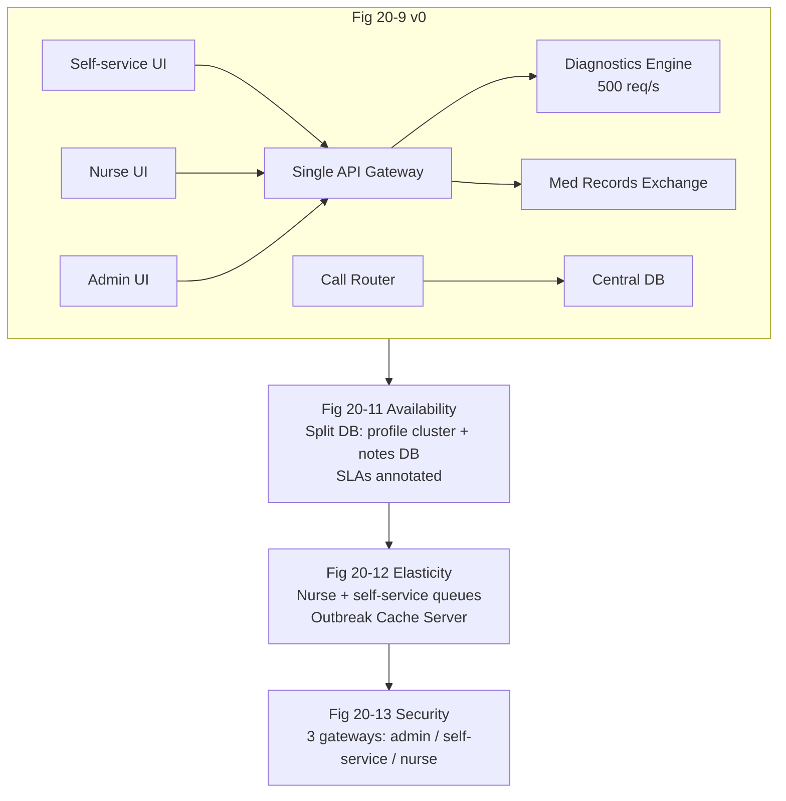

# Chapter 20: Analyzing Architecture Risk — Definitive Technical Summary
*From: Fundamentals of Software Architecture: An Engineering Approach by Mark Richards, Neal Ford*
*Source PDF: pp. 318–335 (402-page PDF) — figures below cite PDF pages.*

> [!NAV] **Chapter Navigation**
> ⬅️ **Previous:** [[chapter-19-architecture-decisions|Chapter 19: Architecture Decisions]] | 🏠 **Index:** [[00-Master-Reading-Dashboard|Master Dashboard]] | ➡️ **Next:** [[chapter-21-diagramming-and-presenting|Chapter 21: Diagramming and Presenting]]

---

## 1. Executive Summary & Core Engineering Problem

- **Core Thesis:** Every architecture carries risk (availability, scalability, data integrity, security) whether acknowledged or not. This chapter gives architects an objective toolkit: a 3×3 **risk matrix** (impact × likelihood → 1–9 score), color-coded **risk assessments** with filtering and direction, and a collaborative **risk-storming** ritual (identify alone → gain consensus together → mitigate together) plus continuous fitness-function tracking.
- **The Core Problem Statement:** Naive risk talk is pure subjectivity — everything is "high risk" when its owner speaks. Without quantification, teams gold-plate trivia while single points of failure hide. Concrete breakage: a central MySQL behind an ELB+Nginx+Redis+Mongo topology looks "fine" until risk storming reveals the diagnostics engine caps at 500 req/s and flu-season self-service traffic will time out thousands of nurses and patients.
- **What This Chapter Covers (PDF pp. 318–335):** Risk matrix mechanics (p.318, Fig 20-1) → Risk assessments, accumulation, filtering to high-only (pp.319–320, Figs 20-2/20-3) → Direction of risk: +/- vs. arrow+number (pp.320–321, Figs 20-4/20-5) → Risk storming: why solo assessment fails, individual + collaborative phases, architecture-diagram prerequisite (pp.322–323, Fig 20-6) → Identification / Consensus / Mitigation activities with Post-it protocol (pp.323–328, Figs 20-7/20-8) → Agile story-risk reuse (p.328) → Full use case: nurse-diagnostics call-center system across availability, elasticity, security (pp.329–334, Figs 20-9–20-13).
- **Historical & Industry Context:** Draws on operational risk matrices (safety engineering), Agile story grooming, and fitness functions (Ch.6) for trend data. Prefigures modern resilience reviews and chaos engineering: make risk visible, then pay to mitigate only where cost < expected loss — negotiated explicitly with business owners.

---

## 2. In-Depth Technical Concepts & Internal Mechanics

### 2.1 Risk Matrix — Impact First, Likelihood Second (Fig 20-1)

Score each area as **Impact (1=low, 2=medium, 3=high) × Likelihood (1/2/3) = 1–9**. Assess **impact first**, likelihood second.

| Score | Band | Color/Shade | Meaning |
| :--- | :--- | :--- | :--- |
| 1–2 | Low | Green / light gray | Accept; watch |
| 3–4 | Medium | Yellow / medium gray | Plan mitigation; prioritize by trend |
| 6–9 | High | Red / dark gray | Act now or explicitly accept with stakeholders |

- **Worked example — central database availability:** Impact of loss = high (3) — whole app halts. Likelihood = low (1) — clustered HA servers. 3×1 = **3 (medium)**. Same impact on an unclustered single instance (likelihood 2–3) → 6–9 (high).
- **Rule for unknown/unproven tech:** Skip the matrix — assign **9 (max)**. "What is a Redis cache?" from a participant *is* the signal: ignorance is top risk and a coaching cue.
- **Alice/Bob example:** Alice rates ELB failure impact 3 ("everything unreachable!") × likelihood 1 (multi-AZ ELB rarely dies) = 3. Bob independently rates Push Expansion Servers 9 from scar tissue (they died under load last release) — a risk nobody else saw. Both surface only because scoring is done alone first.

### 2.2 Risk Assessments — Accumulate, Filter, Show Direction (Figs 20-2–20-5)

- **Assessment grid:** Rows = services/domain areas (Customer Registration, Catalog Checkout, Order Fulfillment…), columns = risk criteria (availability, performance, scalability, data integrity, security…), cells = 1–9 scores. Sum across rows *and* columns: in the book's example, Data Integrity totals 17 (highest criterion) vs. Availability 10 (lowest); Customer Registration is the hottest domain vs. Order Fulfillment coolest. Track deltas sprint-over-sprint to prove improvement or decay.
- **Filtering for signal (Fig 20-3):** Never present the full grid when the question is "where's the fire?" Filter to high-only (6–9) cells. Cuts noise, forces funding conversations.
- **Direction problem:** Up/down or left/right arrows confuse (~50/50 misread even *with* a legend, and legends scroll away). Book's two tested solutions:
  1. **Plus/minus beside the score (Fig 20-4):** `4−` (red) = medium but worsening toward high; `6+` (green) = high but improving. Bare number = stable. Universal, legend-free.
  2. **Arrow + target number (Fig 20-5):** arrow points to where risk is heading, labeled with the destination score, colored red (worsening) / green (improving). Even clearer for execs.
- **Where direction comes from:** Continuous fitness-function measurements (latency, error budget burn, replication lag) trended over time — not gut feel.

### 2.3 Risk Storming — The Three Activities (Figs 20-6–20-8)

> No single architect can assess whole-system risk — they lack full knowledge and miss blind spots. Include senior devs/tech leads: they add implementation truth and learn the architecture.

**Prerequisites:** Current architecture diagram (holistic for full assessments; contextual for focused ones), one dimension per session if possible (performance *or* scalability *or* data loss — multi-dimension sessions force participants to tag each Post-it with its dimension and get confusing), invite 1–2 days ahead with diagram + dimension + time/place.

| Phase | Mode | Mechanics |
| :--- | :--- | :--- |
| **1. Identification (solo, non-collaborative)** | Alone | Each person scores areas with the matrix, writes risk number on green/yellow/red Post-it. No discussion — prevents anchoring/halo effects. |
| **2. Consensus (together)** | Workshop around large printout or shared screen | Stick notes on the diagram where risk was found (Fig 20-7). Unanimous areas (e.g., MySQL=3×3, Mongo logging=2×3) stand. Split areas get debated: ELB 3/3/6 → discuss impact-vs-likelihood until agreement (book: high-rater concedes to 3 after HA evidence); lone-wolf 9s get heard (Push Servers' outage history vindicated; Redis-9-from-ignorance becomes a training action). Output: consolidated map (Fig 20-8). |
| **3. Mitigation (together)** | Collaborative design + stakeholder costing | Propose fixes (queue for back-pressure, split/cluster DB, cache, separate gateways). Cost every fix; let business owners decide cost vs. risk. Example: full DB clustering + split = $20k (rejected) → split-only = $8k (accepted, most risk removed). Re-meet after major features or each iteration — risk storming is continuous. |

- **Agile reuse:** Same matrix scores *story* risk: impact if the story misses the iteration × likelihood it will miss. High-risk stories get swarmed and tracked daily during grooming.

### 2.4 Full Use Case — Nurse-Diagnostics Call Center (Figs 20-9–20-13)

**Starting architecture (Fig 20-9):** Three web UIs (self-service, nurse call-handling, admin profiles); call accepter + profile-aware call router (reads central DB); Diagnostics System API gateway (auth + routing) → Case Management, Nurse Profile, Medical Records Exchange interface, third-party Diagnostics Engine (500 req/s cap). All REST except proprietary call-center/external links. Requirements: 250 concurrent nurses + hundreds of thousands of self-service patients; HIPAA (only nurses touch records); outbreak/flu spikes; profile-based routing.

**Round 1 — Availability (Figs 20-10/20-11):** Central DB = 6 (high impact 3 × medium likelihood 2 — router dies without it; nurses can hand-write case notes but routing halts). Diagnostics engine = 9 (unknown likelihood → auto-9). Med-records exchange = 2 (non-blocking). *Fixes:* split one DB into clustered nurse-profile DB + standalone case-notes DB (also blocks admin access to notes); publish vendor SLAs on the diagram (engine 99.99% = 52.6 min/yr; exchange 99.9% = 8.77 hr/yr) to retire those risks explicitly.

**Round 2 — Elasticity (Fig 20-12):** Self-service fan-in overwhelms 500 req/s REST engine → unanimous 9. *Fixes:* async queues (two channels — nurse priority via Ambulance Pattern + self-service) for back-pressure *plus* Diagnostics Outbreak Cache Server for flu/outbreak question sets so repeat queries never hit the engine. Capacity jumps to tens of thousands concurrent; without storming this surfaces during the first outbreak.

**Round 3 — Security (Fig 20-13):** Single shared API gateway = 6 (high impact 3 × medium likelihood 2 — admin/self-service paths could reach the records interface despite per-call checks). Architect initially said 2, conceded in consensus. *Fix:* three gateways (admin / self-service-diagnostics / nurse) so non-nurse traffic can never route to the records interface. Compare Fig 20-9 vs. 20-13: two DBs, queues, outbreak cache, triple gateways, SLA annotations — the visible dividend of storming.

---

## 3. Important Figures, Diagrams & Visual Architecture

| Figure | PDF Page | Description |
| :--- | :--- | :--- |
| Fig 20-1 | p.318 | 3×3 risk matrix (impact × likelihood → 1–9, green/yellow/red) |
| Fig 20-2 | p.319 | Standard risk assessment grid with row/column totals |
| Fig 20-3 | p.320 | Same grid filtered to high-risk (6–9) only |
| Fig 20-4 | p.320 | Direction via +/- signs beside scores |
| Fig 20-5 | p.321 | Direction via arrows + destination numbers |
| Fig 20-6 | p.323 | Reference topology for storming (ELB→EC2/Nginx→MySQL/Redis/Mongo/Push) |
| Fig 20-7 | p.325 | Initial Post-it scatter (split opinions visible) |
| Fig 20-8 | p.327 | Consolidated consensus map |
| Fig 20-9 | p.329 | Nurse-diagnostics starting architecture |
| Fig 20-10 | p.330 | Availability risks marked |
| Fig 20-11 | p.331 | Availability fixes (split DBs + SLAs) |
| Fig 20-12 | p.333 | Elasticity fixes (queues + outbreak cache) |
| Fig 20-13 | p.334 | Final architecture (separate gateways for security) |

**Figure 20-1 → PDF p.318 — The matrix.** Columns = likelihood, rows = impact; cell = product; shading bands 1–2 / 3–4 / 6–9.



- **Original Book Figure:** Figure 20-1 → PDF p.318 — open the source PDF at page 318 to compare.
- **Takeaway:** Impact first, likelihood second; unknowns max out.

**Figures 20-2/20-3 → PDF pp.319–320 — Assess then filter.**



- **Original Book Figures:** Figures 20-2/20-3 → PDF pp.319–320 — open the source PDF at pages 319–320 to compare.
- **Takeaway:** Totals guide investment; filtered views drive decisions.

**Figures 20-4/20-5 → PDF pp.320–321 — Direction without confusion.**



- **Original Book Figures:** Figures 20-4/20-5 → PDF pp.320–321 — open the source PDF at pages 320–321 to compare.
- **Takeaway:** Never use bare up/down arrows; pair direction with destination.

**Figures 20-6–20-8 → PDF pp.323–327 — Storming lifecycle.**



- **Original Book Figures:** Figures 20-6–20-8 → PDF pp.323–327 — open the source PDF at pages 323–327 to compare.
- **Takeaway:** Solo scoring finds risks; joint debate qualifies them.

**Figures 20-9–20-13 → PDF pp.329–334 — Nurse system evolution.**



- **Original Book Figures:** Figures 20-9–20-13 → PDF pp.329–334 — open the source PDF at pages 329–334 to compare.
- **Takeaway:** Three focused storming rounds visibly transform the topology.

---

## 4. Real-World Systems, Case Studies & Code Examples

- **Production systems named:** AWS ELB + EC2 + Nginx, MySQL (clustered), Redis, MongoDB logging, Push Expansion Servers, third-party diagnostics engine + medical-records exchange with contractual SLAs/SLOs, REST vs. async queue back-pressure, Ambulance Pattern (priority lanes), outbreak-question cache.
- **SLA vs. SLO (book distinction):** SLA = contractual, legally binding; SLO = target, usually not. Architect retires external-availability risk by *publishing the SLA numbers on the diagram* (99.99% → 52.6 min/yr; 99.9% → 8.77 hr/yr) so relative risk is explicit.
- **Code — risk register + direction tracker (pseudocode for the book's grids):**

```python
# Risk assessment with accumulation, filtering, and direction
risks = [
    ("customer-registration", "performance", 4, "-"),  # worsening
    ("catalog-checkout",      "scalability", 6, "+"),  # improving
    ("order-fulfillment",     "availability",2, ""),   # stable
]
def band(s): return "low" if s <= 2 else "medium" if s <= 4 else "high"
totals, hot = {}, [r for r in risks if r[2] >= 6]
for svc, crit, score, trend in risks:
    totals[crit] = totals.get(crit, 0) + score
print("Totals:", totals)   # Data Integrity hottest in book example
print("Fire-map (high only):", hot)  # Fig 20-3 filtering
```

```python
# Fitness-function trend → direction sign (no gut feel)
# e.g., p99 latency slope over 14 days decides +/- for performance cells
def direction(series):
    slope = (series[-1] - series[0]) / len(series)
    return "+" if slope < 0 else "-" if slope > 0 else ""  # latency down = improving
```

- **War stories:** (1) Lone Push-Server 9 from outage scar tissue — missed by everyone else until consensus. (2) Redis 9 from "what is Redis?" — ignorance mapped to training, plus the case for devs in the room. (3) $20k full-fix rejected → $8k split-DB accepted — storming as negotiation instrument. (4) Flu-season meltdown avoided by pre-building the outbreak cache.

---

## 5. Architectural Trade-Off Matrix

| Approach | Objectivity | Coverage (Blind Spots) | Cost to Run | Signal for Execs | Best Used When | Avoid When |
| :--- | :--- | :--- | :--- | :--- | :--- | :--- |
| **Risk matrix + assessment (recommended)** | High (1–9, impact-first) | Medium alone | Low (spreadsheet + fitness trends) | Strong (bands + totals + filtered fire-map) | Continuous tracking; funding debates | As solo-architect exercise — pair with storming |
| **Risk storming (identify→consensus→mitigate)** | Medium-high (consensus-qualified) | High (diverse eyes) | Medium (workshop time) | Strong (annotated diagrams) | Pre-build, post-feature, per-iteration on hot dimensions | Multi-dimension mega-sessions; stale diagrams |
| **Gut-feel "everything is high"** | Low | Low (loudest wins) | Low | Weak (no prioritization) | Never as method | Default — replace immediately |
| **Full mitigation regardless of cost** | N/A (gold-plating) | N/A | Very high ($20k clustering everywhere) | Misleading (safe but broke) | Regulated life-critical paths | Cost outweighs expected loss — negotiate |
| **Ignore / defer risk** | Zero | Zero | Zero now, catastrophic later | None | Explicitly accepted low risks | High/unknown risks — assign 9 and act |

**Heuristics:** One dimension per storming session; unknowns = 9; filter to high-only for execs; show direction with +/− or arrow+number (never bare arrows); re-storm after major features; let stakeholders explicitly price-accept residual risk.

---

## 6. Jargon Buster & Key Terminology

- **Risk Matrix (Impact × Likelihood scorer):** 3×3 grid → 1–9. 1–2 low, 3–4 medium, 6–9 high. Pitfall: scoring likelihood before impact — always impact first.
- **Risk Assessment (Scored architecture map):** Grid of domains × criteria with cell scores and row/column totals. Pitfall: presenting unfiltered — filter to the question asked.
- **Filtering (Noise cutter):** Show only the band relevant to the meeting (e.g., high-only). Boosts signal-to-noise.
- **Direction of Risk (Trend indicator):** `+`/`−` or arrow+destination showing improving/worsening. Pitfall: bare arrows — half the room reads them backwards.
- **Risk Storming (Collaborative risk workshop):** Solo identification → joint consensus → joint mitigation over a live diagram. Pitfall: collaborating too early (anchoring) or storming without a current diagram.
- **Identification / Consensus / Mitigation (Storming phases):** Find alone; agree together; fix together with priced options.
- **Unproven-Tech Rule (Ignorance = 9):** Unknowns bypass the matrix at maximum risk. Includes team ignorance, not just tech novelty.
- **Ambulance Pattern (Priority lane):** Separate channels so critical traffic (nurses) jumps the queue over bulk traffic (self-service).
- **Back-Pressure Queue (Overload shock absorber):** Async buffer before a capped dependency (500 req/s engine) so bursts queue instead of time out.
- **SLA vs. SLO (Promise strength):** SLA = binding contract; SLO = aspirational target. Publish the numbers on the diagram.
- **Story Risk (Agile reuse):** Impact-if-missed × likelihood-of-missing for iteration planning. High-risk stories get swarmed.

---

## 7. System Design & Practical Engineering Takeaways

### 7.1 Production Engineering Checklist

1. **Score impact first, cap unknowns at 9:** Enforce the order in every review template; auto-flag any "new to team" tech as 9 with a training action.
2. **Keep one live assessment:** Domains × criteria with totals, filtered high-only view for leadership, +/- direction fed by fitness-function trends — reviewed per iteration.
3. **Storm single-dimension with fresh diagrams:** Invite 1–2 days ahead; solo Post-its first, debate splits second, price mitigations third; record consensus map as ADR-adjacent artifact.
4. **Price every mitigation:** Present $20k-vs-$8k style options; get explicit stakeholder sign-off on residual risk rather than silent acceptance.
5. **Design the three canonical fixes early:** Split/cluster single DBs on the router path, queue + cache in front of capped third parties, and segregate gateways where regulated data flows — before flu season, not during it.

### 7.2 System Design Interview Blueprint

- **Open with the matrix:** "I'd score availability impact-3/likelihood-1 = 3 for the clustered DB, but auto-9 the unknown engine dependency, then accumulate by domain to find the hottest area."
- **Show the ritual:** Solo scoring → Post-it scatter → consensus debate (ELB split, lone-wolf Push 9, Redis-ignorance 9) → priced mitigation. Emphasize *why solo first* (anchoring defense).
- **Demo trend literacy:** Explain +/− vs. arrow+number choice and that direction comes from fitness-function slopes, not opinion.
- **Pitfalls:** Calling everything high, multi-dimension mega-workshops, stale diagrams, bare-arrow direction, mitigating without costing.

### 7.3 Mastery Self-Assessment Questions

#### Question 1 (Conceptual Depth)
*Why must identification be solo while consensus and mitigation are collaborative?*
- **Answer:** Solo scoring prevents anchoring — seniors or loud voices would otherwise drag everyone to their number and hide blind spots (the Push-Server outage only one person knew, the Redis gap nobody admitted). Collaboration *after* scatter is where value compounds: splits get interrogated (ELB 6→3 after HA evidence), lone-wolf 9s get vindicated or retired, and mitigations gain diverse feasibility checks plus priced trade-offs stakeholders trust.

#### Question 2 (Failure Scenario & Edge Cases)
*Self-service flu traffic will swamp a 500 req/s diagnostics engine over REST. Queues alone still time out nurses. What's the full mitigation and why each piece?*
- **Answer:** (1) Two async queues (nurse-priority Ambulance lane + self-service lane) absorb bursts — back-pressure instead of dropped calls. (2) Queues alone just delay timeouts, so add an Outbreak Cache Server for known flu/outbreak question sets — repeat queries never reach the engine. (3) Result: engine load collapses to novel cases only, capacity rises to tens of thousands concurrent, nurses keep priority. Each piece maps to a distinct failure: burst → queue, repeat-load → cache, priority inversion → separate lanes.

#### Question 3 (Trade-Off & Governance)
*The full DB fix costs $20k; the stakeholder balks. How do you proceed without abandoning risk?*
- **Answer:** Treat cost-vs-risk as negotiation, not surrender: propose the $8k split-only variant (profile cluster + notes DB, skip full clustering) that removes most availability risk plus a security bonus (admins lose notes access), quantify residual risk (explicit medium score + trend), and record the accepted trade in the assessment with direction tracking. Revisit if trends worsen — storming is continuous, and today's accepted risk is next quarter's funded fix.

---

> [!NAV] **Chapter Navigation**
> ⬅️ **Previous:** [[chapter-19-architecture-decisions|Chapter 19: Architecture Decisions]] | 🏠 **Index:** [[00-Master-Reading-Dashboard|Master Dashboard]] | ➡️ **Next:** [[chapter-21-diagramming-and-presenting|Chapter 21: Diagramming and Presenting]]
