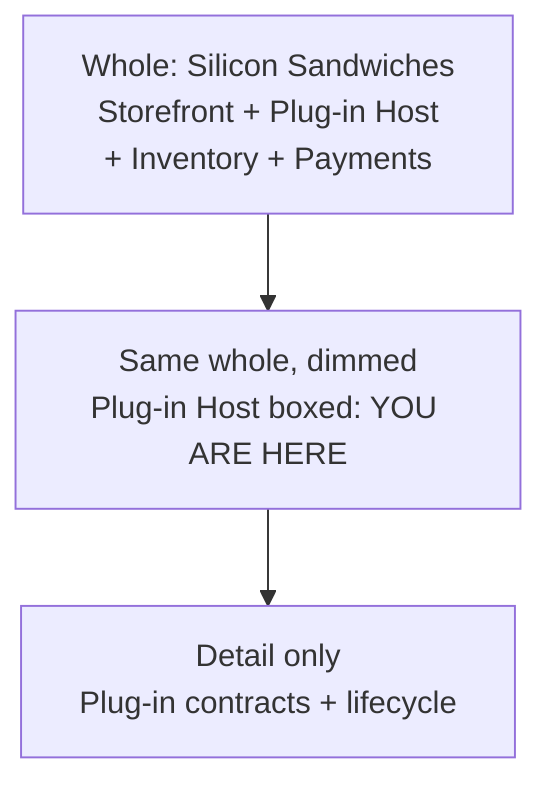
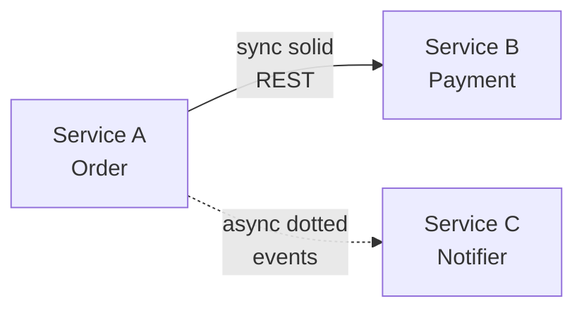
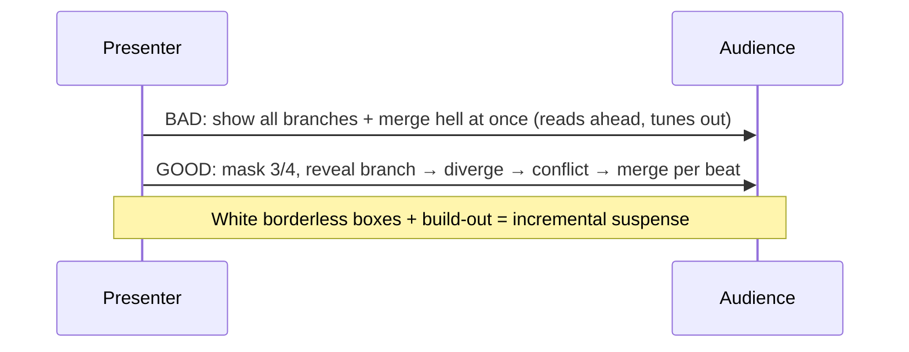

# Chapter 21: Diagramming and Presenting Architecture — Definitive Technical Summary
*From: Fundamentals of Software Architecture: An Engineering Approach by Mark Richards, Neal Ford*
*Source PDF: pp. 335–345 (402-page PDF) — figures below cite PDF pages.*

> [!NAV] **Chapter Navigation**
> ⬅️ **Previous:** [[chapter-20-analyzing-architecture-risk|Chapter 20: Analyzing Architecture Risk]] | 🏠 **Index:** [[00-Master-Reading-Dashboard|Master Dashboard]] | ➡️ **Next:** [[chapter-22-making-teams-effective|Chapter 22: Making Teams Effective]]

---

## 1. Executive Summary & Core Engineering Problem

- **Core Thesis:** Brilliant architecture that can't be drawn clearly or pitched convincingly never ships. This chapter treats **diagramming** (shared structural truth for builders) and **presenting** (time-controlled persuasion for funders) as core architect skills, unified by **representational consistency** — always show where a detail lives in the whole before zooming in.
- **The Core Problem Statement:** Naive architects show a zoomed plug-in diagram with no "you are here" context, or project 40 bullet-filled slides and read them aloud (the Bullet-Riddled Corpse). Viewers get lost, then bored, then unconvinced. Concrete breakage: a microservices coordination diagram uses identical icons for *two different services*, so reviewers approve a design thinking it's intra-service retry when it's actually cross-service choreography with network failure modes.
- **What This Chapter Covers (PDF pp. 335–345):** Why communication decides success (p.335) + representational consistency, Silicon Sandwiches plug-in example (pp.335–336, Fig 21-1) → Diagramming: low-fidelity first, Irrational Artifact Attachment, tablet-over-whiteboard, tool features — layers/stencils/magnets (pp.336–338) → Standards: UML, C4 (Context/Container/Component/Class), ArchiMate (pp.338–339) → Diagram guidelines: titles/lines/shapes/labels/color/keys, sync=solid vs. async=dotted, microservices color example (pp.339–341, Fig 21-2) → Presenting: time control via transitions/animations, Cookie-Cutter, dissolve vs. door/cube (p.341) → Incremental builds, feature-branching bad-vs-good slides (pp.342–343, Figs 21-3/21-4) → Infodecks vs. presentations, half-the-story rule, invisibility/black-slide focus trick (pp.344–345).
- **Historical & Industry Context:** UML (1980s unification of three methods — only class + sequence diagrams survived in practice), Simon Brown's C4 (modernized views, monolith-friendly), The Open Group's ArchiMate (minimal enterprise modeling). Neal Ford's *Presentation Patterns* supplies the talk-side vocabulary (Cookie-Cutter, Bullet-Riddled Corpse). Agile's low-ceremony artifacts (index cards, stickies) motivate the fidelity argument.

---

## 2. In-Depth Technical Concepts & Internal Mechanics

### 2.1 Representational Consistency — Never Zoom Without Context

- **Rule:** Before showing any detail view, show the whole and highlight the detail's location. Applies identically to diagrams and slide decks.
- **Silicon Sandwiches walkthrough:** Slide 1 = full topology (storefront, plug-in host, inventory, payments). Slide 2 = same topology dimmed with plug-in subsystem boxed in red ("you are here"). Slide 3 = plug-in internals only. Without slide 2, half the room thinks plug-ins *are* the system.
- **Failure mode:** Context-free detail diagrams cause mis-scoped reviews — ops plans capacity for a subsystem as if it were the whole, security models the wrong trust boundary.

### 2.2 Diagramming Craft — Fidelity, Tools, Standards

**Low fidelity first (Irrational Artifact Attachment):** Attachment ∝ time invested. A 4-hour Visio diagram is defended harder than a 2-hour one, even when wrong. Start on whiteboard / tablet-projector (infinite canvas, copy/paste what-if branches, glare-free capture, easy discard), add "Do Not Erase!" only as a joke. Move to OmniGraffle/Visio/draw.io only after iteration converges.

**Baseline tool features to master:**

| Feature | What It Does | Architect Use |
| :--- | :--- | :--- |
| **Layers** | Named visibility groups | One master diagram; hide data-plane vs. control-plane per audience; reuse layers as staged presentation builds |
| **Stencils / templates** | Reusable composite symbols | Org-standard microservice, queue, gateway icons → consistent language + fast authoring |
| **Magnets / connection points** | Snap targets on shapes | Clean auto-routing; custom magnets for multi-port components (e.g., 3-in/2-out broker) |
| Export | SVG/PDF/PNG + source | Version the source; publish vector for zoomable docs |

**Standards compared:**

| Standard | Views / Vocabulary | Strengths | Limits | When to Use |
| :--- | :--- | :--- | :--- | :--- |
| **UML** | Class + sequence (+ mostly-dead others) | Precise structure + interaction semantics engineers know | Committee-bloated; weak at system topology | Class/sequence details inside a service |
| **C4** | Context → Container → Component → Class | Progressive disclosure from users/external systems down to code; ops+architect meeting point at Container | Container/Component split strains under fine-grained distributed (microservices) topologies | Standardizing monolith/modular-monolith docs org-wide |
| **ArchiMate** | Minimal business/application/technology layers | "As small as possible" enterprise modeling; Open Group standard | Not exhaustive for every distributed pattern | Cross-domain enterprise landscapes |

> Book advice: borrow freely — build *your* consistent visual dialect; formal compliance matters less than unambiguous reading.

**Diagram guidelines (checklist):**

1. **Titles** on everything (rotate/stick to shapes to save space).
2. **Lines** thick enough to project; arrowheads for directionality; **solid = synchronous, dotted = asynchronous** (one of few near-standards — honor it).
3. **Shapes:** 3-D boxes = deployables, rectangles = containership (authors' dialect — declare yours).
4. **Labels** on every item where ambiguity is possible.
5. **Color** sparingly but purposefully — e.g., two *different* microservices in distinct hues so coordination isn't misread as intra-service calls (Fig 21-2).
6. **Key/legend** whenever shape/color carries meaning. An unkeyed diagram misleads worse than no diagram.

### 2.3 Presenting — Manipulating Time, Building Incrementally

- **Core distinction:** In a *document* the reader controls pace; in a *presentation* you do — via **transitions** (slide→slide) and **animations** (build-in / build-out / motion within a slide, one transition per slide, many animations).
- **Hiding slide boundaries (Cookie-Cutter antidote):** Ideas don't come in slide-sized chunks — don't pad or split artificially. Stitch multi-slide thoughts with subtle dissolves so N slides read as one story; reserve a jarring transition (door, cube) to signal *topic change*.
- **Incremental builds (Bullet-Riddled Corpse antidote):** Two channels — verbal + visual. Dumping all text at once overloads visual, starves verbal (audience reads ahead, then endures re-reading). Instead, reveal graphically step-by-step:
  - *Bad (Fig 21-3):* Full feature-branching decay graph shown instantly — punchline ("long-lived branches → merge hell") visible before the setup, suspense dead.
  - *Good (Fig 21-4):* Same graphic masked by borderless white boxes; each click builds-out one mask, exposing one phase (branch → diverge → conflict → painful merge) in sync with narration. Suspense + retention survive; layers from §2.2 generate these builds for free.
- **Infodecks vs. presentations:** Infodeck = standalone magazine meant to be *read* (emailed, complete, no time effects). Presentation = *half the story* (slides deliberately incomplete; speaker is the other half). If slides stand alone, cancel the meeting and email them.
- **Invisibility (focus lever):** Insert a blank black slide to kill the visual channel — the room snaps back to you. Use before the ask ("we need $X for the split") or the critical warning. One blank slide beats ten bold bullets.

---

## 3. Important Figures, Diagrams & Visual Architecture

| Figure | PDF Page | Description |
| :--- | :--- | :--- |
| Fig 21-1 | p.336 | Representational consistency: whole → highlighted subset → detail |
| Fig 21-2 | p.340 | Microservices coordination in distinct colors (different services, not replicas) |
| Fig 21-3 | p.342 | Bad slide: full feature-branching anti-pattern revealed at once |
| Fig 21-4 | p.343 | Good slide: same content built incrementally with masks |

**Figure 21-1 → PDF p.336 — Context before detail.**



- **Original Book Figure:** Figure 21-1 → PDF p.336 — open the source PDF at page 336 to compare.
- **Takeaway:** The middle frame is the cheapest confusion-killer in architecture.

**Figure 21-2 → PDF p.340 — Color disambiguates identity.**



- **Original Book Figure:** Figure 21-2 → PDF p.340 — open the source PDF at page 340 to compare.
- **Takeaway:** Distinct hues + solid/dotted convention prevent "same service twice" misreads; always add a key.

**Figures 21-3/21-4 → PDF pp.342–343 — Suspense via masking.**



- **Original Book Figures:** Figures 21-3/21-4 → PDF pp.342–343 — open the source PDF at pages 342–343 to compare.
- **Takeaway:** Reveal at narration speed; one idea may span many visually-stitched slides.

---

## 4. Real-World Systems, Case Studies & Code Examples

- **Production systems named:** OmniGraffle (book's diagrams), Visio, tablet+projector rigs, PowerPoint/Keynote (transitions: dissolve/door/cube; animations: build-in/build-out/motion), whiteboard+phone photo workflow, *Presentation Patterns* (Ford) pattern catalog.
- **Architectural divergence:** C4 Container view (ops-friendly deploy boundaries) vs. UML sequence diagram (dev-precise call ordering) — use each where its audience lives; ArchiMate where enterprise portfolio coherence outranks service internals.
- **Code — generating incremental builds from layers (pseudocode for the Fig 21-4 mask technique):**

```python
# One master SVG with layers; export staged slides by toggling visibility
layers = ["base_branches", "divergence", "conflicts", "merge_hell"]
for i in range(1, len(layers) + 1):
    visible = layers[:i]
    export_slide(f"branching_step{i}.svg", show=visible, hide_rest=True)
# Present steps 1..4 with dissolve between (same story),
# then door/cube to the next topic (remediation).
```

```text
// Slide-outline discipline: half-the-story test
// If a reader learns everything without you → it's an infodeck: email it.
// If the slide is cryptic without you → it's a presentation slide: present it.
// Black-slide cue: [BLACK] before the funding ask / critical risk reveal.
```

- **War stories:** (1) Two-hour Visio defended past its wrongness — fidelity created commitment. (2) Feature-branching talk rescued by masks — audience gasped at the merge-hell reveal instead of pre-reading it. (3) Microservices color mix-up caught in review only after hues differentiated services — monochrome had hidden a cross-network dependency.

---

## 5. Architectural Trade-Off Matrix

| Approach | Clarity / Retention | Authoring Cost | Misread Risk | Best Used When | Avoid When |
| :--- | :--- | :--- | :--- | :--- | :--- |
| **Low-fi iterate → hi-fi publish (recommended)** | High (tested metaphors) | Medium (two passes) | Low | Early design; contested concepts | Polished deliverable due tomorrow with settled design |
| **Hi-fi first (Visio day one)** | Medium (pretty but untested) | High + attachment bias | Medium-high (defended errors) | Stable reference after convergence | Exploratory design — invites sunk-cost defense |
| **C4 standardized** | High for monoliths | Medium | Low (shared vocabulary) | Org-wide monolith docs | Fine-grained microservices topologies needing custom views |
| **Ad-hoc boxes, no key, no consistency** | Low | Low | Very high | Throwaway hallway sketch | Any shared/persistent decision artifact |
| **Bullet-dense slides read aloud** | Very low | Low | High (tuned-out room) | Never as presentation | Replace with infodeck or incremental visuals |
| **Infodeck (emailed, complete)** | High for reading | Medium | Low | Async consumption | Live persuasion — needs speaker half |

**Heuristics:** Context frame before every zoom; solid=sync/dotted=async always; one master diagram with layers feeding both docs and staged slides; dissolve = continuation, distinct transition = new topic; when slides stand alone, email them.

---

## 6. Jargon Buster & Key Terminology

- **Representational Consistency (You-are-here discipline):** Always anchor detail views in the whole. Pitfall: assuming the room shares your mental map.
- **Irrational Artifact Attachment (Sunk-cost beauty bias):** Love ∝ hours spent. Antidote: cheap disposable drafts first.
- **Layers / Stencils / Magnets (Diagram power tools):** Visibility groups; reusable symbol libraries; snap connection points. Together they make consistency cheap.
- **UML (Legacy modeling lingua franca):** Class + sequence diagrams still useful; rest largely disused outside mandated shops.
- **C4 (Context/Container/Component/Class):** Progressive-disclosure diagramming, monolith-strong. Pitfall: forcing microservices into Container/Component molds.
- **ArchiMate (Minimal enterprise modeling):** Small Open Group language for business-to-tech landscapes. Strength: portfolio coherence, not code detail.
- **Solid vs. Dotted (Sync vs. async convention):** Solid = blocking call, dotted = fire-and-forget/event. Honor it or key your deviation.
- **Transitions vs. Animations (Time controls):** Slide-to-slide vs. within-slide motion. Use dissolves to stitch, bold moves to separate.
- **Cookie-Cutter (One-slide-per-idea fallacy):** Padding/splitting to fill slides. Fix: let ideas span slides invisibly.
- **Bullet-Riddled Corpse (Wall-of-text talk):** Speaker notes projected, then re-read. Fix: incremental graphical builds.
- **Incremental Build (Staged reveal):** Expose masked regions per narration beat. Preserves suspense and two-channel balance.
- **Infodeck (Read-not-presented deck):** Complete standalone artifact. Don't present it — send it.
- **Invisibility / Black Slide (Attention reset):** Blank slide returning focus to the speaker before the critical point.

---

## 7. System Design & Practical Engineering Takeaways

### 7.1 Production Engineering Checklist

1. **Enforce the context frame:** Every detail diagram/slide section opens with whole→highlight→detail; reject context-free zooms in review.
2. **Publish a stencil + key:** Org-standard symbols (deployable box, queue, gateway), solid/dotted semantics, and color meanings; version alongside ADRs.
3. **Prototype low-fi, publish hi-fi:** Whiteboard/tablet until the metaphor survives critique; only then invest in layered master diagrams that export both docs and slide builds.
4. **Rehearse time, not just content:** Script dissolves (continuation) vs. door/cube (topic shift); mask-based incremental reveals for every punchline graph.
5. **Run the half-the-story test:** If slides stand alone → email as infodeck; if presenting, delete half the text and place one black slide before the ask.

### 7.2 System Design Interview Blueprint

- **Open with consistency:** "I'll frame the whole topology, highlight the slice, then detail it — so capacity and trust boundaries stay scoped correctly."
- **Show standard fluency:** Pick C4 for monolith walkthroughs, UML sequence for cross-service failure ordering, ArchiMate for portfolio impact — and justify each.
- **Demo persuasion mechanics:** Describe the feature-branching mask sequence and where you'd insert invisibility before recommending the expensive fix.
- **Pitfalls:** Unkeyed shapes, monochrome multi-service flows, bullet walls, presenting infodecks live, over-animated transitions that distract.

### 7.3 Mastery Self-Assessment Questions

#### Question 1 (Conceptual Depth)
*Why do diagrams and presentations share the representational-consistency rule despite different media?*
- **Answer:** Both change views under audience attention — zooming a diagram or advancing slides. Without an explicit whole→part anchor, viewers can't tell whether they're seeing the system or a slice, so they mis-scope capacity, security, and cost judgments. The middle "you are here" frame costs seconds and prevents hours of misaligned review in both media.

#### Question 2 (Failure Scenario & Edge Cases)
*Your microservices coordination diagram keeps getting misread as intra-service retries. What's the minimal fix set?*
- **Answer:** (1) Distinct hues per service identity (not per instance) so cross-service hops pop; (2) solid arrows for sync REST, dotted for async events; (3) a key stating both conventions; (4) labels on every arrow with protocol + payload. Together they make the network boundary unmissable — monochrome unkeyed boxes made a distributed failure mode look local.

#### Question 3 (Trade-Off & Capacity Estimation)
*You have one master topology and need both a wiki reference and a 10-minute funding pitch. How do you serve both without redrawing?*
- **Answer:** Build one layered master: base topology + overlays (data-plane, failure annotations, cost hotspots). Export the full stack as the wiki reference (SVG/PDF with key). Export staged layer-subsets as masked slide builds (dissolve-stitched story, door-transition to the ask, black slide before the number). One source, two time-modes — docs for readers who control pace, staged reveals for a room where you control it.

---

> [!NAV] **Chapter Navigation**
> ⬅️ **Previous:** [[chapter-20-analyzing-architecture-risk|Chapter 20: Analyzing Architecture Risk]] | 🏠 **Index:** [[00-Master-Reading-Dashboard|Master Dashboard]] | ➡️ **Next:** [[chapter-22-making-teams-effective|Chapter 22: Making Teams Effective]]
