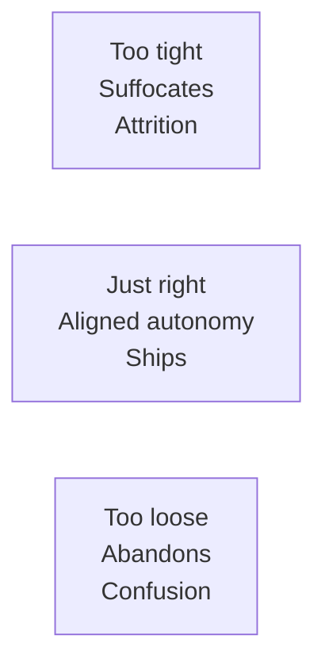
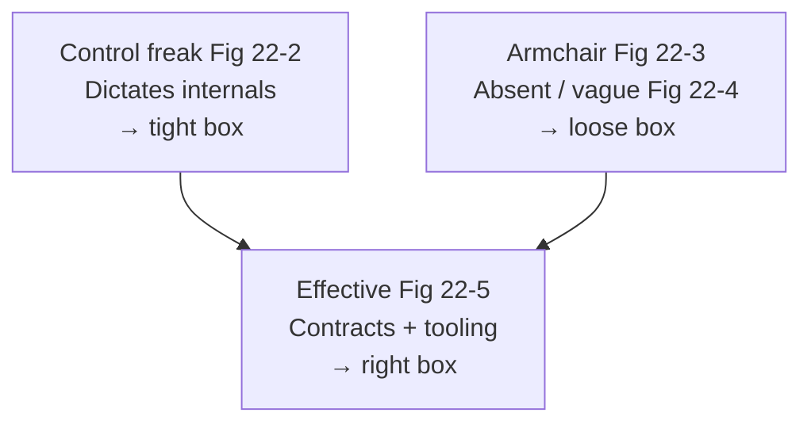
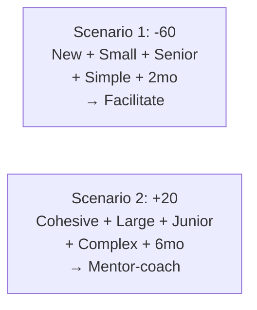
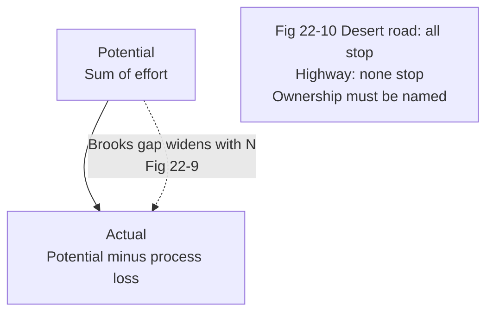
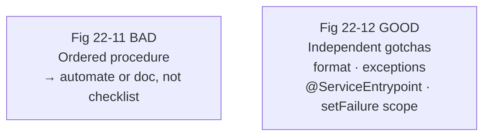
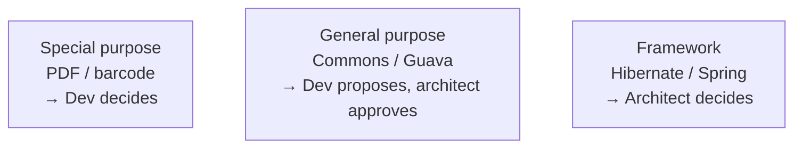

# Chapter 22: Making Teams Effective — Definitive Technical Summary
*From: Fundamentals of Software Architecture: An Engineering Approach by Mark Richards, Neal Ford*
*Source PDF: pp. 345–367 (402-page PDF) — figures below cite PDF pages.*

> [!NAV] **Chapter Navigation**
> ⬅️ **Previous:** [[chapter-21-diagramming-and-presenting|Chapter 21: Diagramming and Presenting]] | 🏠 **Index:** [[00-Master-Reading-Dashboard|Master Dashboard]] | ➡️ **Next:** [[chapter-23-negotiation-and-leadership|Chapter 23: Negotiation and Leadership]]

---

## 1. Executive Summary & Core Engineering Problem

- **Core Thesis:** Architects don't just draw topologies — they set the *box* (constraints) teams build inside. Too tight a box (control freak) suffocates; too loose (armchair) abandons. Effective architects calibrate control via **elastic leadership** (five factors), watch **team-size warning signs** (process loss, pluralistic ignorance, diffusion of responsibility), enforce quality with **small checklists** (code-complete, testing, release), and guide daily choices with **explicit design principles** (e.g., layered-stack library tiers).
- **The Core Problem Statement:** Naive architects either hand down 200-page mandates plus pseudocode (seniors quit) or toss a context-free boxes-and-arrows slide and vanish (velocity collapses as devs re-litigate architecture). Concrete breakage: a trading-system "architecture" showing `UI → Backend → Database` with no component contracts forces 12 developers into proof-of-concept battles over messaging vs. REST through a firewall that makes messaging impossible — discovered months late.
- **What This Chapter Covers (PDF pp. 345–367):** Team boundaries: tight/loose/just-right box (p.345, Fig 22-1) → Three personalities: control freak (p.347, Fig 22-2), armchair (p.348, Fig 22-3), effective (p.350, Fig 22-5), incl. trading-system armchair example (p.349, Fig 22-4) → How much control: elastic leadership, 5 factors, ±20 scale (pp.351–355, Figs 22-6–22-8, Tables 22-1/22-2) → Team warning signs: process loss/Brooks, pluralistic ignorance/Emperor's Clothes, diffusion/broken-car (pp.355–358, Figs 22-9/22-10) → Checklists: Gawande, bad-table checklist, Hawthorne effect, three canonical lists (pp.358–362, Figs 22-11/22-12) → Providing guidance: layered-stack questions + tiers graphic, Scala business-justification story (pp.363–366, Fig 22-13) → Summary: architect (not just manager) owns team effectiveness (p.366).
- **Historical & Industry Context:** Roy Osherove's *Elastic Leadership*, Fred Brooks's *Mythical Man-Month* (process loss), Atul Gawande's *Checklist Manifesto* (surgical lists → near-zero staph), Hans Christian Andersen's Emperor (pluralistic ignorance), Hawthorne studies (observed behavior). Bridges 1st-edition "architect as guide" into 2nd-edition team-topologies thinking.

---

## 2. In-Depth Technical Concepts & Internal Mechanics

### 2.1 Boundaries — The Box Architects Draw (Fig 22-1)

| Boundary | Architect Behavior | Team Effect | Example |
| :--- | :--- | :--- | :--- |
| **Too tight** | Bans libraries, mandates naming/method-length, writes pseudocode | Frustration, attrition; art of programming stolen | "No open-source; hand-roll everything from JDK" |
| **Too loose / none** | No constraints; devs decide everything | POC wars, confusion, velocity loss; devs become reluctant architects | "Here's a cloud icon — build the trading system" |
| **Just right** | Right tools + libraries + principles pre-decided; implementation freedom inside | Aligned autonomy; fast correct builds | Framework tier fixed; special-purpose libs dev-chosen (see §2.4) |

### 2.2 Three Personalities (Figs 22-2–22-5)

**Control freak (Fig 22-2, tight box):** Every call fine-grained and low-level. Reference-data example: architect doesn't stop at `ReferenceManager` component + ops (`GetData/SetData/ReloadCache/NotifyOnUpdate`) + consumer map — they dictate parallel-loader + internal cache structure. That internal design is the *developer's* job (class diagrams, patterns). Easy trap for fresh ex-dev architects reliving their old role.

**Armchair (Figs 22-3/22-4, loose box):** Hasn't coded in years (or ever), absent, parachutes slideware between projects — or is in over their head and fakes it ("architecture is easy to fake; code isn't"). Trading-system artifact: three unlabeled boxes and arrows — not *wrong*, just useless. Diagnostics: no time with teams (by choice or overload), weak domain/tech grasp, no implementation-consequence thinking. Cure: re-embed in tech + domain + team rooms.

**Effective (Fig 22-5, right box):** Right constraints, right tooling, roadblocks removed, collaboration constant, respect earned. Rest of chapter operationalizes *how much* control that means day-to-day.

### 2.3 How Much Control — Elastic Leadership, Five Factors (Figs 22-6–22-8)

Score each factor on a ±20 scale (−20 = armchair/less control, +20 = control-freak/more control); sum for posture. Weightings adjustable; re-score as the project evolves (start-of-project calibration decays).

| Factor | More Control (+20) | Less Control (−20) | Rationale |
| :--- | :--- | :--- | :--- |
| **Team familiarity** | Strangers, cliques forming | Veterans who've shipped together (self-organizing) | New teams need facilitated collaboration |
| **Team size** | Large (>12 on one team) | Small (≤4) | Coordination cost explodes with N (see §2.4) |
| **Overall experience** | Mostly juniors / new to stack+domain | Mostly seniors fluent in stack+domain | Juniors need mentoring; seniors need facilitating |
| **Project complexity** | Highly complex, novel integration | Simple CRUD website | Complexity demands architect availability |
| **Project duration** | Long (e.g., 2 years — urgency decays, lunches lengthen) | Short (e.g., 2 months — urgency intrinsic) | Counterintuitive but field-tested: short deadlines need the architect *out of the way*; marathons need pacing + sequencing |

- **Scenario 1 (Table 22-1, Fig 22-7):** New (+20) + small (−20) + all-senior (−20) + simple (−20) + 2-month (−20) = **−60 → strong armchair/facilitator**. Answer questions, verify trajectory, otherwise let the seniors ship.
- **Scenario 2 (Table 22-2, Fig 22-8):** Know-each-other (−20) + large-12 (+20) + mostly-junior (+20) + high-complexity (+20) + 6-month (−20) = **+20 → engaged mentor-coach**, daily presence without smothering. (Book prints accumulated −20 with a "control freak" label — arithmetic of its rows sums to +20; posture is "lean-in mentor" either way; adjust weights to your context rather than worshipping the sum.)
- **Alice/Bob walkthrough:** Alice inherits 3 strangers + 9 juniors on a complex 18-month ledger rewrite → +60s: she co-locates, sets component contracts, reviews daily. Six months later the same team is senior-fluent and cohesive → she slides toward −20, trading reviews for office-hours + fitness functions.

### 2.4 Team Warning Signs — When Size Hurts (Figs 22-9/22-10)

1. **Process loss (Brooks's law):** Actual productivity = group potential − coordination loss; adding people to a late project makes it later. *Architect tell:* chronic merge conflicts (same files, stepped-on toes). *Fix:* carve parallel streams (per-service ownership); challenge every headcount add without a new stream — show the manager the loss curve.
2. **Pluralistic ignorance (Emperor's New Clothes):** Everyone privately doubts the norm but publicly assents, fearing they're missing something. *Example:* 11 nod at "messaging between DCs" while one quietly knows a firewall blocks it. *Fix:* watch faces/body language; cold-call gently ("Priya, what worries you about the firewall here?") and publicly back dissent.
3. **Diffusion of responsibility (busy-highway breakdown, Fig 22-10):** On a desert road everyone stops; on a packed highway everyone assumes someone else called help. On big teams, ownership blurs and tasks drop. *Fix:* single named owner per stream/risk; make "who owns this?" answerable in one breath.

### 2.5 Checklists That Actually Work (Figs 22-11/22-12)

Gawande's lesson (pilots, surgeons → staph near zero): lists catch the *obvious-but-skipped* steps. Software caveats: no procedural/dependent flows in a checklist (Fig 22-11's "create table → submit form → verify" is a *procedure*, not a checklist — table can't be verified before submission); no lists for frequently-executed-flawless trivia; keep each list tiny or it rots (law of diminishing returns); automate anything automatable and delete it from the list; state the obvious — that's what gets skipped.

- **Adoption mechanics:** Co-author lists with devs; teach the *why* (assign *Checklist Manifesto*); when compliance slips, invoke the **Hawthorne effect** honestly: announce spot-verification (then actually spot-check) — observed work gets done.
- **Three canonical lists:**
  - *Developer code-completion / definition-of-done (Fig 22-12):* non-automated formatting, absorbed-exception sweep, project-specific gates (`@ServiceEntrypoint` present; only public methods call `setFailure()` — the latter automatable via crawler, so promote it out of the list).
  - *Unit/functional edge-case list:* special chars, min/max ranges, extremes, missing fields; every QA escape adds a row until automated, then the row leaves the list. Bridges dev/tester gaps.
  - *Software release list (most volatile):* config/server deltas, new JARs/DLLs, DB migrations; every failed deploy's root cause becomes a new row — the same failure never recurs twice.

### 2.6 Providing Guidance — Design Principles as the Box (Fig 22-13)

**Layered-stack governance ritual (third-party JARs/DLLs):** Developer proposes a library → must answer (1) *Overlap?* (does an existing lib already do this — kills duplication) and (2) *Justification?* (technical *plus* business — builds cost-awareness). Then the tier graphic decides who approves:

| Tier | Examples | Who Decides |
| :--- | :--- | :--- |
| **Special purpose** (narrow, low blast radius) | PDF rendering, barcode scanning | Developer decides, no architect consult |
| **General purpose** (language-API wrappers, sprawling) | Apache Commons, Guava | Developer runs overlap+justification → recommends; **architect approves** |
| **Framework** (invasive, structural) | Hibernate, Spring (persistence, IoC) | **Architect decides**; devs don't even analyze alternatives |

- **Scala story (behavioral proof):** Mark's Java project nearly lost two seniors over a Scala enthusiast's disruption. Mark offered support *conditional on a business justification* (training + rewrite cost vs. "-ility" gain). Next day the enthusiast returned transformed: all technical pros, zero business value, timeline/cost harm — and became a top contributor. Asking for business value didn't just settle the library; it grew an engineer and kept the team.
- **Team topologies note (2nd-edition bridge):** Align the box with Conway/Team Topologies — stream-aligned services per team, platform teams for framework tiers, explicit interaction modes — so the constraint map matches the org chart instead of fighting it.

---

## 3. Important Figures, Diagrams & Visual Architecture

| Figure | PDF Page | Description |
| :--- | :--- | :--- |
| Fig 22-1 | p.346 | Tight / loose / just-right boundary boxes |
| Fig 22-2 | p.347 | Control-freak architect |
| Fig 22-3 | p.348 | Armchair architect |
| Fig 22-4 | p.349 | Armchair trading-system diagram (content-free boxes) |
| Fig 22-5 | p.350 | Effective architect |
| Fig 22-6 | p.353 | ±20 control scale |
| Fig 22-7 | p.354 | Scenario 1 (−60, hands-off facilitator) |
| Fig 22-8 | p.355 | Scenario 2 (lean-in mentor-coach) |
| Fig 22-9 | p.356 | Brooks process-loss curve |
| Fig 22-10 | p.357 | Diffusion of responsibility (roadside breakdown) |
| Fig 22-11 | p.359 | Bad checklist (procedural steps, not a checklist) |
| Fig 22-12 | p.361 | Good developer code-completion checklist |
| Fig 22-13 | p.365 | Layered-stack guidance tiers |

**Figure 22-1 → PDF p.346 — The box.**



- **Original Book Figure:** Figure 22-1 → PDF p.346 — open the source PDF at page 346 to compare.
- **Takeaway:** Constraints are leadership — calibrate, don't abdicate or strangle.

**Figures 22-2–22-5 → PDF pp.347–350 — Personalities.**



- **Original Book Figures:** Figures 22-2–22-5 → PDF pp.347–350 — open the source PDF at pages 347–350 to compare.
- **Takeaway:** Match personality to evidence: component contracts are yours, class internals are theirs, presence is non-negotiable.

**Figures 22-6–22-8 → PDF pp.353–355 — Elastic control.**



- **Original Book Figures:** Figures 22-6–22-8 → PDF pp.353–355 — open the source PDF at pages 353–355 to compare.
- **Takeaway:** Re-score continuously; duration inverts intuition (short = back off, long = lean in).

**Figures 22-9/22-10 → PDF pp.356–357 — Size pathologies.**



- **Original Book Figures:** Figures 22-9/22-10 → PDF pp.356–357 — open the source PDF at pages 356–357 to compare.
- **Takeaway:** Parallel streams, invited dissent, and named owners counteract size.

**Figures 22-11/22-12 → PDF pp.359–361 — List discipline.**



- **Original Book Figures:** Figures 22-11/22-12 → PDF pp.359–361 — open the source PDF at pages 359–361 to compare.
- **Takeaway:** Checklists catch skipped obvious steps; procedures and automatables don't belong.

**Figure 22-13 → PDF p.365 — Library tiers.**



- **Original Book Figure:** Figure 22-13 → PDF p.365 — open the source PDF at page 365 to compare.
- **Takeaway:** Blast radius determines approver; overlap + business justification gate every proposal.

---

## 4. Real-World Systems, Case Studies & Code Examples

- **Production systems named:** ReferenceManager (GetData/SetData/ReloadCache/NotifyOnUpdate), Apache Commons/Guava, Hibernate/Spring, PDF/barcode libs, `@ServiceEntrypoint` + `setFailure()` gates, JAR/DLL + migration release gates.
- **Architectural divergence:** Control-freak pseudocode (fast for trivial teams, fatal for seniors) vs. armchair slideware (fast to produce, expensive to implement) vs. effective contracts + fitness functions (slower upfront, cheapest over the release).
- **Code — automatable checklist promotion (Java crawler sketch):**

```java
// Promote "only public methods call setFailure()" from checklist to CI check
@Test
void only_public_methods_call_setFailure() {
    Set<String> violators = ClassGraph.scan("com.acme")
        .stream().flatMap(c -> c.methods().stream())
        .filter(m -> m.calls("setFailure") && !m.isPublic())
        .map(m -> m.describe()).collect(toSet());
    assertTrue(violators.isEmpty(), "Non-public setFailure callers: " + violators);
}
// Keep in checklist: absorbed-exception review (judgment call, not yet automatable).
// Release gate sketch: fail build if migration missing for schema diff.
```

```text
# Release-checklist row lifecycle (book rule)
# 1. Deploy fails: root cause = missing migration script
# 2. Add row: "DB migration script attached + backward-compatible?"
# 3. Automate: CI diffs entities vs. migrations/; row retires once green 3x.
```

- **War stories:** (1) Trading-system boxes-and-arrows left 12 devs debating firewall-blocked messaging. (2) Merge-conflict storms signaling missing parallel streams. (3) Silent firewall expert rescued by facilitated dissent. (4) Scala enthusiast converted by the business-justification question — two resignations averted.

---

## 5. Architectural Trade-Off Matrix

| Approach | Velocity (Short Term) | Quality / Correctness | Morale / Retention | Governance Load | Best Used When | Avoid When |
| :--- | :--- | :--- | :--- | :--- | :--- | :--- |
| **Elastic right-box (recommended)** | High (clear lanes) | High (contracts + checks) | High (autonomy + support) | Medium (calibrated reviews) | Default; re-scored per phase | Static posture across a changing project |
| **Control freak / tight** | Low (waits on architect) | Medium (consistent but brittle) | Very low (exits) | Very high | Safety-critical internals; brand-new juniors on complex core | Senior/cohesive teams; creative problem spaces |
| **Armchair / loose** | Medium then collapsing | Low (divergent POCs) | Low (abandoned) | Low (absent) | 2-month senior-team dash with settled stack | Complex/long/multi-team efforts |
| **No checklists** | Fast today | Low (repeat escapes) | Medium (heroics) | None | Throwaway spikes | Anything shipping to prod |
| **Checklist-everything** | Low (form fatigue) | Medium (ignored lists) | Low (resentment) | High (unaudited theater) | Never — prune ruthlessly | Default — automate and shrink |

**Heuristics:** New/large/junior/complex/long → lean in; familiar/small/senior/simple/short → step back. Any list item automatable leaves the list; any deploy failure adds one row; every library proposal answers overlap + business why.

---

## 6. Jargon Buster & Key Terminology

- **Team Boundaries / The Box (Constraint envelope):** Pre-decided tools, tiers, and principles devs build inside. Too tight suffocates, too loose abandons.
- **Control Freak (Over-constraint personality):** Dictates internals + pseudocode. Useful briefly for safety-critical junior work; toxic as default.
- **Armchair Architect (Under-constraint personality):** Absent, vague, or faking. Produces content-free diagrams teams can't build from.
- **Effective Architect (Calibrated personality):** Right contracts, right tooling, roadblocks cleared, presence constant.
- **Elastic Leadership (Osherove, adapted) (Situational control):** Slide freak↔armchair per five factors; re-score continuously.
- **Process Loss / Brooks's Law (Coordination tax):** Output < potential; adding people late delays further. Tell: merge-conflict storms.
- **Pluralistic Ignorance (Silent dissent):** Private doubt, public assent from fear of looking foolish. Cure: facilitated cold-calls + backed dissent.
- **Diffusion of Responsibility (Nobody-owns-it drift):** Big-group bystander effect. Cure: one named owner per stream.
- **Checklist vs. Procedure (Independent gotchas vs. ordered steps):** Only the former belongs on a checklist; latter gets automated/documented.
- **Hawthorne Effect (Observed-work effect):** Announced spot-checks raise compliance. Pair with real audits, not bluffs alone.
- **Definition of Done (Code-complete contract):** Checklist-gated "done" (format, exceptions, project gates, edge tests).
- **Layered-Stack Tiers (Library blast-radius map):** Special (dev) / General (dev-proposes-architect-disposes) / Framework (architect-only).
- **Overlap + Business Justification (Proposal gates):** "Does it duplicate?" + "Why should the business pay?" — the Scala-converter questions.

---

## 7. System Design & Practical Engineering Takeaways

### 7.1 Production Engineering Checklist

1. **Draw the box explicitly:** Publish component contracts + tiered library policy + interaction modes; review every "architect decision" for tight/loose fit before imposing.
2. **Score control quarterly:** Run the five-factor ±20 with tech leads; post the resulting posture (facilitate vs. mentor-coach) and revisit after staffing/milestone shifts.
3. **Instrument size health:** Track merge-conflict rate, unowned-task count, and dissent rate in reviews; trigger stream-splitting, ownership-naming, or facilitated rounds when they drift.
4. **Keep three living checklists:** Code-complete, edge-testing, release — each tiny, co-authored, automation-pruned, with deploy-failure rows added within 24h.
5. **Gate every dependency:** Overlap analysis + technical/business justification + tier-correct approver; reject unapproved JARs/DLLs in CI (dependency-allowlist check).

### 7.2 System Design Interview Blueprint

- **Open with the box:** "I'll fix framework tiers, require approval for general libs, free special-purpose choice — contracts up front, internals to the team."
- **Show calibration:** Walk −60 (hands-off seniors, 2-month runway) vs. +20 (daily mentoring, 12 juniors, complex ledger) and when you'd slide between them.
- **Demo size literacy:** Cite Brooks/process-loss (parallel streams), Emperor/pluralistic ignorance (facilitated dissent over firewall-blocked messaging), highway/diffusion (named owners).
- **Pitfalls:** Pseudocode mandates, content-free diagrams, mega-checklists, procedure-rows, checklist theater without spot-checks.

### 7.3 Mastery Self-Assessment Questions

#### Question 1 (Conceptual Depth)
*Why does longer project duration demand more architect control, when urgency seems lower?*
- **Answer:** Short deadlines supply intrinsic urgency — developers self-prioritize and any architect overhead delays shipping, so step back. Long horizons dissipate urgency (vacations, lunches, deferred hard tasks) while complexity compounds; without pacing, sequencing (hard tasks first), and sustained presence, drift and tech-debt accumulate silently. Control here means cadence + sequencing, not micromanagement — the marathon needs a pacer the sprint doesn't.

#### Question 2 (Failure Scenario & Edge Cases)
*Twelve developers show chronic merge conflicts plus a silently-known firewall that kills the chosen messaging design. Diagnose and intervene.*
- **Answer:** Dual pathology: process loss (no parallel streams — everyone on shared code) + pluralistic ignorance (firewall knower stayed silent). Intervene same week: (a) split ownership per service/stream so parallel work stops colliding; (b) facilitated review explicitly inviting the firewall concern, then pivot messaging→REST with an ADR recording why; (c) challenge the headcount-to-stream ratio with the loss curve. Both signals are size-driven — the fix is structural, not motivational.

#### Question 3 (Trade-Off & Governance)
*A developer demands Framework Y over your Framework X on technical grounds alone. How do you resolve it without dictating?*
- **Answer:** Apply the layered-stack ritual plus "arrive at it themselves" (previewed fully in Ch.23): require overlap analysis and technical *plus* business justification, then — if security/compliance is the decider — challenge them to prove Y meets it in a spike. Either they fail and own the X decision (buy-in preserved) or they succeed and you've learned something (better framework adopted). Framework-tier authority stays with the architect, but exercised through evidence, not title.

---

> [!NAV] **Chapter Navigation**
> ⬅️ **Previous:** [[chapter-21-diagramming-and-presenting|Chapter 21: Diagramming and Presenting]] | 🏠 **Index:** [[00-Master-Reading-Dashboard|Master Dashboard]] | ➡️ **Next:** [[chapter-23-negotiation-and-leadership|Chapter 23: Negotiation and Leadership]]
