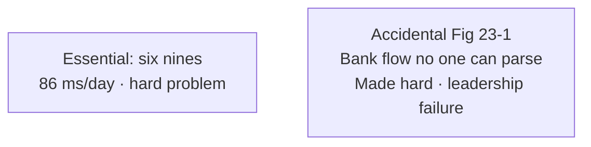
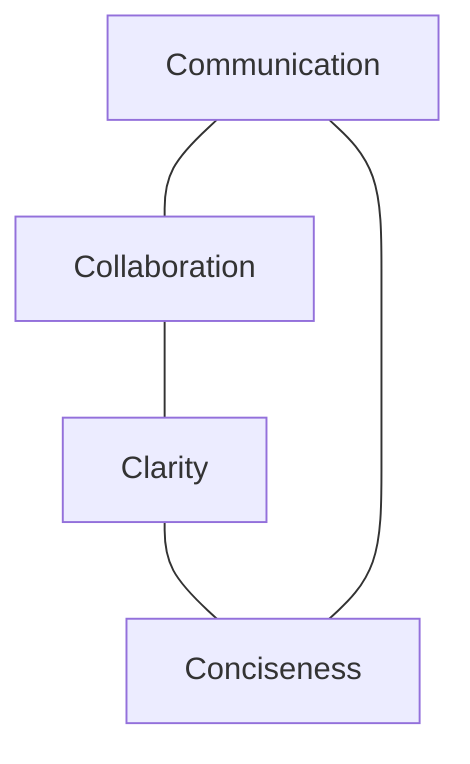
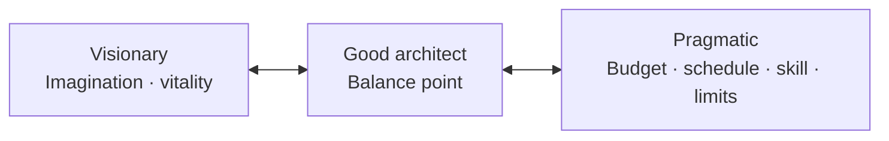
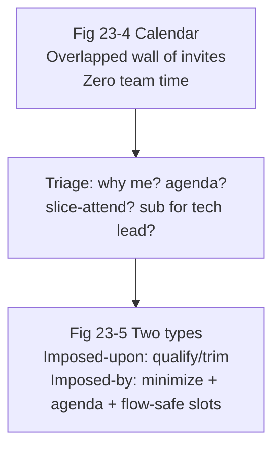

# Chapter 23: Negotiation and Leadership Skills — Definitive Technical Summary
*From: Fundamentals of Software Architecture: An Engineering Approach by Mark Richards, Neal Ford*
*Source PDF: pp. 367–385 (402-page PDF) — figures below cite PDF pages.*

> [!NAV] **Chapter Navigation**
> ⬅️ **Previous:** [[chapter-22-making-teams-effective|Chapter 22: Making Teams Effective]] | 🏠 **Index:** [[00-Master-Reading-Dashboard|Master Dashboard]] | ➡️ **Next:** [[chapter-24-developing-career-path|Chapter 24: Developing a Career Path]]

---

## 1. Executive Summary & Core Engineering Problem

- **Core Thesis:** Nearly every architect decision gets challenged — by developers, peer architects, and cost-driven stakeholders — so negotiation and leadership are not soft extras but ~50% of effectiveness. This chapter gives field-tested scripts for all three audiences plus a leadership operating system: the **4 Cs** (communication, collaboration, clarity, conciseness), **pragmatic-yet-visionary** balance, leading by example (grammar, names, handshakes, favors, go-to presence), and **calendar control** so the architect actually sits with teams.
- **The Core Problem Statement:** Naive architects dictate ("you must go through the business layer"), argue REST-vs-messaging by Googling, or demand five-nines without translating cost. Developers shut down, peers feud, sponsors overbuy availability they don't need. Concrete breakage: insisting on 99.999% (5 min 35 s downtime/year) for an entire trading platform when 99.9% (8 h 46 m/year, ~86 s/day) suffices — at multiples of the cost — because nobody converted nines to hours or scoped the requirement to the slice that truly needs it.
- **What This Chapter Covers (PDF pp. 367–385):** Why politics/navigation is a core expectation (p.367) → Negotiating with business stakeholders: Scenario 1 (five-nines sponsor), grammar-as-signal, Table 23-1 nines math, cost/time last resort, divide-and-conquer scoping (pp.368–370) → Negotiating with architects: Scenario 2 (REST vs. messaging feud), demonstration-defeats-discussion, calm-over-personal (pp.370–371) → Negotiating with developers: anti-Ivory-Tower, justification-first scripts, let-them-arrive-themselves spikes (pp.371–373) → Leader: 50% people skills, 4 Cs vs. accidental complexity bank diagram (pp.373–375, Figs 23-1/23-2) → Pragmatic-yet-visionary balance, data-mesh caution (pp.375–376, Fig 23-3) → Leading by example: captain/sergeant, "have you considered…", names/handshakes/no-hugs, request-as-favor payment-service split, go-to brown-bags (pp.377–380) → Integrating with teams: architect calendar, imposed-upon vs. imposed-by meetings, agenda/flow rules, sit-with-team (pp.380–383, Figs 23-4/23-5) → Roosevelt closer (p.383).
- **Historical & Industry Context:** Sun Tzu's divide-and-conquer, Gerald Weinberg ("it's a people problem"), Theodore Roosevelt on getting along, flow-state research (interruption cost), HIPAA/enterprise governance as negotiation backdrop. Prefigures Ch.24's career advice: visibility and trust compound.

---

## 2. In-Depth Technical Concepts & Internal Mechanics

### 2.1 Negotiating with Business Stakeholders (Scenario 1)

**Setup:** SVP sponsor demands five nines for the new trading system; architect's analysis says three nines suffice. Sponsor hates being corrected, dabbles in nonfunctionals. Force fails; condescension backfires.

| Technique | Mechanics | Script Fragment |
| :--- | :--- | :--- |
| **Read grammar as requirements signal** | "Needed it yesterday" → time-to-market; "lightning fast" → performance; "zero downtime" → availability | "Five nines tells me availability is paramount — let me quantify what that buys." |
| **Research before the room (Table 23-1)** | Convert nines → downtime/year + per-day (see §3) | "Five nines = 5 m 35 s/year (~1 s/day); three nines = 8 h 46 m/year (~86 s/day). Is 86 s/day acceptable for non-matching paths?" |
| **Validate, then reframe units** | Affirm concern, negotiate in hours/minutes not nines-vernacular | "I understand availability is critical — here's the clock-time trade…" |
| **Divide and conquer (Sun Tzu)** | Scope the extreme requirement to the slice needing it | "Does *all* of it need five nines, or just order-matching while reporting takes three?" |
| **Cost/time last** | Money/effort are real but opening with them sours rooms | Exhaust fit-based arguments first; close with "and here's the $/schedule delta once we agree on scope." |

- **Why cost-last works:** Leading with "that's expensive" sounds dismissive and triggers status defense (especially with correction-averse sponsors). Leading with shared understanding + quantified options lets the sponsor *choose* economy without being "wrong."

### 2.2 Negotiating with Other Architects (Scenario 2)

**Setup:** Lead favors async messaging for inter-service perf/scalability; peer insists "REST is always faster, Google it," with heated history. Pulling rank breeds resentment that poisons the team.

| Technique | Mechanics |
| :--- | :--- |
| **Demonstration defeats discussion** | Benchmark both in a *production-like* harness (payload sizes, TLS, serialization, concurrency, broker topology) — environment-specific truth beats search results. Present numbers, not adjectives. |
| **Calm leadership, concise reasoning** | No personal volleys; pause and re-engage later if heated. Composure forces de-escalation — the aggressor backs down when there's nothing to push against. |

- **Harness checklist:** same hardware class, warm JVMs, realistic fan-out, timeout/deadline parity, broker persistence settings declared, p50/p99/p99.9 + throughput + CPU/$ reported. If REST wins the spike, adopt it — the method's credibility depends on losing gracefully.

### 2.3 Negotiating with Developers (Anti-Ivory-Tower)

Ivory Tower = dictate from above without regard for opinion → respect collapse → team dysfunction. Two correctives:

**1. Justification-first, depersonalized grammar.**
- *Bad:* Architect: "You must go through the business layer." Developer: "No — direct DB is faster." ("You must" demeans + triggers counter-reason; conversation dies.)
- *Good:* "Since change control matters most, we've formed closed layers — so DB calls come from the business layer." Developer: "OK… but how do I fix simple-query perf?" Now it's collaborative problem-solving within constraints. Rules: reason *before* the claim (listeners stop hearing after disagreement), facts over commands ("this means…" not "you must…").
**2. Let them arrive at it (win-win spike).** Framework X (yours, meets security) vs. Y (theirs): "We'll take Y if you can demo it meeting the security requirements." Either they fail and own X (buy-in without dictate) or succeed and you've been saved from your blind spot (better framework wins). Collaboration, not abdication — scope the spike tightly.

### 2.4 The Leader's Core — 4 Cs, Pragmatism, Example, Calendar

**Essential vs. accidental complexity (Fig 23-1):** Six-nines (86 ms/day, 31.5 s/year) is *essential* ("hard problem"); the global-bank spaghetti flow diagram nobody can parse is *accidental* ("made hard" — to look vital, stay in loops, or protect jobs). Accidental complexity is leadership failure.

**4 Cs antidote (Fig 23-2):** Communication + Collaboration + Clarity + Conciseness, mutually reinforcing. Clear-concise communicators get heard; collaborators get truth; together they earn go-to status (questions, mentoring, advice — not just approvals).

**Pragmatic-yet-visionary (Fig 23-3):** Visionary = strategic imagination (architectural vitality over years); pragmatic = budget, schedule, team skill, trade-offs, technical limits. Balance example: elasticity via exotic data mesh (visionary theory — has the org ever run one? what are its trade-offs?) vs. find-the-bottleneck-first (DB? service? external?) and cache what avoids the call entirely. Stakeholders fund vision inside constraints; developers implement practice, not theory.

**Leading by example (not title):** Captain orders the hill taken from afar (ignored); sergeant nods (trusted, followed). Weinberg's law applies to technical disputes — tone decides whether solutions surface ("that's a dumb idea" silences the room for the day).
- *Grammar:* "Have you considered a cache here?" / "What about…?" returns control to the developer; coach these phrasings peer-to-peer when you hear commands.
- *Names + handshakes:* Use names often (verify pronunciation by repeat-back); firm 2–3 s handshake with eye contact for infrequent/high-stakes contacts (e.g., monthly head-of-ops — "Hello Ruth…"); daily handshakes for desk neighbors = weird; hugs at work = skip (discomfort + HR risk) unless that's genuinely the whole-company norm.
- *Request as favor:* Demand ("split payments into five services this sprint — shouldn't take long") → instant "no way, busy." Favor ("Hi Sridhar — I'm in a bind… any way to squeeze the payment split for fault tolerance/scalability? Would really help me out… thanks, I owe you one") → "I'll see what I can do." Name + vulnerability + gratitude beats title + estimate-dismissal. Doesn't always work — but wins far more often.
- *Become the go-to:* Swarm visible struggles (technical or human — "Hey Antonio, coffee run together?" as a low-pressure opener, back off on closed signals); host brown-bags on patterns/language features to practice teaching and advertise helpfulness.

**Calendar integration (Figs 23-4/23-5):** The default architect calendar (back-to-back overlaps) leaves zero team time. Two meeting types:
- *Imposed-upon (invited):* Ask why you're needed; require an agenda; attend only the relevant slice (arrive late/leave early by agenda); take-one-for-the-team by subbing for the tech lead so makers keep making.
- *Imposed-by (you call it):* Ask if it's worth the flow-break; default to email; always set + hold an agenda; schedule mornings/post-lunch/EOD — never mid-day flow. Plus: sit *with* the team (cube-away = "do not disturb"); if floor-separated, block daily walk-around/coffee time with devs *and* stakeholders (head of ops on the coffee route).

---

## 3. Important Figures, Diagrams & Visual Architecture

| Figure | PDF Page | Description |
| :--- | :--- | :--- |
| Table 23-1 | p.369 | Nines of availability → downtime/year (per day) |
| Fig 23-1 | p.374 | Accidental-complexity bank flow (made-hard diagram) |
| Fig 23-2 | p.375 | 4 Cs of architecture |
| Fig 23-3 | p.376 | Pragmatic ↔ visionary balance |
| Fig 23-4 | p.381 | Typical overloaded architect calendar |
| Fig 23-5 | p.382 | Imposed-upon vs. imposed-by meetings |

**Table 23-1 → PDF p.369 — Nines math (negotiation ammunition).**

| Uptime | Downtime / year (per day) |
| :--- | :--- |
| 90% (one nine) | 36 d 12 h (2.4 h) |
| 99% (two nines) | 87 h 46 m (14 m) |
| 99.9% (three nines) | 8 h 46 m (86 s) |
| 99.99% (four nines) | 52 m 33 s (7 s) |
| 99.999% (five nines) | 5 m 35 s (1 s) |
| 99.9999% (six nines) | 31.5 s (86 ms) |

- **Original Book Table:** Table 23-1 → PDF p.369 — open the source PDF at page 369 to compare.
- **Takeaway:** Negotiate in clock time and scoped slices, not nines slogans.

**Figure 23-1 → PDF p.374 — Accidental complexity warning.**



- **Original Book Figure:** Figure 23-1 → PDF p.374 — open the source PDF at page 374 to compare.
- **Takeaway:** If only you can read it, you failed — simplify, don't gatekeep.

**Figure 23-2 → PDF p.375 — 4 Cs.**



- **Original Book Figure:** Figure 23-2 → PDF p.375 — open the source PDF at page 375 to compare.
- **Takeaway:** Concise clarity earns the right to collaborate; collaboration earns go-to trust.

**Figure 23-3 → PDF p.376 — Balance point.**



- **Original Book Figure:** Figure 23-3 → PDF p.376 — open the source PDF at page 376 to compare.
- **Takeaway:** Fundable vision + implementable practice beats either extreme.

**Figures 23-4/23-5 → PDF pp.381–382 — Time defense.**



- **Original Book Figures:** Figures 23-4/23-5 → PDF pp.381–382 — open the source PDF at pages 381–382 to compare.
- **Takeaway:** Every meeting declined or sliced is an hour returned to the team.

---

## 4. Real-World Systems, Case Studies & Code Examples

- **Production systems named:** Trading platform (nines negotiation), closed-layered n-tier app (business-layer rule), Framework X/Y spike, payment-service split (store-credit/credit-card/PayPal/gift-card/points), diagnostics/perf cache proposal, brown-bag curriculum (patterns, language releases).
- **Architectural divergence:** Dictated layering (fast to state, slow to adopt — workarounds sprout) vs. justified layering + perf collaboration (slower conversation, durable compliance); Googled benchmarks (generic, misleading) vs. in-situ spikes (environmental truth).
- **Code — the two dialogues as review lint (pseudocode policy):**

```python
# Communication lint for review comments / ADRs (book grammar rules)
BANNED = ["you must", "you need to", "that's a dumb idea", "just google it"]
PREFER = {"directive": "have you considered… / what about…?",
          "reason_first": "Since <constraint>, <consequence>.",
          "favor": "Hi <Name>, I'm in a bind… would really help me out. Thanks — I owe you one."}
def lint(message):
    hits = [b for b in BANNED if b in message.lower()]
    return ("REWRITE: " + "; ".join(hits)) if hits else "OK"
# Spike contract for Framework Y challenge:
# "We'll adopt Y if demo proves <security req> on <prod-like env> by <date>."
```

- **War stories:** (1) Five-nines sponsor converted via 86-seconds/day framing + scoped matching-engine carve-out. (2) REST-vs-messaging feud dissolved by a one-week harness both sides trusted. (3) "Dumb idea" meeting-killer vs. "have you considered" collaboration rescue. (4) Sridhar's payment split secured as favor after demand failed. (5) Antonio's coffee-walk opener surfacing a personal blocker before it became attrition.

---

## 5. Architectural Trade-Off Matrix

| Approach | Buy-in / Trust | Decision Quality | Speed | Best Used When | Avoid When |
| :--- | :--- | :--- | :--- | :--- | :--- |
| **Validate→reframe→scope→price-last (recommended, stakeholders)** | High | High (quantified, scoped) | Medium | Nines/cost disputes; status-sensitive sponsors | Genuine emergencies needing instant cost veto |
| **Cost-first veto** | Very low | Medium (right number, wrong room) | Fast | Last resort after fit arguments exhausted | Opening move — triggers defensiveness |
| **Demonstration spike (peer architects)** | High (shared numbers) | Highest (environmental truth) | Slow (days) | Deep technical feuds; Google-proof claims | Trivia — reserve for fork-in-road choices |
| **Rank-pulling / dictation** | Very low | Low (compliance theater) | Fast today, slow forever | Never as method | Default — poisons team velocity |
| **Justification-first + self-arrived spike (devs)** | High | High (constraints + creativity) | Medium | Layering/rules disputes; framework contests | Unscoped fishing expeditions — timebox strictly |
| **4 Cs + pragmatic-visionary + calendar defense** | Compounding | Compounding | Medium (presence costs meetings) | Default leadership OS | Performative presence without listening/follow-through |

**Heuristics:** Grammar signals requirements — research before entering; nines→clock-time always; scope extremes before pricing them; spikes beat arguments; reason before claim; favor beats order; agenda or decline; flow-safe scheduling; sit with the team.

---

## 6. Jargon Buster & Key Terminology

- **Negotiation vs. Facilitation (Deal-making vs. room-running):** Architects do both — bargains with sponsors/peers/devs *and* sessions that surface truth. Both need politics literacy (core expectation).
- **Grammar-as-Signal (Requirement eavesdropping):** "Yesterday / lightning / zero-downtime" decode to time/perf/availability priorities. Pitfall: mocking the phrasing instead of mining it.
- **Nines Vernacular (Availability shorthand):** 99.9%→99.9999% ladder. Always expand to clock time (Table 23-1) before negotiating.
- **Divide and Conquer (Scoped extreme):** Apply harsh requirements only where proven needed. Sun Tzu via scope decomposition.
- **Demonstration Defeats Discussion (Spike supremacy):** Production-like numbers end opinion wars. Pitfall: rigged harnesses — declare all settings.
- **Ivory Tower (Dictation anti-pattern):** Commands without justification. Symptom: silent compliance + active workarounds.
- **Justification-First (Reason-before-claim):** State constraint → consequence ("Since change control matters, layers stay closed…"). Holds attention past disagreement.
- **Self-Arrived Solution (Owned verdict):** Challenger proves their option under your acceptance test. Win-win by construction.
- **Essential vs. Accidental Complexity (Hard vs. made-hard):** Six-nines physics vs. unreadable diagrams. Latter is a leadership bug.
- **4 Cs (Leadership core):** Communication, Collaboration, Clarity, Conciseness. Go-to status is their compound interest.
- **Pragmatic-yet-Visionary (Fundable futurism):** Imagination bounded by budget/schedule/skill/trade-offs/limits.
- **Flow State (Deep-work fragility):** 100%-engaged maker mode; mid-day meetings shatter it. Schedule around it.
- **Imposed-Upon vs. Imposed-By (Meeting taxonomy):** Invited (qualify/trim/slice/sub) vs. called (minimize/agenda/flow-safe). Both compete with team time.

---

## 7. System Design & Practical Engineering Takeaways

### 7.1 Production Engineering Checklist

1. **Pre-research every negotiation:** Decode stakeholder grammar, compute Table 23-1 clock times, scope extremes per slice — enter with numbers, not adjectives.
2. **Spike don't spar:** For peer feuds, timebox a production-like harness with agreed metrics (p99, $/req, failure modes); both sides pre-commit to the outcome.
3. **Enforce justification grammar:** Lint review/ADR language for "you must / dumb idea"; rewrite as reason-first + "have you considered…"; run framework contests as acceptance-tested spikes.
4. **Audit complexity monthly:** Flag any diagram only its author can explain as accidental; simplify via 4 Cs (fewer boxes, keyed lines, scoped views) before adding process.
5. **Defend maker time weekly:** Require agendas, slice-attend, sub for tech leads, batch own-meetings to mornings/EOD, sit with the team or walk the floor daily.

### 7.2 System Design Interview Blueprint

- **Open with politics literacy:** "I expect challenges from devs/peers/sponsors — here's how I handle each: justification scripts, spikes, and scoped nines math."
- **Show the math:** Recite 99.9%→86 s/day and 99.999%→1 s/day cold; explain divide-and-conquer scoping (matching engine vs. reporting) before pricing.
- **Demo leadership OS:** 4 Cs on a whiteboard, pragmatic-vs-visionary data-mesh caution, black-slide-grade meeting hygiene (agenda/flow/sit-with-team).
- **Pitfalls:** Cost-first openings, Googled proofs, rank-pulling, "you must" directives, hug-level familiarity errors, calendar surrender.

### 7.3 Mastery Self-Assessment Questions

#### Question 1 (Conceptual Depth)
*Why save cost/time arguments for last with business stakeholders if they're ultimately decisive?*
- **Answer:** Sequencing is persuasion: opening with money sounds like dismissal and triggers status defense (worse with correction-averse sponsors). Validating the concern, quantifying in clock time, and scoping extremes first lets sponsors *discover* economy as their choice — preserving face while reaching the same budget outcome. Cost then ratifies an agreed scope instead of ambushing an unheard concern.

#### Question 2 (Failure Scenario & Edge Cases)
*Two architects are deadlocked on messaging vs. REST with personal heat rising. What's the exact play?*
- **Answer:** Pause immediately — heated negotiation produces compliance theater, not truth. Reconvene around a jointly-scoped production-like spike (payloads, TLS, concurrency, persistence, p99 + $/req) both sides sign off on, with pre-commitment to adopt the winner. Present numbers without adjectives; if messaging loses, adopt REST gracefully — the method's future credibility depends on it. Calm process beats clever rebuttal.

#### Question 3 (Trade-Off & Governance)
*Developers bypass your closed layers for "fast" direct-DB calls. Dictate or redesign the conversation?*
- **Answer:** Redesign: restate reason-first ("Since change control dominates, layers stay closed — so queries route via business layer"), then collaborate on the real pain (simple-query latency) with a cache or read-optimization inside the constraint. Codify the rule in an ADR + fitness function, offer the bypass-requester a timeboxed spike to prove an alternative meets change-control, and coach command-grammar into question-grammar. Compliance follows understanding plus a viable fast path — not orders.

---

> [!NAV] **Chapter Navigation**
> ⬅️ **Previous:** [[chapter-22-making-teams-effective|Chapter 22: Making Teams Effective]] | 🏠 **Index:** [[00-Master-Reading-Dashboard|Master Dashboard]] | ➡️ **Next:** [[chapter-24-developing-career-path|Chapter 24: Developing a Career Path]]
