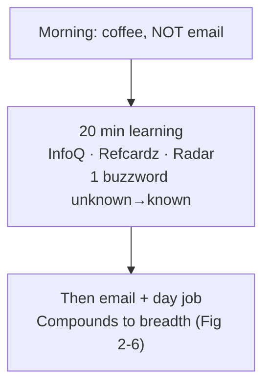
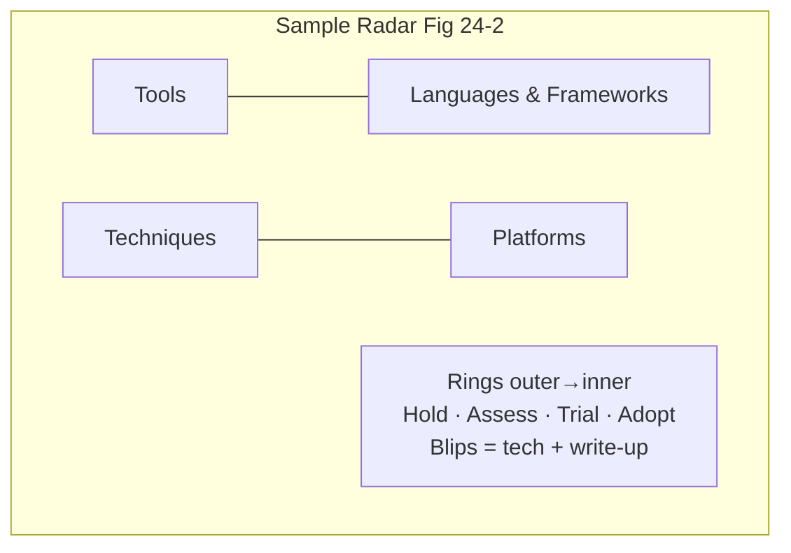
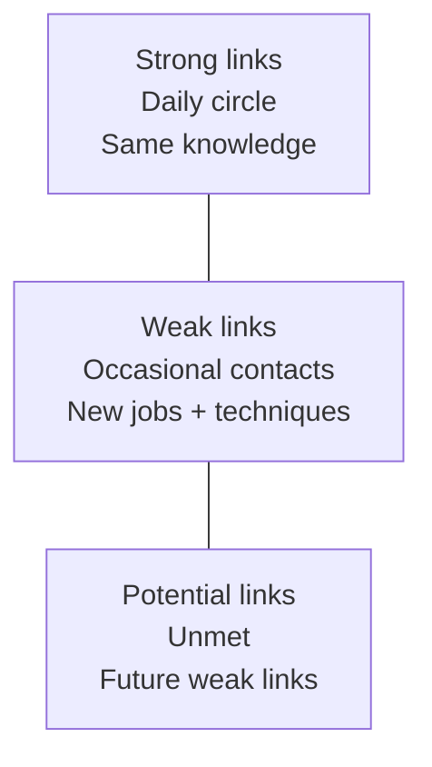

# Chapter 24: Developing a Career Path — Definitive Technical Summary
*From: Fundamentals of Software Architecture: An Engineering Approach by Mark Richards, Neal Ford*
*Source PDF: pp. 386–393 (402-page PDF) — figures below cite PDF pages.*

> [!NAV] **Chapter Navigation**
> ⬅️ **Previous:** [[chapter-23-negotiation-and-leadership|Chapter 23: Negotiation and Leadership]] | 🏠 **Index:** [[00-Master-Reading-Dashboard|Master Dashboard]] | ➡️ **Next:** *None (End of Book)*

---

## 1. Executive Summary & Core Engineering Problem

- **Core Thesis:** Becoming an architect is only halftime — staying one demands deliberate, daily learning because stacks rot fast (Clipper experts learned this the hard way). This closing chapter gives a sustainable system: the **20-minute rule** (breadth every morning before email), a **personal technology radar** (ThoughtWorks quadrants × Hold/Assess/Trial/Adopt rings, repurposed for habits), **social-media weak links** for assess-ring fuel, and **katas + trade-off practice** as the parting mandate — "always learn, always practice, go do architecture."
- **The Core Problem Statement:** Naive architects learn on nights-and-weekends, live inside vendor bubbles (echo chambers with no honest appraisals), and pick portfolios ad hoc ("cool" vs. "employable"). Then the platform vanishes — DOS→Windows overnight — and decades of depth become untransferable. Concrete breakage: a Clipper world-expert with zero breadth radar watches his entire skill stock go to zero while ex-colleagues who spent 20 minutes daily on "things you don't know you don't know" glide to the next stack.
- **What This Chapter Covers (PDF pp. 386–393):** Keep-learning mandate + Clipper cautionary tale (p.386) → 20-minute rule mechanics, resource examples (InfoQ, DZone Refcardz, ThoughtWorks Radar), morning-before-email discipline (pp.386–387, Fig 24-1) → Personal radar: Neal's CTO/bubble lesson, ThoughtWorks TAB origins + biannual cadence (pp.387–388) → Radar parts: quadrants (Tools / Languages+Frameworks / Techniques / Platforms) + rings (Hold/Assess/Trial/Adopt) + sample view (pp.388–389, Fig 24-2) → Personal-ring meanings + portfolio-diversification advice (pp.390–391) → Build-Your-Own-Radar tooling (spreadsheet→HTML5 canvas, Nov 2016) (p.391) → Social media: McAfee *Enterprise 2.0*, strong/weak/potential links, next-job-from-weak-links, follow-respected-technologists (pp.391–392, Fig 24-3) → Parting words: Brooks/Neward quotes, architecture katas, no-answer-key doctrine — only trade-offs (p.392).
- **Historical & Industry Context:** ThoughtWorks Technology Advisory Board (Rebecca Parsons, CTO) → biannual Radar; 2016 open-sourced visualization; Andrew McAfee's social-network job research; Fred Brooks ("great designers design") → Ted Neward ("how do we get great architects with <6 real chances?") → companion-site katas as deliberate practice. Bridges Ch.2's knowledge triangle (unknown-unknowns → known-unknowns) and breadth-over-depth thesis (Fig 2-6).

---

## 2. In-Depth Technical Concepts & Internal Mechanics

### 2.1 The 20-Minute Rule — Breadth Before Email (Fig 24-1)

- **Mechanics:** ≥20 minutes *daily* learning something new or deepening a thin slice: skim InfoQ / DZone Refcardz / ThoughtWorks Radar, Google one buzzword from the unknown-unknowns pile into known-unknowns, or push one assess-ring item toward trial with a spike.
- **Why mornings:** Lunch shrinks into catch-up; evenings lose to family/plans — both intentions die. Even mornings fail *after* coffee+email (inbox diversion eats the day). Protocol: arrive slightly early → coffee/tea → **20 minutes learning → then email**. Non-negotiable sequence.
- **Alice walkthrough:** Alice (payments architect) spends Mon: "eBPF" explainer + one paper abstract (unknown→known-unknown); Tue: 20-min spike reading on idempotency-key patterns (assess→trial note); Fri: shares a Refcardz summary at standup — 100 min/week ≈ 80+ hours/year of breadth for the price of arriving 20 min early.
- **Failure modes:** Binge-weekend learning (no compounding, burnout); feed-only consumption (no spikes, no retention); email-first mornings (zero sessions by 10 a.m.).

### 2.2 Personal Technology Radar — Formalized Portfolio Thinking

**Origin:** Neal's training-consulting CTO era on Clipper/dBASE DOS apps — Windows arrived gradually, then suddenly; the bubble collapsed from the inside unnoticed. Lesson: vendor immersion = echo chamber; without an external assessment ritual, collapse is invisible until too late. ThoughtWorks TAB (senior leaders + CTO Parsons, face-to-face 2×/year) built the Radar to force that ritual — then discovered conference attendees cloning it for their own shops.

**Structure (canonical):**

| Quadrant | Covers | Examples |
| :--- | :--- | :--- |
| **Tools** | Dev-to-enterprise tooling | IDEs, CI/CD, integration platforms, observability |
| **Languages & Frameworks** | Languages, libs, frameworks (often OSS) | Java 21, Spring Boot 3, Rust, htmx |
| **Techniques** | Practices, processes, engineering advice | Fitness functions, chaos testing, platform engineering |
| **Platforms** | Runtime/data substrates | Postgres, Kafka, K8s, AWS/GCP, edge runtimes |

| Ring (outer→inner) | Canonical Meaning | Personal-Use Repurposing |
| :--- | :--- | :--- |
| **Hold** (was "too new to assess" → now "don't start new with this") | Safe on existing projects, think twice for greenfield | Also park *habits to break* (e.g., doomscrolling team-gossip forums — entertaining, low-value) |
| **Assess** | Worth exploring for org impact (spikes, conference sessions, mobile-strategy-style probes) | Staging area for promising hearsay awaiting your own evaluation — fed by weak links (see §2.3) |
| **Trial** | Worth piloting on low-risk work to build capability | Active R&D — your spikes inside real codebases enabling real trade-off analysis |
| **Adopt** | Industry should adopt (strong conviction) | Your excited best-answers — proven tools you'd choose again |

- **Portfolio doctrine:** Treat tech like money — **diversify**. Hold some high-demand employable anchors *and* some gambits (OSS nights, mobile bets) that could become career destinations. Ad-hoc "cool-or-employer-driven" picking concentrates risk exactly like an undiversified fund. The *exercise* (scheduled thinking) matters more than the *artifact* (pretty plot) — busy architects need the excuse to think.
- **Tooling (Nov 2016):** ThoughtWorks *Build Your Own Radar*: quadrant-per-sheet Google spreadsheet → HTML5-canvas visualization. Conversations during capture are the value; the graphic organizes follow-through. Rebuild yours biannually at minimum.

### 2.3 Weak Links + Katas — Fuel and Reps

**Social circles (McAfee, Fig 24-3):** Strong links (family, daily coworkers — could name last week's lunch) share everything you already know; weak links (casual acquaintances, few-times-a-year contacts) carry outside-world news; potential links (unmet) await. Pre-social-media, weak links decayed; Twitter/professional feeds preserve them cheaply. Key finding: **your next job (and next crucial technique) more likely arrives via weak link than strong**. Practice: follow respected technologists outside your stack; let their pointers fill your assess ring.
- **Bubble mechanics:** Vendor/strong-link bubbles filter dissent ("our way works") until collapse. Weak-linkRadar inflow is the hedge.

**Parting practice doctrine:** Brooks ("great designers design") → Neward ("architects get <6 real shots — how do they get great?") → answer: **katas**. Companion-site architecture katas simulate constrained design reps. No answer key exists *by design*: student teams kept topology-only artifacts (the *how*) without ADRs (the *why*), and untrade-offed *how* is half a story — "there are no right/wrong answers, only trade-offs." Final charge: always learn, always practice, go do architecture.

---

## 3. Important Figures, Diagrams & Visual Architecture

| Figure | PDF Page | Description |
| :--- | :--- | :--- |
| Fig 24-1 | p.386 | 20-minute rule (daily inputs: InfoQ, Refcardz, Radar, buzzword Googling) |
| Fig 24-2 | p.389 | Sample ThoughtWorks Technology Radar (blips across quadrants × rings) |
| Fig 24-3 | p.391 | Social circles: strong / weak / potential links |

**Figure 24-1 → PDF p.386 — Daily breadth ritual.**



- **Original Book Figure:** Figure 24-1 → PDF p.386 — open the source PDF at page 386 to compare.
- **Takeaway:** Sequence is the system — learning before inbox, daily, not heroic weekends.

**Figure 24-2 → PDF p.389 — Radar map.**



- **Original Book Figure:** Figure 24-2 → PDF p.389 — open the source PDF at page 389 to compare.
- **Takeaway:** Quadrants organize the landscape; rings stage conviction; blips force opinions.

**Figure 24-3 → PDF p.391 — Network fuel.**



- **Original Book Figure:** Figure 24-3 → PDF p.391 — open the source PDF at page 391 to compare.
- **Takeaway:** Curate weak links deliberately — they're your assess-ring pipeline and bubble insurance.

---

## 4. Real-World Systems, Case Studies & Code Examples

- **Production systems named:** Clipper/dBASE DOS apps, Windows disruption, InfoQ, DZone Refcardz, ThoughtWorks Radar + TAB + Build-Your-Own-Radar (spreadsheet→canvas), Twitter/professional social feeds, companion-site architecture katas.
- **Architectural divergence:** Ad-hoc portfolio (cool/employer-driven, concentrated, fragile) vs. radar portfolio (diversified anchors + gambits, reviewed 2×/year, resilient to platform death).
- **Code — personal radar as data + morning ritual automation:**

```python
# radar.csv → personal radar state (quadrant, ring per blip) + morning picker
import csv, random
blips = list(csv.DictReader(open("radar.csv")))  # name,quadrant,ring,note,next_step
assess = [b for b in blips if b["ring"] == "Assess"]
print("Today's 20-min target:", random.choice(assess))
# Ring promotion rule: Assess→Trial needs a spike note; Trial→Adopt needs prod evidence.
# Hold doubles as habit list: e.g., {name: "team-gossip forums", ring: "Hold", note: "low-value loop"}
```

```text
# Morning protocol (calendar block, 20 min, before inbox)
# 1. Open radar.csv → pick 1 Assess blip (weak-link suggestion优先).
# 2. Google/spike it; append 3-line note + next_step.
# 3. Promote/demote one ring if evidence changed. Commit.
# Metric: Assess→Trial conversions per quarter (target: ≥3).
```

- **War stories:** (1) Clipper expert's untransferable depth vs. radar-keepers' glide. (2) TAB's internal tool becoming industry ritual via conference word-of-mouth. (3) OSS night-project gambits becoming purchasable careers. (4) Kata cohorts producing topology without rationale — proving why ADRs (Ch.19) complete practice.

---

## 5. Architectural Trade-Off Matrix

| Approach | Breadth Growth | Depth Risk | Time Cost | Collapse Insurance | Best Used When | Avoid When |
| :--- | :--- | :--- | :--- | :--- | :--- | :--- |
| **20-min mornings + radar + weak links + katas (recommended)** | High (compounding) | Managed (spikes → trial evidence) | Low (20 min pre-inbox) | High (diversified, reviewed) | Default sustained career | Treated as theater (no promotions, no spikes) |
| **Nights/weekends binges** | Spiky | Shallow (no reps) | High (family/burnout) | Low | Rare deep-dives only | As the system — unsustainable |
| **Vendor-bubble immersion only** | Low (echo chamber) | Brittle depth | Hidden (feels productive) | None (blind to collapse) |Excelling inside a stable platform *plus* radar hedge | As sole source — collapse surprise |
| **Ad-hoc cool-chasing** | Medium (scattered) | Low (tourist depth) | Medium | Low (concentrated bets) | Hack-day fun | Portfolio strategy — undiversified |
| **No practice (no katas/ADRs)** | Zero | Decaying | Zero now, career-costly later | None | Never | Default — <6 real shots need simulated reps |

**Heuristics:** Breadth > depth for architects (Fig 2-6) — depth via targeted spikes; unknown→known-unknown daily; assess ring fed by weak links, drained by trial spikes; review radar 2×/year like TAB; every kata ends with an ADR, not just a diagram.

---

## 6. Jargon Buster & Key Terminology

- **20-Minute Rule (Daily breadth habit):** Pre-email learning block. Pitfall: lunch/evening scheduling — protect mornings.
- **Technical Breadth vs. Depth (Architect's balance):** Wide landscape fluency over single-stack mastery (Fig 2-6). Depth bought per-need via spikes.
- **Knowledge Triangle (Unknown-unknowns ladder):** Things you don't know you don't know → know you don't know → know. The 20 minutes climbs it daily.
- **Technology Radar (Opinionated landscape map):** Quadrants × rings with blip write-ups. Exercise > artifact.
- **Quadrants (Landscape slices):** Tools / Languages+Frameworks / Techniques / Platforms. Covers most of software development.
- **Rings: Hold / Assess / Trial / Adopt (Conviction staging):** Don't-start-new → explore → pilot → adopt. Personal twist: Hold also parks bad habits.
- **TAB (Technology Advisory Board):** ThoughtWorks senior group advising the CTO; 2×/year Radar ritual. Cadence worth copying personally.
- **Build Your Own Radar (Spreadsheet→canvas tool):** Nov 2016 OSS visualizer. Use it, but value the capture conversations most.
- **Bubble Living / Echo Chamber (Insight starvation):** Vendor/strong-link immersion filtering honest appraisal. Hedge: weak-link inflow + radar review.
- **Strong / Weak / Potential Links (McAfee circles):** Daily intimates / occasional acquaintances / unmet. Next-job signal lives in weak links.
- **Architecture Kata (Simulated design rep):** Constrained practice problem. No answer key — trade-off reasoning *is* the answer; always close with an ADR.
- **Portfolio Diversification (Career risk management):** Mix employable anchors + gambits like a financial portfolio. Review like one too.

---

## 7. System Design & Practical Engineering Takeaways

### 7.1 Production Engineering Checklist

1. **Block 20 minutes pre-inbox daily:** Calendar-hold before email; arrive early; single assess-blip target with a 3-line note committed — track weekly streak.
2. **Maintain radar.csv:** Four quadrants, four rings, per-blip `next_step`; Hold includes habits; promote only on spike/prod evidence; review 2×/year.
3. **Curate 20+ weak links:** Follow respected technologists outside your stack; route every useful pointer straight to Assess with source attribution.
4. **Run monthly katas with ADRs:** Team/individual constrained design + full ADR (Context/Decision/Consequences) — topology alone fails review.
5. **Diversify deliberately:** At least one anchor skill (hiring-market durable) + one gambit (OSS/experimental) active in Trial at all times; report conversions quarterly.

### 7.2 System Design Interview Blueprint

- **Open with the system:** "I run 20-min pre-inbox breadth, a personal radar reviewed biannually, weak-link sourcing, and monthly katas closed with ADRs."
- **Show the artifact:** Sketch quadrants×rings, place 2–3 current blips (e.g., "eBPF: Assess→Trial via spike; gossip forums: Hold-habit"), explain one promotion/demotion with evidence.
- **Connect to breadth thesis:** Cite Fig 2-6 + Clipper lesson — why breadth insurance beats depth concentration for architects.
- **Pitfalls:** Evening-only intentions, feed-scrolling without spikes, bubble-only sources, kata diagrams without trade-off ADRs, radar as poster (no reviews).

### 7.3 Mastery Self-Assessment Questions

#### Question 1 (Conceptual Depth)
*Why must the 20 minutes happen before email, and why do lunch/evening slots reliably fail?*
- **Answer:** Email triggers diversion — replies beget threads that consume the day's discretionary attention, so post-email learning never starts. Lunch compresses into work catch-up and evenings lose to family/plans/fatigue — both depend on leftover energy that rarely exists. Pre-inbox mornings exploit fresh attention and a hard sequence (coffee→learn→email), turning breadth into a protected habit rather than a residual wish; arriving slightly early funds it without taxing the day.

#### Question 2 (Failure Scenario & Edge Cases)
*You're a deep expert in a vendor platform showing bubble symptoms (no internal criticism, declining external hiring). What's the radar-driven exit?*
- **Answer:** Declare the platform Hold-for-new (keep earning on existing, no new bets), flood Assess via weak links outside the bubble (ex-vendor engineers, neutral practitioners), run Trial spikes on two candidate anchors (e.g., portable OSS stack) inside low-risk work, and track Assess→Trial conversions weekly under the 20-minute rule. Diversification is paced and evidenced — not a panicked rewrite — so when the bubble pops (Clipper→Windows style), a vetted Adopt alternative already exists.

#### Question 3 (Trade-Off & Practice Design)
*Your kata group produces clever topologies but can't defend them in review. What process change fixes this, and why is there still no answer key?*
- **Answer:** Require a closing ADR per kata (Context/forces, Decision/why with business case, Consequences/trade-offs, Compliance check) — topology shows *how*, only the ADR shows *why*, and undocumented *how* is half a story that collapses under "why not X?" No answer key exists because architecture has no context-free correct answer — only trade-offs valid *for stated forces*; publishing topologies without their forces would teach mimicry over reasoning. Judge katas on trade-off completeness, not diagram cleverness.

---

> [!NAV] **Chapter Navigation**
> ⬅️ **Previous:** [[chapter-23-negotiation-and-leadership|Chapter 23: Negotiation and Leadership]] | 🏠 **Index:** [[00-Master-Reading-Dashboard|Master Dashboard]] | ➡️ **Next:** *None (End of Book)*
